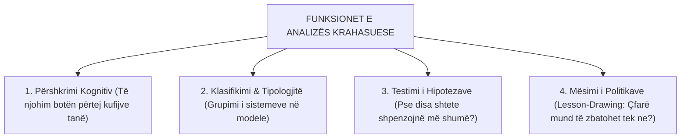
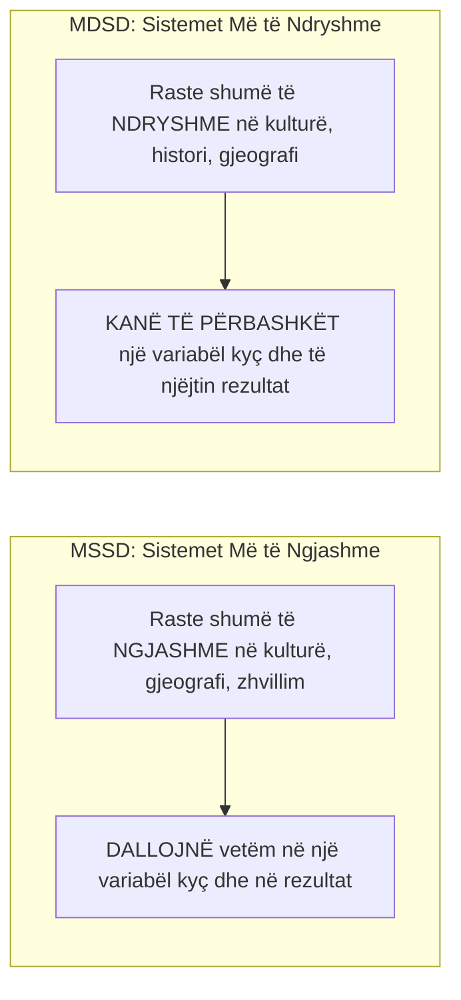

# 📌 Tema 01: Hyrje në Analizën Krahasuese të Politikave Sociale

`[[00 - Harta e Lëndës dhe Udhëzuesi i Studimit (MOC)|⬅️ Kthehu tek Harta e Lëndës]]` | `[[Tema 02 - Shteti i Mirëqenies - Origjina dhe Evolucioni Historik|Tema 02: Shteti i Mirëqenies ➡️]]`

---

> [!summary] Përmbledhje Ekzekutive
> **Analiza Krahasuese e Politikave Sociale** studion mënyrën se si vende të ndryshme përballen me rreziqet sociale (sëmundjet, papunësinë, pleqërinë, varfërinë). Krahasimi na ndihmon të kapërcejmë "etnocentrizmin" (mendimin se sistemi ynë është i vetmi i mundshëm), të kuptojmë shkaqet e divergjencave midis kombeve dhe të mësojmë nga sukseset apo dështimet e të tjerëve (**Policy Transfer / Mësimi i Politikave**). Metodologjia mbështetet në dy dizajne klasike: **MSSD (Most Similar Systems Design)** dhe **MDSD (Most Different Systems Design)**.

---

## 🎯 Objektivat e Mësimit
Pas studimit të këtij leksioni, ju do të jeni në gjendje të:
1. Përkufizoni fushën e **Analizës Krahasuese të Politikave Sociale**.
2. Argumentoni **4 arsyet kryesore pse krahasojmë** (Përshkrimi, Shpjegimi, Vlerësimi, Mësimi i Politikave).
3. Dalloni metodën **MSSD** (Dizajni i Sistemeve më të Ngjashme) nga metoda **MDSD** (Dizajni i Sistemeve më të Ndryshme).
4. Shpjegoni sfidat metodologjike: **Ekuivalenca funksionale**, problemi i shumë variablave me pak raste (*Many variables, small N*), dhe faji i Galton-it (*Galton's problem*).
5. Analizoni rolin e transferimit të politikave (**Policy Transfer / Lesson Drawing**).

---

## 1. Pse Krahasojmë? Funksionet e Analizës Krahasuese

Pse duhet që një studiues shqiptar të interesohet për sistemin e pensioneve në Suedi apo sistemin shëndetësor në Gjermani?

### Katër Funksionet Kryesore:
1. **Kapërcimi i Etnocentrizmit**: Të kuptuarit se institucionet tona nuk janë universale, por produkt i historisë sonë specifike.
2. **Krijimi i Tipologjive**: Sistematizimi i qindra vendeve të botës në disa modele baze (p.sh. modelet e Esping-Andersen).
3. **Testimi i Teorive Shkakësore**: Për shembull: *A çon forca e sindikatave punëtore në shpenzime më të larta sociale?* Kjo mund të vërtetohet vetëm duke krahasuar shumë vende njëherazi.
4. **Huazimi dhe Transferimi i Politikave (Policy Transfer)**: Marrja e modeleve të suksesshme (p.sh. modeli danez i punësimit) dhe përshtatja e tyre vendore.

---

## 2. Metodologjia e Kërkimit Krahasues: MSSD vs. MDSD

E formuluar fillimisht nga John Stuart Mill, metodologjia krahasuese mbështetet në dy strategji themelore përzgjedhjeje të rasteve:

### Tabela Krahasuese: MSSD vs. MDSD

| Karakteristika | Most Similar Systems Design (MSSD) | Most Different Systems Design (MDSD) |
| :--- | :--- | :--- |
| **Përzgjedhja e Vendeve** | Vende me ngjashmëri të larta (p.sh. Suedia, Norvegjia, Danimarka) | Vende me dallime rrënjësore (p.sh. SHBA, Japonia, Gjermania) |
| **Qëllimi** | Izolimi i dallimit të vetëm që shpjegon ndryshimin në rezultat | Gjetja e faktorit të vetëm të përbashkët që sjell të njëjtin rezultat |
| **Fokusi** | Mban të pandryshuara (konstante) shumicën e variablave | Teston nëse një teori funksionon pavarësisht kontekstit |
| **Shembull në Politika Sociale** | Pse Danimarka ka papunësi më të ulët se Suedia, kur të dyja kanë të njëjtin model nordik? | Pse si SHBA ashtu edhe Gjermania po rrisin moshën e pensionit, megjithëse kanë sisteme krejt të ndryshme? |

---

## 3. Sfidat dhe Kurthet e Analizës Krahasuese

Krahasimi i politikave sociale nuk është i lehtë; ai përballet me këto pengesa madhore:

1. **Problemi i Ekuivalencës Funksionale**:
   - Institucione me të njëjtin emër mund të bëjnë gjëra krejt të ndryshme në vende të ndryshme. P.sh., termi *"Ndihmë Sociale"* në Shqipëri nënkupton një pagesë minimale mbijetese, ndërsa në Danimarkë përfshin banesë të paguar, kurse trajnimi dhe mbështetje psikologjike.
2. **Problemi "Shumë variabla, pak raste" (*Small N, Many Variables*)**:
   - Shtetet e zhvilluara të botës janë vetëm rreth 30-40 kombe (numër i vogël rastesh $N$), ndërsa faktorët që ndikojnë politikat janë me qindra (kultura, feja, lufta, ekonomia, partitë).
3. **Problemi i Galton-it (*Galton's Problem*)**:
   - A u zhvillua një politikë sociale për shkak të faktorëve të brendshëm të vendit, apo thjesht sepse vendi kopjoi fqinjin e tij? (Efekti i difuzionit / përhapjes).

---

## 📖 Fjalori i Termave Kyç

- **Analiza Krahasuese**: Studimi sistematik i politikave, institucioneve dhe rezultateve sociale duke krahasuar dy ose më shumë shtete.
- **MSSD (Most Similar Systems Design)**: Strategji kërkimi që krahason vende shumë të ngjashme për të gjetur faktorin që shpjegon dallimin në rezultat.
- **MDSD (Most Different Systems Design)**: Strategji kërkimi që krahason vende krejt të ndryshme për të gjetur faktorin e vetëm të përbashkët shpjegues.
- **Ekuivalenca Funksionale**: Sigurimi që konceptet apo institucionet e krahasuara kryejnë realisht të njëjtin rol shoqëror në vendet përkatëse.
- **Policy Transfer (Huazimi i Politikave)**: Procesi përmes të cilit dijet mbi politikat dhe programet administrative të një vendi përdoren për të zhvilluar politika në një vend tjetër.

---

## 🧠 Seksioni i Memorizimit & Retrieval Practice

### 🔹 Flashcards të Fshehura (Kliko për Përgjigjen)

> [!question]- Pyetja 1: Cili është thelbi i metodës MSSD (Most Similar Systems Design) dhe jepni një shembull?
> **Përgjigjja:**
> MSSD krahason vende që ngjajnë në shumicën dërrmuese të aspekteve (gjeografi, kulturë, nivel zhvillimi), por dallohen në një faktor specifik dhe në rezultat.
> *Shembull*: Krahasimi i Suedisë dhe Norvegjisë për të parë se si një ndryshim i vogël në ligjin e lejes prindërore ndikon në punësimin e grave.

> [!question]- Pyetja 2: Çfarë është "Problemi i Ekuivalencës Funksionale" në analizën krahasuese?
> **Përgjigjja:**
> Është rreziku i supozimit të gabuar se institucione që mbajnë të njëjtin emër në gjuhë të ndryshme luajnë të njëjtin rol. Për të bërë krahasim të vlefshëm, studiuesi duhet të krahasojë funksionin real që luan shërbimi për qytetarin dhe jo thjesht etiketën formale ligjore.

> [!question]- Pyetja 3: Cilat janë 4 arsyet kryesore pse studiuesit krahasojnë politikat sociale?
> **Përgjigjja:**
> 1. Përshkrimi i realiteteve sociale jashtë vendit tonë.
> 2. Klasifikimi dhe ndërtimi i tipologjive të shteteve të mirëqenies.
> 3. Testimi i hipotezave dhe teorive shkakësore.
> 4. Huazimi dhe transferimi i politikave të suksesshme (Lesson-Drawing).

---

### 🔹 Flashcards për Obsidian Spaced Repetition (Plugin)
Analiza Krahasuese e Politikave Sociale:: Studimi sistematik i mënyrës se si vende të ndryshme organizojnë mirëqenien dhe mbrojtjen sociale.
MSSD:: Most Similar Systems Design; krahasimi i vendeve të ngjashme për të izoluar faktorin dallues.
MDSD:: Most Different Systems Design; krahasimi i vendeve të ndryshme për të gjetur faktorin e përbashkët që shpjegon rezultatin.
Ekuivalenca Funksionale:: Parimi që kërkon krahasimin e institucioneve sipas rolit real që kryejnë dhe jo sipas emrit formal.

---

### 🔹 Plotëso Vendet Bosh (Cloze Recall)
1. Strategjia e krahasimit të vendeve shumë të ngjashme njihet me akronimin ==MSSD==.
2. Strategjia e krahasimit të vendeve thellësisht të ndryshme njihet me akronimin ==MDSD==.
3. Rreziku që një term apo institucion të mos kryejë të njëjtin rol në dy kultura quhet problemi i ==ekuivalencës funksionale==.
4. Marrja e një modeli politike sociale nga një vend i huaj dhe zbatimi i tij në vendin amë njihet si ==policy transfer (transferim politikash)==.

---

### 🔹 Checklist për Vetë-Vlerësim
- [ ] Mund të shpjegoj qartë dallimin midis MSSD dhe MDSD.
- [ ] Di të argumentoj pse krahasimi ndërkombëtar përmirëson politikat vendore.
- [ ] Kuptoj problemin e ekuivalencës funksionale dhe atë të Galton-it.
