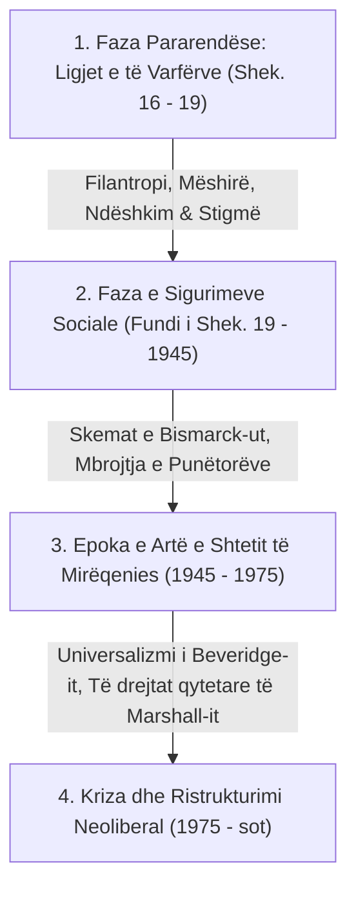
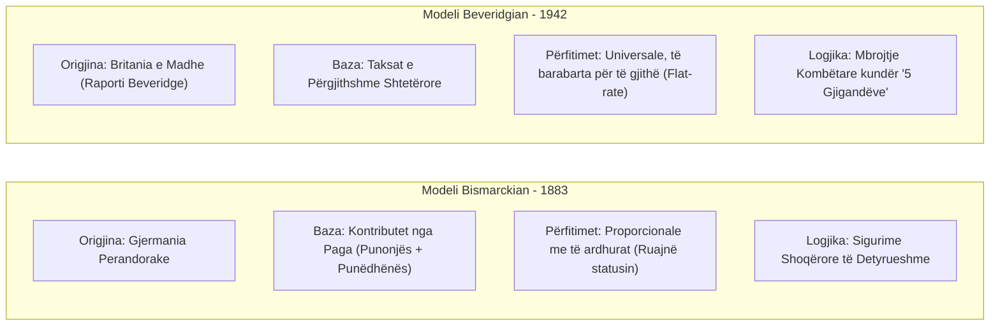
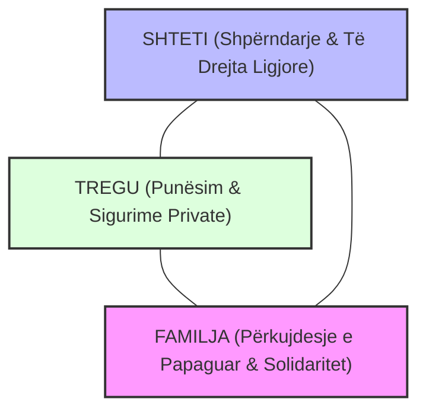

# 📌 Tema 02: Shteti i Mirëqenies - Origjina dhe Evolucioni Historik

`[[Tema 01 - Hyrje në Analizën Krahasuese të Politikave Sociale|⬅️ Tema 01: Hyrje]]` | `[[00 - Harta e Lëndës dhe Udhëzuesi i Studimit (MOC)|Indeksi]]` | `[[Tema 03 - Tipologjia e Esping-Andersen (Tre Botët e Mirëqenies)|Tema 03: Tipologjia e Esping-Andersen ➡️]]`

---

> [!summary] Përmbledhje Ekzekutive
> **Shteti i Mirëqenies (Welfare State)** është një shpikje historike e shoqërive moderne ku shteti merr përgjegjësinë ligjore për të garantuar një minimum jetik dhe mbrojtje nga rreziqet e tregut për qytetarët e tij. Ky leksion trajton evolucionin nga ligjet represive të të varfërve (*Poor Laws*) drejt dy modeleve themeltare botërore: **Modeli Kontributiv i Kancelarit Bismarck (Gjermani, 1880-at)** dhe **Modeli Universal i Raportit Beveridge (Britani, 1942)**, së bashku me konceptin qendror të **Dekomodifikimit**.

---

## 🎯 Objektivat e Mësimit
Pas studimit të këtij leksioni, ju do të jeni në gjendje të:
1. Përkufizoni konceptin e **Shtetit të Mirëqenies** dhe fazat kryesore të lindjes së tij.
2. Analizoni **Modelin Bismarckian** të sigurimeve shoqërore (kontributiv, i bazuar në punësim).
3. Analizoni **Modelin Beveridgian** të mbrojtjes universale (financuar me taksa, e drejtë qytetare).
4. Skiconi dhe shpjegoni **Trekëndëshin e Mirëqenies (Welfare Mix)**: Shteti, Tregu dhe Familja.
5. Përkufizoni konceptin sociologjik të **Dekomodifikimit (De-commodification)**.

---

## 1. Evolucioni Historik: Nga Mëshira te të Drejtat Sociale

Lindja e shtetit të mirëqenies kaloi nëpër tri faza të mëdha historike:

* **Ligjet e të Varfërve (Poor Laws)**: Varfëria trajtohej si faj moral personal. Ndihma jepej vetëm brenda "shtëpive të punës" (*workhouses*) në kushte çnjerëzore për të dekurajuar njerëzit.
* **Qytetaria Sociale (T.H. Marshall)**: Marshall argumentoi se qytetaria u zhvillua në 3 valë: të drejtat civile (shek. 18), të drejtat politike (shek. 19) dhe **të drejtat sociale** (shek. 20 - e drejta për arsim, shëndetësi dhe siguri ekonomike).

---

## 2. Dy Modelet Themeluese: Bismarck vs. Beveridge

Çdo sistem modern mirëqenieje në botë është një kombinim i këtyre dy arkitekturave historike:

### Tabela Krahasuese: Bismarck vs. Beveridge

| Dimensioni | Modeli Bismarckian | Modeli Beveridgian |
| :--- | :--- | :--- |
| **Qëllimi Parësor** | Ruajtja e standardit të jetesës dhe statusit të punëtorit | Parandalimi i varfërisë dhe garantimi i minimumit jetik |
| **Kushti i Përfitimit** | Statusi i punësimit dhe historia e pagesës së kontributeve | Shtetësia ose rezidenca e përhershme (E drejtë universale) |
| **Burimi i Financimit** | Kontributet e ndara (Pagë + Punëdhënës) | Buxheti i shtetit përmes taksave të përgjithshme |
| **Lartësia e Përfitimit** | Proporcionale me pagën e kaluar (kush fitoi më shumë merr më shumë) | Fikse dhe e barabartë për të gjithë (*Flat-rate*) |
| **Vendet Përfaqësuese** | Gjermania, Franca, Austria, Belgjika | Britania e Madhe, Suedia, Danimarka |

> [!important] "5 Gjigandët" e William Beveridge (1942)
> Lordi Beveridge deklaroi se rindërtimi i pasluftës kërkonte luftë kundër 5 të këqijave madhore shoqërore:
> 1. **Want (Varfëria / Mungesa e të ardhurave)**
> 2. **Disease (Sëmundja)**
> 3. **Ignorance (Injoranca / Mungesa e arsimit)**
> 4. **Squalor (Kushtet e këqija të banimit)**
> 5. **Idleness (Papunësia / Pasiviteti)**

---

## 3. Trekëndëshi i Mirëqenies (The Welfare Mix)

Mirëqenia e një individi nuk prodhohet vetëm nga qeveria, por nga bashkëveprimi i tre institucioneve bazë:

* **Shteti**: Ofron përfitime publike bazuar në të drejta ligjore dhe rishpërndarje taksash.
* **Tregu**: Ofron të ardhura përmes pagave të punës dhe shërbimeve të blera private (pensione private, spitale private).
* **Familja**: Ofron mbështetjen e parë jetike, ushqimin dhe përkujdesjen e papaguar për fëmijët dhe të moshuarit.
* *(Sektori i Katërt)*: OJQ-të, komuniteti dhe kisha (Sektori Vullnetar).

---

## 4. Koncepti Themelor: Dekomodifikimi (De-commodification)

I formuluar nga Karl Polanyi dhe i zhvilluar nga Esping-Andersen:
* Në kapitalizmin e pastër, punëtori është një **"mall" (commodity)**: nëse sëmuret ose humb punën dhe nuk mund të shesë krahun e tij të punës në treg, ai vdes urie.
* **Dekomodifikimi** është shkalla në të cilën një qytetar mund të mbijetojë lirisht dhe dinjitozisht, **pa qenë i detyruar të varet plotësisht nga tregu i punës**.
  - *Dekomodifikim i Lartë*: Pagesa bujare e papunësisë, shëndetësi falas, pensione të garantuara (vendet skandinave).
  - *Dekomodifikim i Ulët*: Përfitime shumë të ulëta që detyrojnë njeriun të pranojë çfarëdo pune me pagë mjerane për të mbijetuar (SHBA).

---

## 📖 Fjalori i Termave Kyç

- **Shteti i Mirëqenies (Welfare State)**: Sistem institucional ku shteti garanton siguri sociale bazë për të gjithë qytetarët përballë rreziqeve jetësore.
- **Modeli Bismarckian**: Sistem sigurimesh shoqërore i financuar nga kontributet e pagës, ku përfitimet lidhen me statusin e punës.
- **Modeli Beveridgian**: Sistem mbrojtjeje universale i financuar nga taksat e përgjithshme, që garanton minimum fiks jetik si të drejtë qytetare.
- **Dekomodifikimi**: Shkalla në të cilën një individ mund të sigurojë jetesën e tij të pavarur nga forcat e tregut të punës.
- **Welfare Mix (Trekëndëshi i Mirëqenies)**: Raporti dhe balanca midis Shtetit, Tregut dhe Familjes në sigurimin e mirëqenies.

---

## 🧠 Seksioni i Memorizimit & Retrieval Practice

### 🔹 Flashcards të Fshehura (Kliko për Përgjigjen)

> [!question]- Pyetja 1: Cilat janë 3 dallimet thelbësore midis Modelit Bismarck dhe Modelit Beveridge?
> **Përgjigjja:**
> 1. **Financimi**: Bismarck financohet nga kontributet nga paga; Beveridge nga taksat e përgjithshme shtetërore.
> 2. **Kriteri i Përfitimit**: Bismarck kërkon status punësimi dhe kontribute; Beveridge bazohet në të drejtën universale të qytetarisë.
> 3. **Lartësia e Ndihmës**: Bismarck ofron përfitime proporcionale me pagën (ruan statusin); Beveridge ofron një shumë minimale fikse të barabartë për të gjithë (flat-rate).

> [!question]- Pyetja 2: Çfarë kuptimi ka koncepti sociologjik i "Dekomodifikimit" sipas Esping-Andersen?
> **Përgjigjja:**
> Dekomodifikimi tregon shkallën në të cilën shteti i mirëqenies i mundëson një individi të mbajë një standard jetese dinjitoz pavarësisht nëse ai punon apo jo në treg (p.sh. kur sëmuret, plaket ose mbetet pa punë).

> [!question]- Pyetja 3: Cilët janë 3 aktorët kryesorë të "Trekëndëshit të Mirëqenies" (Welfare Mix)?
> **Përgjigjja:**
> 1. **Shteti** (shpërndarja publike me ligj)
> 2. **Tregu** (punësimi dhe sigurimet private)
> 3. **Familja** (përkujdesja e papaguar dhe solidariteti familjar)

---

### 🔹 Flashcards për Obsidian Spaced Repetition (Plugin)
Shteti i Mirëqenies:: Shteti që garanton mbrojtje ligjore sociale dhe minimum jetik për qytetarët e tij.
Modeli Bismarckian:: Skemë sigurimesh shoqërore e financuar nga kontributet e punësimit, proporcionale me pagën.
Modeli Beveridgian:: Skemë mbrojtjeje sociale universale e financuar nga taksat e shtetit, me përfitime fikse qytetare.
Dekomodifikimi:: Aftësia e qytetarit për të mbijetuar dinjitozisht pa qenë i detyruar të shesë krahun e punës në treg.

---

### 🔹 Plotëso Vendet Bosh (Cloze Recall)
1. Modeli i bazuar në sigurimet e detyrueshme nga paga u krijua në Gjermani nga kancelari ==Otto von Bismarck==.
2. Modeli universal i mbrojtjes nga taksat u formulua në Britani në Raportin ==Beveridge (1942)==.
3. Tre aktorët e trekëndëshit klasik të mirëqenies janë: Shteti, ==Tregu== dhe ==Familja==.
4. Çlirimi i qenies njerëzore nga varësia e plotë ndaj tregut të punës quhet ==dekomodifikim==.

---

### 🔹 Checklist për Vetë-Vlerësim
- [ ] Di të shpjegoj të gjitha ndryshimet midis sistemit Bismarck dhe Beveridge.
- [ ] Mund të përkufizoj saktë konceptin e dekomodifikimit.
- [ ] Di të skicoj dhe shpjegoj trekëndëshin e Welfare Mix.
