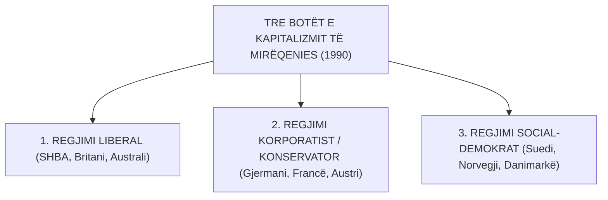

# 📌 Tema 03: Tipologjia e Esping-Andersen (Tre Botët e Mirëqenies)

`[[Tema 02 - Shteti i Mirëqenies - Origjina dhe Evolucioni Historik|⬅️ Tema 02: Shteti i Mirëqenies]]` | `[[00 - Harta e Lëndës dhe Udhëzuesi i Studimit (MOC)|Indeksi]]` | `[[Tema 04 - Regjimi Mesdhetar dhe Kritika Feministe (Defamilizimi)|Tema 04: Regjimi Mesdhetar & Feminizmi ➡️]]`

---

> [!summary] Përmbledhje Ekzekutive
> Në librin e tij epokal të vitit 1990, *"The Three Worlds of Welfare Capitalism"*, sociologu danez **Gøsta Esping-Andersen** revolucionarizoi analizën krahasuese duke provuar se shtetet nuk dallohen thjesht nga "sa para shpenzojnë", por nga **mënyra se si e organizojnë mirëqenien**. Ai klasifikoi shtetet perëndimore në **Tre Regjime Mirëqenieje**: **Regjimi Liberal (Anglosakson)**, **Regjimi Korporatist / Konservator (Kontinental)** dhe **Regjimi Social-Demokrat (Nordik)**, bazuar në dy dimensione analitike: **Dekomodifikimi** dhe **Stratifikimi Social**.

---

## 🎯 Objektivat e Mësimit
Pas studimit të këtij leksioni, ju do të jeni në gjendje të:
1. Përkufizoni konceptin e **Regjimit të Mirëqenies (Welfare Regime)**.
2. Shpjegoni dy dimensionet analitike të Esping-Andersen: **Dekomodifikimi** dhe **Stratifikimi Social**.
3. Analizoni në thellësi **Regjimin Liberal** (SHBA, Britania e Madhe, Australia).
4. Analizoni në thellësi **Regjimin Korporatist / Konservator** (Gjermania, Franca, Austria).
5. Analizoni në thellësi **Regjimin Social-Demokrat** (Suedia, Norvegjia, Danimarka).
6. Krahasoni të tre regjimet në një matricë sintetike sipas treguesve të rolit të shtetit, tregut dhe familjes.

---

## 1. Dy Dimensionet Analitike të Esping-Andersen

Esping-Andersen argumentoi se matja e thjeshtë e shpenzimeve sociale si përqindje e PBB-së është mashtruese. Ai propozoi dy tregues cilësorë strukturorë:

1. **Shkalla e Dekomodifikimit (De-commodification)**:
   - Sa lehtë mundet një qytetar të braktisë punën pa humbur të ardhurat bazë kur është i sëmurë, i papunë apo i moshuar? A trajtohet mirëqenia si mall tregu apo si e drejtë qytetare?
2. **Sistemi i Stratifikimit Social (Stratification)**:
   - Çfarë lloj rendi shoqëror prodhon shteti i mirëqenies? A e thellon ai pabarazinë midis klasave (stratifikim i lartë), a ruan hierarkitë e vjetra profesionale, apo krijon barazi dhe solidaritet universal (stratifikim i ulët)?

---

## 2. Analiza e Thelluar e Tre Regjimeve

### A. Regjimi Liberal (Anglosakson)
* **Vendet Shembull**: SHBA, Britania e Madhe, Kanadaja, Australia.
* **Filozofia Bazë**: Besimi te tregu i lirë dhe individualizmi. Shteti ndërhyn vetëm kur tregu dhe familja dështojnë plotësisht (*Shtet Rezidual*).
* **Mekanizmi Kryesor**: Ndihma sociale me testim të rreptë të mjeteve të jetesës (**Means-tested assistance**). Përfitimet janë shumë të ulëta dhe mbartin stigmë shoqërore.
* **Roli i Tregut**: Shumë i lartë. Qytetarët inkurajohen të blejnë sigurime private shëndetësore dhe pensione private në treg.
* **Niveli i Dekomodifikimit**: **Shumë i Ulët**. Qytetari varet plotësisht nga tregu i punës.
* **Stratifikimi Social**: **I Lartë** (ndarje e thellë midis shumicës që blen shërbime në treg dhe pakicës së varfër që merr lëmosha shtetërore).

### B. Regjimi Korporatist / Konservator (Kontinental)
* **Vendet Shembull**: Gjermania, Franca, Austria, Belgjika, Holanda.
* **Filozofia Bazë**: E rrënjosur në traditën bismarckiane dhe mësimet sociale të Kishës Katolike (*Parimi i Subsidiaritetit*).
* **Mekanizmi Kryesor**: Sigurimet shoqërore të detyrueshme të lidhura me statusin e punësimit. Përfitimet varen nga kontributet e derdhura nga paga.
* **Roli i Familjes**: Shumë i lartë. Mbështetet modeli tradicional i familjes me mashkullin fitues të bukës (*Male Breadwinner*). Shteti ndërhyn vetëm kur familja nuk e përballon dot më krizën.
* **Niveli i Dekomodifikimit**: **I Moderuar** (punëtorët e siguruar mbrohen mirë, por ata jashtë tregut formal të punës mbeten të pambrojtur).
* **Stratifikimi Social**: **Ruan Statusin Ekzistues** (ruan diferencat e klasave dhe hierarkive midis nëpunësve civilë, punëtorëve të fabrikës dhe profesioneve të lira).

### C. Regjimi Social-Demokrat (Nordik / Skandinav)
* **Vendet Shembull**: Suedia, Norvegjia, Danimarka, Finlanda.
* **Filozofia Bazë**: Universalizmi, barazia e plotë shoqërore dhe solidariteti kombëtar.
* **Mekanizmi Kryesor**: Përfitime dhe shërbime universale me standarde të larta, të financuara nga taksat progresive të larta. Çdo qytetar gëzon të njëjtat të drejta, pavarësisht nëse është i pasur apo i varfër.
* **Roli i Shtetit**: Dominues. Shteti merr përsipër kujdesin e fëmijëve dhe të moshuarve, duke çliruar gratë për t'u punësuar lirisht në tregun e punës (*Defamilizim i lartë*).
* **Niveli i Dekomodifikimit**: **Shumë i Lartë**. Qytetari mund të jetojë me dinjitet të plotë edhe pa punuar gjatë periudhave të vështirësisë.
* **Stratifikimi Social**: **Shumë i Ulët** (krijon një shoqëri me barazi të lartë dhe klasë të mesme dominuese universale).

---

## 3. Matrica e Madhe Krahasuese e Tre Regjimeve

| Treguesi Krahasues | Regjimi Liberal | Regjimi Korporatist | Regjimi Social-Demokrat |
| :--- | :--- | :--- | :--- |
| **Vendet Tipike** | SHBA, Britani, Australi | Gjermani, Francë, Austri | Suedi, Norvegji, Danimarkë |
| **Aktori Kryesor i Mirëqenies** | **Tregu** | **Familja & Sigurimet** | **Shteti** |
| **Kriteri Kryesor i Ndihmës** | Nevoja e provuar (Testimi i pasurisë) | Kontributet e punësimit (Statusi) | Qytetaria (Universalizmi) |
| **Niveli i Dekomodifikimit** | **I Ulët** | **I Moderuar** | **I Lartë** |
| **Ndikimi te Pabarazia** | E lartë (Polarizim social) | Ruan hierarkitë ekzistuese | E ulët (Egalitarizëm dhe barazi) |
| **Punësimi i Grave** | I lartë (në shërbime private me paga të ulëta) | I moderuar / i ulët (Gratë në shtëpi) | **Shumë i lartë** (në sektorin publik) |

---

## 📖 Fjalori i Termave Kyç

- **Regjim Mirëqenieje (Welfare Regime)**: Mënyra e ndërlikuar se si shteti, tregu dhe familja ndërthuren për të prodhuar mbrojtje sociale.
- **Means-Testing (Testimi i Pasurisë/Mjeteve)**: Verifikimi i të ardhurave për të kufizuar ndihmën vetëm për ata që konsiderohen ekstremisht të varfër.
- **Universalizëm**: Parimi ku të gjithë qytetarët gëzojnë të njëjtat të drejta sociale pavarësisht nivelit të të ardhurave.
- **Subsidiaritet**: Parim që kërkon që problemet sociale të zgjidhen në nivelin më të ulët të mundshëm (së pari familja, pastaj komuniteti dhe në fund shteti).
- **Male Breadwinner (Burri Bukë-fitues)**: Modeli tradicional i familjes ku burri punon dhe siguron të ardhurat, ndërsa gruaja kujdeset për shtëpinë dhe fëmijët.

---

## 🧠 Seksioni i Memorizimit & Retrieval Practice

### 🔹 Flashcards të Fshehura (Kliko për Përgjigjen)

> [!question]- Pyetja 1: Cilat janë "Tre Botët" e kapitalizmit të mirëqenies sipas Esping-Andersen (1990) dhe jepni 2 vende shembull për secilën?
> **Përgjigjja:**
> 1. **Regjimi Liberal**: SHBA, Britania e Madhe (Australia, Kanadaja).
> 2. **Regjimi Korporatist / Konservator**: Gjermania, Franca (Austria, Belgjika).
> 3. **Regjimi Social-Demokrat**: Suedia, Norvegjia (Danimarka, Finlanda).

> [!question]- Pyetja 2: Cilat janë dy dimensionet analitike mbi të cilat Esping-Andersen ndërtoi tipologjinë e tij?
> **Përgjigjja:**
> 1. **Dekomodifikimi** (shkalla në të cilën mirëqenia nuk varet nga tregu i punës).
> 2. **Stratifikimi Social** (lloji i strukturës shoqërore dhe shkalla e pabarazisë që prodhon shteti i mirëqenies).

> [!question]- Pyetja 3: Pse Regjimi Liberal prodhon "stratifikim të lartë social" (polarizim shoqëror)?
> **Përgjigjja:**
> Sepse duke e lënë shumicën e popullsisë të blejë shërbime cilësore private në treg dhe duke kufizuar ndihmën shtetërore vetëm te të varfrit e skajshëm me anë të testimit të mjeteve (*means-testing*), ai krijon stigmë shoqërore dhe ndan kombin në dy grupe armiqësore: ata që paguajnë taksa dhe ata që konsiderohen "parazitë të ndihmës ekonomike".

---

### 🔹 Flashcards për Obsidian Spaced Repetition (Plugin)
Tre Botët e Esping-Andersen:: Regjimi Liberal, Regjimi Korporatist/Konservator, Regjimi Social-Demokrat.
Regjimi Liberal:: Model me dekomodifikim të ulët, ndihmë me testim mjetesh (means-tested) dhe rol dominues të tregut.
Regjimi Korporatist:: Model i bazuar te sigurimet e punësimit, ruajtja e statusit dhe subsidiariteti i familjes.
Regjimi Social-Demokrat:: Model me universalizëm të plotë, dekomodifikim shumë të lartë dhe barazi sociale.

---

### 🔹 Plotëso Vendet Bosh (Cloze Recall)
1. Libri madhor i Esping-Andersen i botuar në vitin 1990 titullohet ==The Three Worlds of Welfare Capitalism==.
2. Sistemi i ndihmës sociale ku kërkohet verifikimi i pasurisë njihet si ==means-testing (testimi i mjeteve)==.
3. Në regjimin korporatist, parimi që përcakton se shteti ndërhyn vetëm kur familja dështon quhet ==subsidiaritet==.
4. Regjimi që siguron shkallën më të lartë të barazisë dhe dekomodifikimit është regjimi ==social-demokrat (nordik)==.

---

### 🔹 Checklist për Vetë-Vlerësim
- [ ] Di të shpjegoj përmendsh të tre regjimet e Esping-Andersen.
- [ ] Mund të krahasoj rolin e tregut, shtetit dhe familjes në të tre modelet.
- [ ] Kuptoj dallimin midis të drejtës universale dhe ndihmës me testim mjetesh.
