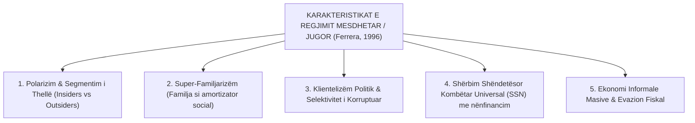
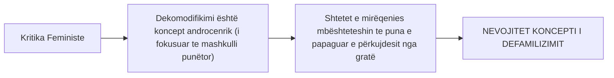

# 📌 Tema 04: Regjimi Mesdhetar dhe Kritika Feministe (Defamilizimi)

`[[Tema 03 - Tipologjia e Esping-Andersen (Tre Botët e Mirëqenies)|⬅️ Tema 03: Tipologjia e Esping-Andersen]]` | `[[00 - Harta e Lëndës dhe Udhëzuesi i Studimit (MOC)|Indeksi]]` | `[[Tema 05 - Shtetet Post-Komuniste në Tranzicion (Evropa Qendrore dhe Lindore)|Tema 05: Shtetet Post-Komuniste ➡️]]`

---

> [!summary] Përmbledhje Ekzekutive
> Tipologjia klasike e Esping-Andersen (1990) u përball me dy kritika madhore teorike: **(1) Neglizhimi i Evropës Jugore** si një regjim i mëvetshëm me karakteristika specifike (Maurizio Ferrera, Stephan Leibfried), dhe **(2) Neglizhimi i Marrëdhënieve Gjinore dhe Punës së Papaguar** brenda familjes (Jane Lewis, Ann Shola Orloff). Ky leksion trajton **Modelin Mesdhetar / Jugor** (super-familjarizmi, segmentimi, klientelizmi) dhe konceptin revolucionar të **Defamilizimit (De-familisation)**.

---

## 🎯 Objektivat e Mësimit
Pas studimit të këtij leksioni, ju do të jeni në gjendje të:
1. Shpjegoni arsyet pse vendet e Evropës Jugore (Italia, Spanja, Greqia, Portugalia) formojnë një **"Botë të Katërt"** të mirëqenies.
2. Analizoni karakteristikat e Modelit Mesdhetar sipas Maurizio Ferrera: **Segmentimi (Insiders vs. Outsiders)**, **Super-familjarizmi**, dhe **Klientelizmi**.
3. Zbërtheni kritikën feministe ndaj konceptit të dekomodifikimit (Jane Lewis, Ann Orloff).
4. Përkufizoni dhe matni konceptin e **Defamilizimit (De-familisation)**.
5. Vlerësoni ngjashmëritë midis Modelit Mesdhetar dhe strukturës së mirëqenies në Shqipëri.

---

## 1. Pse Vendet Mesdhetare Nuk Përshtateshin te Modeli Korporatist?

Esping-Andersen fillimisht e klasifikoi Italinë te regjimi korporatist kontinental. Studiuesit e Evropës Jugore (Ferrera 1996, Rhodes 1997) provuan se vendet latine mesdhetare kanë një arkitekturë thelbësisht unike:

### Katër Tiparet e Modelit Jugor (Maurizio Ferrera):
1. **Segmentimi Dualist i Mbrojtjes Sociale**:
   - **Të Brendshmit (Insiders)**: Nëpunësit publikë dhe punëtorët e industrisë së madhe me kontrata të rregullta gëzojnë pensione tepër bujare dhe mbrojtje absolute nga pushimi nga puna.
   - **Të Jashtmit (Outsiders)**: Të rinjtë, gratë, të vetëpunësuarit dhe punëtorët sezonalë/bujqësorë nuk kanë pothuajse asnjë mbrojtje sociale ose pagesë papunësie.
2. **Super-Familjarizmi**: Shteti presupozon se familja e gjerë patriarkale do të mbajë të gjithë peshën e kujdesit për fëmijët, të papunët dhe të moshuarit pa pagesë.
3. **Klientelizmi dhe Partitizmi**: Përfitimet sociale (veçanërisht pensionet e invaliditetit dhe vendet e punës në administratë) janë përdorur historikisht si shpërblime elektorale në këmbim të votave.
4. **Shërbim Shëndetësor Universal, por me Pagesa nga Xhepi**: Miratimi me ligj i një sistemi kombëtar shëndetësor falas (p.sh. SSN në Itali dhe Spanjë), i cili vuan nga listat e gjata të pritjes dhe pagesat informale.

---

## 2. Kritika Feministe ndaj Esping-Andersen: Koncepti i "Defamilizimit"

Sociologet Jane Lewis (1992) dhe Ann Shola Orloff (1993) ngritën një pyetje themelore:
> *"Që një person të jetë i **dekomodifikuar** (të çlirohet nga varësia e tregut), ai duhet më parë të jetë i **komodifikuar** (të ketë akses në punë të paguar). Por çfarë ndodh me gratë, puna e të cilave kryhet pa pagesë brenda mureve të shtëpisë?"*

### Çfarë është Defamilizimi (De-familisation)?
**Defamilizimi** është shkalla në të cilën një individ mund të gëzojë një standard jetese të pranueshëm dhe pavarësi ekonomike, **pa qenë i varur nga marrëdhëniet martesore apo solidariteti i detyruar familjar**.

### Si e realizon shteti Defamilizimin?
1. **Shërbime Publike Kujdesi**: Hapja masive e çerdheve dhe kopshteve me kosto të ulët ose falas për fëmijët e vegjël (0-3 vjeç).
2. **Kujdesi i Institucionalizuar për të Moshuarit**: Shtepia publike të të moshuarve dhe kujdestarë të paguar në shtëpi, duke hequr këtë barrë nga shpatullat e vajzave dhe nuseve.
3. **Leje Prindërore të Ndara**: Kuota të dedikuara të lejes prindërore për baballarët që nuk mund t'i transferohen nënës (*Use it or lose it* - zbatuar në Skandinavi).

---

## 3. Tipologjia e Modeleve Gjinore (Jane Lewis, 1992)

Jane Lewis i klasifikoi shtetet e mirëqenies sipas shkallës së mbështetjes së modelit tradicional:

| Modeli Gjinor | Karakteristikat Kryesore | Vendet Shembull |
| :--- | :--- | :--- |
| **Modeli i Fortë i Mashkullit Fitues** (*Strong Male Breadwinner*) | Shteti supozon se burri punon dhe gruaja rri në shtëpi. Sigurimet e gruas varen nga bashkëshorti. Pak çerdhe publike. | Gjermania (tradicionalisht), Britania e Madhe |
| **Modeli i Modifikuar i Mashkullit Fitues** (*Modified Male Breadwinner*) | Shteti njeh rolin e gruas si punëtore dhe nënë, duke ofruar disa shërbime dhe ndihma familjare. | Franca |
| **Modeli i Dy Prindërve Punëtorë** (*Dual-Earner / Weak Male Breadwinner*) | Barazi e plotë. Shteti stimulon punësimin e barabartë të burrave dhe grave përmes defamilizimit të plotë. | Suedia, Danimarka, Norvegjia |

---

## 📖 Fjalori i Termave Kyç

- **Regjimi Mesdhetar (Jugor)**: Model i mirëqenies i karakterizuar nga super-familjarizmi, segmentimi i thellë midis "insiders" dhe "outsiders", dhe klientelizmi.
- **Defamilizimi**: Shkalla në të cilën politikat publike u mundësojnë individëve (veçanërisht grave) të jenë të pavarura nga marrëdhëniet e detyruara familjare.
- **Insiders vs. Outsiders**: Ndarje shoqërore midis punonjësve të mbrojtur me kontrata të qëndrueshme dhe punonjësve të pasigurt/të rinjve pa asnjë mbrojtje.
- **Super-familjarizëm**: Mbështetja e thellë dhe e detyruar e shoqërisë tek rrjetet farefisnore për të amortizuar varfërinë dhe mungesën e shërbimeve shtetërore.
- **Modeli Male Breadwinner**: Strukturë sociale ku burri shihet si siguruesi i vetëm i të ardhurave financiare, ndërsa gruaja si kujdestare shtëpiake.

---

## 🧠 Seksioni i Memorizimit & Retrieval Practice

### 🔹 Flashcards të Fshehura (Kliko për Përgjigjen)

> [!question]- Pyetja 1: Cilat janë 4 karakteristikat kryesore të Modelit Mesdhetar/Jugor të mirëqenies sipas Maurizio Ferrera?
> **Përgjigjja:**
> 1. **Segmentimi dhe polarizimi**: Mbrojtje shumë bujare për "të brendshmit" (insiders) dhe braktisje e "të jashtmëve" (outsiders).
> 2. **Super-familjarizmi**: Familja vepron si amortizatori kryesor i krizave ekonomike dhe përkujdesit.
> 3. **Klientelizmi politik**: Përdorimi i skemave sociale dhe vendeve të punës për vota.
> 4. **Prania e një ekonomie informale të gjerë** dhe evazioni fiskal.

> [!question]- Pyetja 2: Çfarë kuptimi ka koncepti i "Defamilizimit" dhe cila ishte kritika që i bënë teoricienet feministe Esping-Andersen-it?
> **Përgjigjja:**
> Defamilizimi është shkalla në të cilën shteti lehtëson barrën e kujdesit familjar dhe u mundëson grave pavarësi ekonomike pa qenë të varura nga martesa. Kritika feministe ishte se Esping-Andersen u fokusua vetëm te marrëdhënia Shtet-Treg (puna e paguar e meshkujve) dhe injoroi tërësisht rolin e Shtet-Familjes dhe punën e papaguar të grave.

> [!question]- Pyetja 3: Cilat janë 3 politikat konkrete me të cilat një shtet arrin "Defamilizimin" e shoqërisë?
> **Përgjigjja:**
> 1. Ofrimi i çerdheve dhe kopshteve publike universale falas ose me çmim simbolik.
> 2. Shërbime institucionale dhe kujdestarë të paguar në shtëpi për të moshuarit.
> 3. Leje prindërore të mirëpaguara me kuota të rezervuara posaçërisht për baballarët.

---

### 🔹 Flashcards për Obsidian Spaced Repetition (Plugin)
Modeli Mesdhetar:: Regjim mirëqenieje i karakterizuar nga super-familjarizmi, segmentimi i thellë dhe klientelizmi (Italia, Spanja, Greqia).
Defamilizimi:: Mundësia e një individi për të gëzuar mirëqenie i pavarur nga varësia martesore dhe familjare.
Insiders vs Outsiders:: Polarizimi midis punonjësve të mbrojtur me kontrata të forta dhe punonjësve të pasigurt pa mbrojtje sociale.
Super-familjarizmi:: Fenomeni ku familja vepron si institucioni parësor zëvendësues i shërbimeve të munguara shtetërore.

---

### 🔹 Plotëso Vendet Bosh (Cloze Recall)
1. Modeli i katërt i mirëqenies për vendet e Evropës Jugore u formulua kryesisht nga sociologu italian ==Maurizio Ferrera==.
2. Koncepti feminist që mat pavarësinë e grave nga varësia martesore quhet ==defamilizim (de-familisation)==.
3. Në modelin mesdhetar, punonjësit me kontrata të forta mbrojtëse quhen ==insiders (të brendshëm)==.
4. Modeli tradicional gjinor ku burri punon dhe gruaja kryen punët e papaguara të shtëpisë njihet si ==Male Breadwinner==.

---

### 🔹 Checklist për Vetë-Vlerësim
- [ ] Di të shpjegoj pse Modeli Mesdhetar dallohet nga ai Kontinental.
- [ ] Mund të përkufizoj saktë konceptin e Defamilizimit.
- [ ] Di të analizoj rolin e familjes në shoqërinë shqiptare nën dritën e super-familjarizmit.
