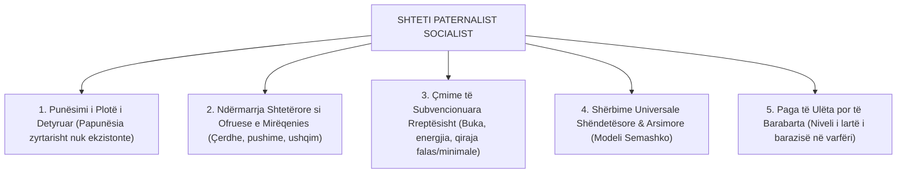
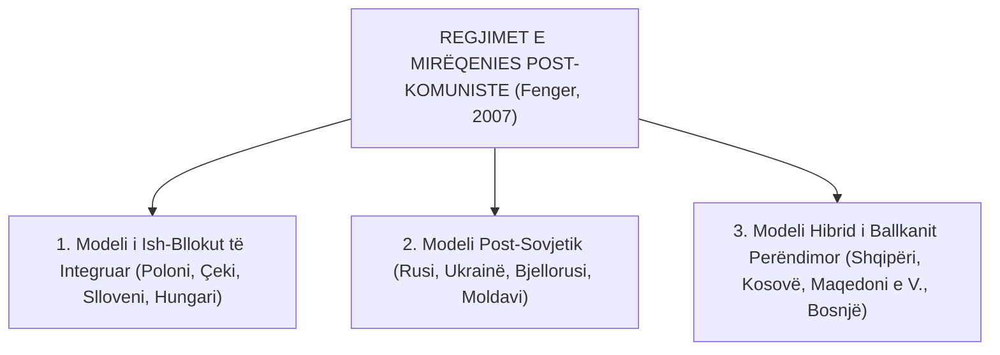

# 📌 Tema 05: Shtetet Post-Komuniste në Tranzicion (Evropa Qendrore dhe Lindore)

`[[Tema 04 - Regjimi Mesdhetar dhe Kritika Feministe (Defamilizimi)|⬅️ Tema 04: Regjimi Mesdhetar & Feminizmi]]` | `[[00 - Harta e Lëndës dhe Udhëzuesi i Studimit (MOC)|Indeksi]]` | `[[Tema 06 - Analiza Krahasuese e Sistemeve të Pensioneve|Tema 06: Sistemet e Pensioneve ➡️]]`

---

> [!summary] Përmbledhje Ekzekutive
> Pas rënies së Murit të Berlinit në vitin 1989, vendet e Evropës Qendrore dhe Lindore (CEE) dhe Ballkani Perëndimor përjetuan një përmbysje tektonike të sistemeve të tyre të mbrojtjes sociale. Ky leksion analizon **Shtetin Paternalist Socialist** (punësimi i plotë i detyruar, shërbimet e ndërmarrjes, banesat falas), tronditjen e rëndë të tranzicionit (**Transformational Recession**), debatin nëse këto vende formojnë një **regjim të ri post-komunist** (Bob Deacon, Alfio Cerami, Menno Fenger), dhe vendosjen e Shqipërisë në këtë trajektore.

---

## 🎯 Objektivat e Mësimit
Pas studimit të këtij leksioni, ju do të jeni në gjendje të:
1. Përshkruani karakteristikat e **Shtetit Paternalist Socialist të Mirëqenies** para vitit 1990.
2. Analizoni pasojat sociale të tranzicionit drejt ekonomisë së tregut (*Transformational Recession*).
3. Zbërtheni tipologjinë e **Menno Fenger (2007)** mbi nën-ndarjet e vendeve post-komuniste.
4. Identifikoni ndikimin e institucioneve financiare ndërkombëtare (Banka Botërore, FMN) në privatizimin e mbrojtjes sociale.
5. Analizoni veçoritë e modelit social në Shqipëri: **Remitancat si amortizator privat**, **informaliteti i lartë** dhe **buxheti i ulët social**.

---

## 1. Modeli Socialist i Mirëqenies (Para vitit 1989/1990)

Në bllokun komunist (përfshirë Shqipërinë socialiste), mbrojtja sociale nuk organizohej si në Perëndim:

### Karakteristikat e Modelit Socialist:
* **Ndërmarrja si Qendër e Mirëqenies**: Fabrika apo kooperativa bujqësore nuk ishte thjesht vend pune; ajo ofronte banesën, kopshtin e fëmijëve, pushimet verore në kampet e punëtorëve dhe trajtimin mjekësor.
* **Mungesa e Sigurimit të Papunësisë**: Duke qenë se papunësia konsiderohej ideologjikisht "e pamundur", nuk ekzistonin skemat e pagesës së papunësisë apo zyrat e punës.
* **Modeli Shëndetësor Semashko**: Sistem tërësisht i centralizuar shtetëror, i financuar nga buxheti qendror, me spitale publike dhe mjekë punonjës shteti.

---

## 2. Tronditja e Madhe e Tranzicionit: "Transformational Recession"

Në vitet 1990, kalimi i rrufeshëm te tregu i lirë solli një kolaps masiv:
1. **Shpërthimi i Papunësisë Masive**: Mbyllja e kombinateve dhe minierave joproduktive hodhi qindra mijëra qytetarë në rrugë.
2. **Kriza Fiskale e Shtetit**: Të ardhurat nga taksat ranë në nivele katastrofike, duke lënë skemat e pensioneve pa financim.
3. **Shfaqja e Varfërisë Ekstreme**: Për herë të parë pas dekadash, shoqëria u përball me uri, lypësirë dhe të pastrehë.
4. **Presioni i "Terapisë së Shokut" dhe FMN-së**: Organizatat ndërkombëtare kërkuan shkurtime drastike të shpenzimeve sociale, heqjen e subvencioneve të çmimeve dhe kufizimin e ndihmës vetëm te të varfrit ekstremë (*Safety Nets*).

---

## 3. Tipologjitë e Shtetit Post-Komunist: Tipologjia e Menno Fenger (2007)

A formojnë vendet post-komuniste një botë të vetme mirëqenieje? Menno Fenger provoi se ato janë diferencuar në tre nën-grupe:

### Karakteristikat e Nën-Grupeve:
1. **Evropa Qendrore e Integruar (Vishegrad & Slloveni)**:
   - Zhvilluan shpejt institucione të qëndrueshme duke iu afruar **Modelit Kontinental Gjerman**.
   - Shpenzimet sociale arrijnë në 20-24% të PBB-së; skemat e pensioneve dhe shëndetësisë u reformuan me sukses.
2. **Modeli Post-Sovjetik**:
   - Nivel shumë i ulët mirëqenieje, jetëgjatësi në rënie, pabarazi oligarkike ekstreme dhe varësi nga ndihmat e fragmentuara shtetërore.
3. **Modeli i Ballkanit Perëndimor dhe Rasti i Shqipërisë**:
   - **Shpenzime Sociale tejet të Ulëta**: Vetëm rreth 9-12% të PBB-së (krahasuar me mesataren e BE-së prej 28%).
   - **Informalitet Masiv në Tregun e Punës (30-40%)**: Një pjesë e madhe e punonjësve nuk paguajnë kontribute, duke e lënë skemën e pensioneve në deficit të përhershëm.
   - **Remitancat si "Shtet Privat Mirëqenieje"**: Paratë e dërguara nga emigrantët në Greqi, Itali dhe Britani kanë qenë mekanizmi kryesor që ka shpëtuar qindra mijëra familje nga varfëria ekstreme.
   - **Zëvendësimi i Shtetit nga OJQ-të dhe Donatorët**: Pjesa më e madhe e shërbimeve sociale të specializuara (për fëmijët me autizëm, gratë e dhunuara) ofrohen nga shoqëria civile e financuar nga jashtë.

---

## 📖 Fjalori i Termave Kyç

- **Shteti Paternalist Socialist**: Modeli autoritar komunist ku shteti kontrollonte plotësisht ekonominë dhe garantonte punësim, arsim dhe banesë pa liri politike.
- **Transformational Recession**: Rënia e thellë ekonomike dhe rritja eksplozive e varfërisë gjatë viteve të para të tranzicionit post-komunist.
- **Modeli Semashko**: Sistemi shëndetësor i centralizuar sovjetik i financuar tërësisht nga buxheti i shtetit.
- **Remitancat**: Paratë e dërguara nga emigrantët drejt familjeve në atdhe, të cilat funksionojnë si rrjet privat mbijetese sociale.
- **Terapia e Shokut**: Politika ekonomike neoliberale e privatizimit të menjëhershëm, liberalizimit të çmimeve dhe shkurtimit të shpenzimeve publike.

---

## 🧠 Seksioni i Memorizimit & Retrieval Practice

### 🔹 Flashcards të Fshehura (Kliko për Përgjigjen)

> [!question]- Pyetja 1: Cilat ishin 3 tiparet kryesore të sistemit socialist të mirëqenies para vitit 1990?
> **Përgjigjja:**
> 1. **Punësimi i plotë i detyruar** (papunësia ishte e ndaluar me ligj dhe nuk ekzistonte zyrtarisht).
> 2. **Ndërmarrja shtetërore** funksiononte si ofruesja e të gjitha shërbimeve (banesat, kopshtet, pushimet).
> 3. **Çmimet e artikujve bazë dhe shërbimeve ishin thellësisht të subvencionuara** nga shteti.

> [!question]- Pyetja 2: Pse Shqipëria dhe vendet e Ballkanit Perëndimor nuk përshtaten thjesht te modelet e Evropës Perëndimore?
> **Përgjigjja:**
> Sepse ato karakterizohen nga një **buxhet shumë i ulët publik për mbrojtjen sociale** (nën 12% të PBB-së), **shkallë shumë e lartë informaliteti në punë** (30-40%), deficit kronik i sigurimeve shoqërore, dhe varësi kritike nga **remitancat e emigrantëve** dhe OJQ-të për ofrimin e shërbimeve bazë.

> [!question]- Pyetja 3: Cili ishte roli i Bankës Botërore dhe FMN-së në reformat sociale të tranzicionit në Evropën Lindore?
> **Përgjigjja:**
> Ato promovuan konsensusin neoliberal: reduktimin e rolit të shtetit, heqjen e subvencioneve universale, shënjestrimin e ngushtë të ndihmës ekonomike vetëm për skamnorët ekstremë (*safety nets*), dhe privatizimin e skemave pensionale e shëndetësore.

---

### 🔹 Flashcards për Obsidian Spaced Repetition (Plugin)
Shteti Socialist i Mirëqenies:: Sistem ku mirëqenia lidhej me punësimin e detyruar shtetëror dhe shërbimet e ndërmarrjes.
Transformational Recession:: Kriza e thellë ekonomike dhe sociale e shkaktuar nga kalimi i rrufeshëm në tregun e lirë pas vitit 1990.
Modeli Semashko:: Sistemi shëndetësor publik sovjetik i centralizuar pa sigurime shëndetësore.
Roli i Remitancave në Shqipëri:: Amortizatori kryesor privat financiar kundër varfërisë për qindra mijëra familje.

---

### 🔹 Plotëso Vendet Bosh (Cloze Recall)
1. Sistemi shëndetësor i centralizuar i bllokut lindor njihet si modeli ==Semashko==.
2. Tipologjia e shteteve post-komuniste në tre nën-grupe u zhvillua nga studiuesi ==Menno Fenger (2007)==.
3. Rënia e thellë ekonomike e fillimit të viteve '90 njihet si ==Transformational Recession==.
4. Në Shqipëri, të ardhurat private nga emigracioni që zëvendësojnë ndihmën shtetërore quhen ==remitanca==.

---

### 🔹 Checklist për Vetë-Vlerësim
- [ ] Di të shpjegoj dallimin midis shtetit socialist dhe shtetit perëndimor të mirëqenies.
- [ ] Mund të analizoj rolin e remitancave dhe informalitetit në sistemin social shqiptar.
- [ ] Kuptoj tipologjinë e Menno Fenger mbi diversitetin e vendeve post-komuniste.
