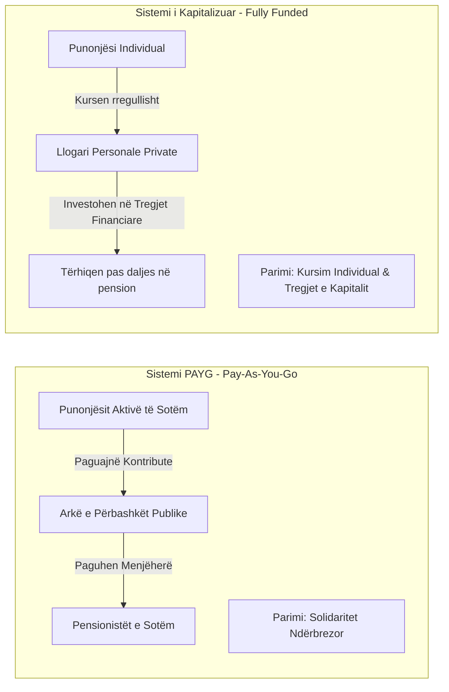
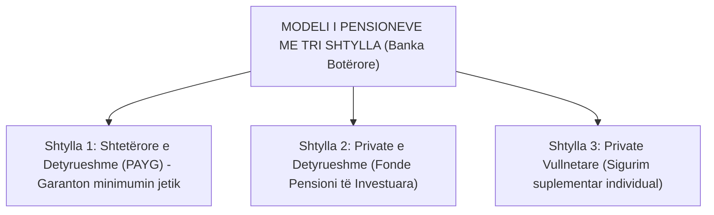
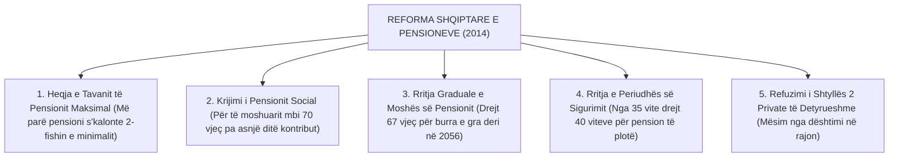

# 📌 Tema 06: Analiza Krahasuese e Sistemeve të Pensioneve

`[[Tema 05 - Shtetet Post-Komuniste në Tranzicion (Evropa Qendrore dhe Lindore)|⬅️ Tema 05: Shtetet Post-Komuniste]]` | `[[00 - Harta e Lëndës dhe Udhëzuesi i Studimit (MOC)|Indeksi]]` | `[[Tema 07 - Analiza Krahasuese e Sistemeve Shëndetësore|Tema 07: Sistemet Shëndetësore ➡️]]`

---

> [!summary] Përmbledhje Ekzekutive
> Pensionet përbëjnë zërin më të madh të shpenzimeve sociale në të gjithë botën (zakonisht mbi 50% të të gjithë buxhetit social). Ky leksion krahason dy mekanizmat themelorë të financimit: **Sistemin PAYG (Pay-As-You-Go / Solidariteti Ndërbrezor)** dhe **Fondet e Kapitalizuara (Fonde Private Pensionale)**, **Modelin me Tri Shtylla të Bankës Botërore (1994)**, skemat moderne **NDC (Notional Defined Contribution)**, si dhe sfidat demografike dhe **Reformën e Madhe të Pensioneve në Shqipëri (Ligji 104/2014)**.

---

## 🎯 Objektivat e Mësimit
Pas studimit të këtij leksioni, ju do të jeni në gjendje të:
1. Krahasoni sistemin **PAYG (Pay-As-You-Go)** me sistemin e **Fondeve të Kapitalizuara (Fully Funded)**.
2. Zbërtheni **Modelin me Tri Shtylla të Bankës Botërore (1994)**.
3. Shpjegoni skemat inovative **NDC (Notional Defined Contribution)** të zbatuara në Suedi dhe Itali.
4. Analizoni krizën demografike të pensioneve: Plakja e popullsisë dhe rënia e koeficientit të mbështetjes.
5. Shpjegoni **Reformën e Pensioneve në Shqipëri (2014/2015)**: Heqja e tavanit, rritja e moshës dhe **Pensioni Social**.

---

## 1. Dy Mekanizmat Kryesorë të Financimit të Pensioneve

### Tabela Krahasuese: PAYG vs. Fully Funded

| Karakteristika | Sistemi PAYG (Publik / Tradicional) | Sistemi i Kapitalizuar (Fonde Private) |
| :--- | :--- | :--- |
| **Financimi** | Nuk ka rezerva; paratë hyjnë e dalin menjëherë | Paratë akumulohen dhe investohen në aksione/bono |
| **Rreziku Kryesor** | **Rreziku Demografik** (Pakësimi i të rinjve, plakja) | **Rreziku Financiar** (Krizat e bursës, inflacioni) |
| **Përfitimi** | Zakonisht i përcaktuar me ligj (*Defined Benefit*) | Varet nga ecuria e tregut financiar (*Defined Contribution*) |
| **Solidariteti** | I lartë (rishpërndarje nga të pasurit te të varfrit) | Zero (çdo person merr vetëm sa ka kursyer vetë) |

---

## 2. Modeli me Tri Shtylla i Bankës Botërore (1994)

Në raportin *"Averting the Old Age Crisis"* (1994), Banka Botërore propozoi zëvendësimin e monopolit shtetëror me një sistem me shumë shtylla:

* **Shtylla 1 (Publike e Detyrueshme)**: Financuar me PAYG, synon zbutjen e varfërisë së të moshuarve.
* **Shtylla 2 (Private e Detyrueshme)**: Një pjesë e kontributeve të pagës detyrimisht kalon në llogari personale në fonde private investimi.
* **Shtylla 3 (Private Vullnetare)**: Kursime shtesë për ata që duan të kenë pensione luksi.

> [!warning] Dështimi i Shtyllës 2 në Evropën Lindore
> Shumë vende të CEE (Polonia, Hungaria) e zbatuan Shtyllën 2 në vitet '90. Por gjatë krizës financiare të 2008, qeveritë panë se Shtylla 1 po futej në borxhe kolosale (pasi paratë i kalonin privatit), ndërsa fondet private humbën paratë në bursa. Si pasojë, Hungaria dhe Polonia i **ri-shtetëzuan** fondet private të pensioneve.

---

## 3. Sistemi Suedez NDC (Notional Defined Contribution)

Suedia dhe Italia krijuan një rrugë të tretë inovative:
* Sistemi mbetet **financiarisht PAYG** (paratë përdoren menjëherë për pensionistët e sotëm).
* Por llogaritet sikur të ishte **llogari personale virtuale (notional)**: Shuma e pensionit llogaritet duke pjesëtuar të gjitha kontributet e jetës me **jetëgjatësinë mesatare të pritshme** në momentin e daljes në pension.
* Nëse del më herët në pension, merr më pak; nëse del më vonë, merr më shumë. Kjo e mbron sistemin automatikisht nga falimenti!

---

## 4. Reforma e Pensioneve në Shqipëri (Ligji 104/2014)

Skema shqiptare e sigurimeve vuante nga një deficit katastrofik (mbi 45% e pensioneve mbuloheshin nga taksat e përgjithshme) për shkak të emigracionit dhe evazionit. Në vitin 2014, qeveria miratoi reformën rrënjësore (në fuqi nga 1 Janari 2015):

### Formula e Re e Pensionit në Shqipëri:
$$	ext{Pensioni Mujor} = 	ext{Pensioni Bazë} + (Vite\ Sigurimi 	imes Pagë\ Mesatare\ e\ Jetës 	imes 1\%)$$
Kjo formulë rivendosi lidhjen direkte: **Kush deklaron pagë reale dhe paguan më shumë kontribute, merr një pension shumë më të lartë.**

---

## 📖 Fjalori i Termave Kyç

- **PAYG (Pay-As-You-Go)**: Skemë pensionale ku kontributet e punonjësve aktualë financojnë drejtpërdrejt pensionistët e sotëm.
- **Fully Funded (Fonde të Kapitalizuara)**: Skemë ku kontributet investohen në tregjet financiare për të gjeneruar fitim në një llogari personale.
- **Shtylla 2 e Pensioneve**: Fond pensional privat i detyrueshëm me ligj.
- **Pensioni Social**: Përfitim me karakter asistence i financuar nga taksat për individët mbi 70 vjeç që nuk plotësojnë kushtet e viteve të punës.
- **Koeficienti i Mbështetjes (Dependency Ratio)**: Raporti midis numrit të punonjësve që paguajnë kontribute dhe numrit të pensionistëve që marrin pagesa.

---

## 🧠 Seksioni i Memorizimit & Retrieval Practice

### 🔹 Flashcards të Fshehura (Kliko për Përgjigjen)

> [!question]- Pyetja 1: Cili është dallimi kryesor midis sistemit PAYG dhe sistemit me Fonde të Kapitalizuara (Fully Funded)?
> **Përgjigjja:**
> - **PAYG**: Nuk ruan rezerva; kontributet e punëtorëve të sotëm paguajnë menjëherë pensionistët e sotëm (solidaritet ndërbrezor). Rrezikohet nga plakja demografike.
> - **Fully Funded**: Paratë e çdo personi futen në llogari personale dhe investohen në tregjet financiare (kursim individual). Rrezikohet nga krizat financiare dhe inflacioni.

> [!question]- Pyetja 2: Cilat janë 3 shtyllat e modelit të pensioneve të Bankës Botërore (1994)?
> **Përgjigjja:**
> 1. **Shtylla 1**: Skemë publike e detyrueshme (PAYG) për të garantuar minimumin jetik.
> 2. **Shtylla 2**: Fonde pensionale private të detyrueshme të kapitalizuara.
> 3. **Shtylla 3**: Sigurim pensional privat tërësisht vullnetar.

> [!question]- Pyetja 3: Cilat ishin 3 ndryshimet thelbësore të Reformës së Pensioneve në Shqipëri në vitin 2014?
> **Përgjigjja:**
> 1. **Heqja e tavanit të pensionit maksimal** (pensioni lidhet drejtpërdrejt me pagën reale pa kufizim artificial).
> 2. **Krijimi i Pensionit Social** për moshat mbi 70 vjeç pa të ardhura dhe pa vite kontributive.
> 3. **Rritja graduale e moshës së daljes në pension** (drejt 67 vjeç për të dyja gjinitë) dhe e viteve të kërkuara të sigurimit (drejt 40 viteve).

---

### 🔹 Flashcards për Obsidian Spaced Repetition (Plugin)
Sistemi PAYG:: Skemë e solidaritetit ndërbrezor ku kontributet e sotme paguajnë pensionet e sotme.
Fully Funded:: Skemë pensionesh me llogari individuale të investuara në tregjet e kapitalit.
Pensioni Social në Shqipëri:: Përfitim jorishpërndarës nga buxheti i shtetit për qytetarët mbi 70 vjeç pa sigurime shoqërore.
Rreziku Demografik i Pensioneve:: Rënia e numrit të punonjësve kontribues përballë rritjes së numrit të pensionistëve.

---

### 🔹 Plotëso Vendet Bosh (Cloze Recall)
1. Skema ku të ardhurat e sotme shpenzohen menjëherë për pensionistët quhet ==PAYG (Pay-As-You-Go)==.
2. Modeli me tri shtylla të pensioneve u propozua nga ==Banka Botërore në vitin 1994==.
3. Në reformën e vitit 2014 në Shqipëri, mosha e daljes në pension synon të arrijë në ==67 vjeç==.
4. Skema suedeze me llogari personale virtuale quhet skema ==NDC (Notional Defined Contribution)==.

---

### 🔹 Checklist për Vetë-Vlerësim
- [ ] Di të shpjegoj përparësitë dhe rreziqet e sistemit PAYG kundrejt atij privat.
- [ ] Kuptoj strukturën e modelit me tri shtylla të Bankës Botërore.
- [ ] Di të listoj elementet kryesore të Reformës së Pensioneve në Shqipëri.
