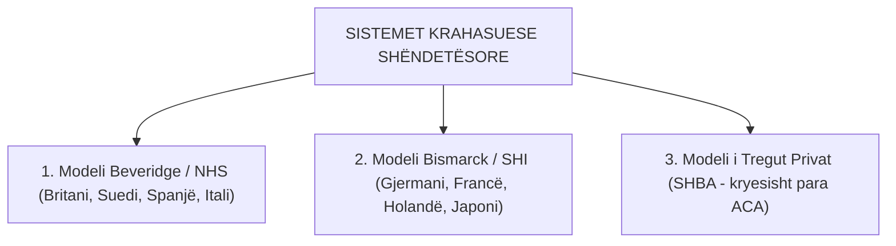
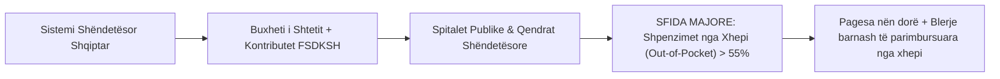

# 📌 Tema 07: Analiza Krahasuese e Sistemeve Shëndetësore

`[[Tema 06 - Analiza Krahasuese e Sistemeve të Pensioneve|⬅️ Tema 06: Sistemet e Pensioneve]]` | `[[00 - Harta e Lëndës dhe Udhëzuesi i Studimit (MOC)|Indeksi]]` | `[[Tema 08 - Politikat e Tregut të Punës dhe Modeli i Fleksiguritetit|Tema 08: Tregu i Punës & Fleksiguriteti ➡️]]`

---

> [!summary] Përmbledhje Ekzekutive
> Kujdesi shëndetësor përbën një nga shtyllat më jetike të mbrojtjes sociale. Analiza krahasuese ndërkombëtare dallon tre modele të mëdha: **Modeli Beveridge / NHS (Shërbimi Kombëtar Shëndetësor i financuar me taksa)**, **Modeli Bismarck / SHI (Sigurimet Shëndetësore Shoqërore të financuara me kontribute)** dhe **Modeli i Tregut Privat (Sigurimet Vullnetare - SHBA)**. Në Shqipëri, sistemi funksionon përmes FSDKSH-së, por përballet me normën më të lartë në Evropë të **shpenzimeve direkte nga xhepi (Out-of-Pocket mbi 55-60%)**.

---

## 🎯 Objektivat e Mësimit
Pas studimit të këtij leksioni, ju do të jeni në gjendje të:
1. Krahasoni tre modelet klasike shëndetësore: **Beveridge (NHS)**, **Bismarck (SHI)** dhe **Tregu Privat**.
2. Analizoni parimet e financimit, qasjes dhe pronësisë së spitaleve në secilin model.
3. Vlerësoni reformën shëndetësore në SHBA (**Obamacare / ACA**) dhe kufijtë e tregut privat.
4. Përkufizoni dhe analizoni fenomenin e **Shpenzimeve Direkte nga Xhepi (Out-of-Pocket Expenditures)**.
5. Diagnostikoni gjendjen e sistemit shëndetësor në Shqipëri (FSDKSH, listat e rimbursimit, emigrimi i bluzave të bardha).

---

## 1. Tre Modelet Ndërkombëtare të Kujdesit Shëndetësor

### Tabela Krahasuese e Tre Modeleve

| Dimensioni | Modeli Beveridge (NHS) | Modeli Bismarck (SHI) | Modeli Privat (SHBA) |
| :--- | :--- | :--- | :--- |
| **Financimi** | **Taksat e Përgjithshme** shtetërore | **Kontributet e Detyrueshme** nga rroga | **Polica Private** të blera individualisht |
| **Aksesi / Mbulimi** | **Universal** për të gjithë qytetarët | **Pothuajse Universal** (i lidhur me punën) | **I Segmentuar** (shumë të pasiguruar) |
| **Pronësia e Spitaleve** | **Publike** (Mjekët janë punonjës shteti) | **Të Përziera** (spitale publike & jofitimprurëse) | **Private Fitimprurëse** & OJF |
| **Menaxhimi** | Ministria e Shëndetësisë / Shteti | Fondet e Pavarura (*Krankenkassen*) | Kompanitë Private të Sigurimeve |
| **Pika e Fortë** | Barazi e lartë, kosto administrative të ulëta | Zgjedhje e lirë e mjekut, cilësi e lartë | Inovacion teknologjik i lartë |
| **Dobësia Kryesore** | **Lista të gjata pritjeje** për operacione | Kosto të larta të punës për biznesin | **Përjashtim social**, kosto marramendëse |

---

## 2. Rasti i SHBA-së dhe Reforma "Obamacare" (ACA)

Për dekada, SHBA ishte i vetmi vend i industrializuar perëndimor pa sistem shëndetësor universal:
* Rreth 45-50 milionë amerikanë ishin plotësisht **të pasiguruar**; falimenti mjekësor ishte shkaku numër 1 i falimentimeve personale.
* Sistemi shtetëror ndërhynte vetëm për dy kategori të ngushta: **Medicare** (për të moshuarit mbi 65 vjeç) dhe **Medicaid** (për të varfrit ekstremë me testim mjetesh).
* **Affordable Care Act (ACA / Obamacare - 2010)**:
  - Detyroi kompanitë e sigurimeve të pranojnë persona me sëmundje para-ekzistuese.
  - Zgjodhi zgjerimin e Medicaid dhe subvencionimin e policave private, duke ulur ndjeshëm numrin e të pasiguruarve, por pa krijuar dot një sistem universal të njësuar.

---

## 3. Sistemi Shëndetësor në Shqipëri: Struktura dhe Sfidat

Në Shqipëri, sistemi shëndetësor është një **hibrid midis Bismarck-ut dhe Beveridge-it**:
* **FSDKSH (Fondi i Sigurimit të Detyrueshëm të Kujdesit Shëndetësor)** mbledh kontributet nga pagat (3.4% e pagës bruto, e ndarë 1.7% punëdhënësi dhe 1.7% punëmarrësi).
* Shteti paguan nga taksat e përgjithshme kontributet për kategoritë pasive (pensionistët, fëmijët, të papunët e regjistruar).

### Sfidat Madhore Krahasuese të Shqipërisë:
1. **Shpenzimet Katastrofike nga Xhepi (Out-of-Pocket)**: Qytetarët shqiptarë paguajnë drejtpërdrejt mbi **55-60%** të të gjitha kostove shëndetësore (ilaçet në farmaci, vizitat private, pagesat joformale), krahasuar me mesataren e BE-së prej rreth 15%.
2. **Listat e Barnave të Rimbursueshme**: Shumë ilaçe moderne për kancerin apo sëmundjet kronike nuk mbulohen nga shteti.
3. **Eksodi i Personelit Mjekësor**: Ikja masive e qindra mjekëve dhe infermierëve drejt Gjermanisë ka krijuar boshllëqe kritike në spitalet rajonale.

---

## 📖 Fjalori i Termave Kyç

- **Modeli Beveridge (NHS)**: Sistem shëndetësor universal i financuar me taksa shtetërore, me spitale publike falas.
- **Modeli Bismarck (SHI)**: Sistem sigurimesh shëndetësore shoqërore i financuar nga kontributet e punës, me menaxhim fondesh të pavarura.
- **Out-of-Pocket Expenditures (Shpenzime nga Xhepi)**: Pagesat e drejtpërdrejta që bën qytetari në momentin e marrjes së shërbimit mjekësor ose barnave.
- **Medicare & Medicaid**: Programet publike shëndetësore në SHBA për të moshuarit (Medicare) dhe të varfrit (Medicaid).
- **FSDKSH**: Institucioni publik i vetëm blerës i shërbimeve shëndetësore në Shqipëri.

---

## 🧠 Seksioni i Memorizimit & Retrieval Practice

### 🔹 Flashcards të Fshehura (Kliko për Përgjigjen)

> [!question]- Pyetja 1: Cilat janë dallimet kryesore midis Modelit Beveridge (NHS) dhe Modelit Bismarck (SHI) në shëndetësi?
> **Përgjigjja:**
> - **Beveridge (NHS - p.sh. Britani, Suedi)**: Financuar 100% nga taksat e përgjithshme; spitalet janë pronë shtetërore; mjekët janë nëpunës publikë; shërbimi është falas universal për çdo qytetar.
> - **Bismarck (SHI - p.sh. Gjermani, Francë)**: Financuar nga kontributet e detyrueshme të pagës; menaxhuar nga fonde të pavarura (*Krankenkassen*); spitalet mund të jenë publike ose private jofitimprurëse; mjekët paguhen sipas shërbimit.

> [!question]- Pyetja 2: Çfarë nënkupton termi "Shpenzime nga Xhepi" (Out-of-Pocket) dhe pse Shqipëria ka nivel kritik në këtë tregues?
> **Përgjigjja:**
> Shpenzimet nga xhepi janë paratë që pacienti paguan direkt nga buxheti i tij familjar për vizita, analiza dhe barna. Në Shqipëri ky tregues kalon 55-60% (nga më të lartët në Evropë), çka tregon se mbrojtja financiare e FSDKSH-së është e dobët dhe i ekspozon qytetarët ndaj rrezikut të falimentimit dhe varfërisë në rast sëmundjeje të rëndë.

---

### 🔹 Flashcards për Obsidian Spaced Repetition (Plugin)
Modeli Beveridge në Shëndetësi:: Sistemi Kombëtar Shëndetësor (NHS) i financuar me taksa dhe me shërbime universale falas.
Modeli Bismarck në Shëndetësi:: Sigurime shëndetësore shoqërore të financuara nga kontributet e punës dhe fondet e pavarura.
Out-of-Pocket Expenditures:: Shpenzime të drejtpërdrejta nga xhepi i qytetarit për kujdesin shëndetësor.
Obamacare (ACA):: Reforma e vitit 2010 në SHBA që zgjeroi mbulimin shëndetësor përmes rregullimit të tregut privat dhe zgjerimit të Medicaid.

---

### 🔹 Plotëso Vendet Bosh (Cloze Recall)
1. Modeli shëndetësor i Britanisë së Madhe dhe Suedisë njihet si modeli ==Beveridge (ose NHS)==.
2. Modeli gjerman i bazuar në fondet e sigurimit shëndetësor njihet si modeli ==Bismarck (ose SHI)==.
3. Shpenzimet e drejtpërdrejta që bën qytetari në farmaci ose spital njihen si shpenzime ==nga xhepi (out-of-pocket)==.
4. Fondi shtetëror që mbledh sigurimet shëndetësore në Shqipëri njihet me akronimin ==FSDKSH==.

---

### 🔹 Checklist për Vetë-Vlerësim
- [ ] Di të krahasoj me saktësi modelin Beveridge dhe Bismarck në shëndetësi.
- [ ] Kuptoj kufizimet e modelit shëndetësor të tregut privat në SHBA.
- [ ] Di të argumentoj pasojat sociale të shpenzimeve të larta nga xhepi në Shqipëri.
