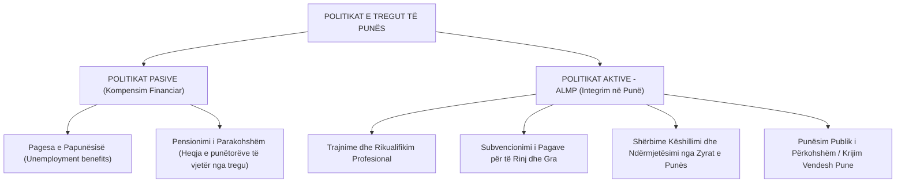
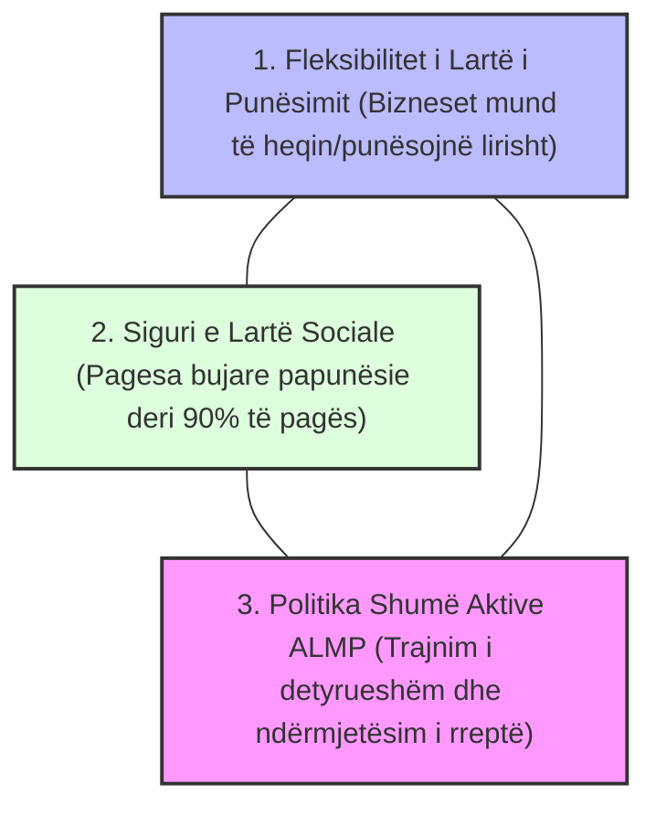

# 📌 Tema 08: Politikat e Tregut të Punës dhe Modeli i Fleksiguritetit

`[[Tema 07 - Analiza Krahasuese e Sistemeve Shëndetësore|⬅️ Tema 07: Sistemet Shëndetësore]]` | `[[00 - Harta e Lëndës dhe Udhëzuesi i Studimit (MOC)|Indeksi]]` | `[[Tema 09 - Lufta Kundër Varfërisë dhe Skemat e Asistencës Sociale|Tema 09: Asistenca Sociale ➡️]]`

---

> [!summary] Përmbledhje Ekzekutive
> Në ekonominë post-industriale, suksesi i një shteti të mirëqenies varet nga aftësia për të mbajtur qytetarët në punë. Ky leksion krahason **Politikat Pasive** (kompensimi financiar i papunësisë) me **Politikat Aktive të Tregut të Punës (ALMP)**, analizon modelin e famshëm danez të **Fleksiguritetit (Flexicurity)** që ndërthur fleksibilitetin e biznesit me sigurinë sociale të punëtorit, si dhe trajton problemin e **Dualizmit (Insiders vs. Outsiders)** dhe **informalitetit** në tregun e punës në Shqipëri dhe Ballkan.

---

## 🎯 Objektivat e Mësimit
Pas studimit të këtij leksioni, ju do të jeni në gjendje të:
1. Dalloni **Politikat Pasive** nga **Politikat Aktive të Tregut të Punës (ALMP)**.
2. Zbërtheni dhe skiconi "Trekëndëshin e Artë" të **Modelit të Fleksiguritetit (Flexicurity)** në Danimarkë.
3. Krahasoni regjimet e mbrojtjes së punësimit (EPL - Employment Protection Legislation) në vendet liberale dhe ato kontinentale.
4. Analizoni fenomenin e **të rinjve NEET (Not in Education, Employment, or Training)**.
5. Diagnostikoni sfidat e tregut të punës në Shqipëri: informaliteti, emigrimi i rinisë dhe efektiviteti i AKPA-së.

---

## 1. Politikat Pasive vs. Politikat Aktive të Tregut të Punës (ALMP)

* **Politikat Pasive**: Sigurojnë zëvendësim të ardhurash kur humbet puna. Nëse zgjasin shumë dhe janë shumë bujare pa kërkesa aktive, ato mund të krijojnë "kurthin e papunësisë" (njerëzit preferojnë të rrinë në shtëpi).
* **Politikat Aktive (ALMP)**: Synojnë rritjen e punësueshmërisë (*employability*) së qytetarit, duke e përshtatur me kërkesat e reja teknologjike të tregut.

---

## 2. "Trekëndëshi i Artë" i Fleksiguritetit (Modeli Danez)

I zhvilluar në Danimarkë dhe Holandë në vitet 1990, **Fleksiguriteti (Flexicurity = Flexibility + Security)** konsiderohet modeli më i suksesshëm botëror i menaxhimit të punësimit:

### Tri Shtyllat e Fleksiguritetit:
1. **Fleksibiliteti Numerik për Punëdhënësit**: Ligje shumë liberale punësimi; bizneset nuk pengohen nga gjyqet nëse duan të pushojnë punëtorë kur bie puna.
2. **Siguria e të Ardhurave për Punëtorët**: Punëtori nuk ka frikë nga pushimi nga puna, sepse shteti i garanton menjëherë një pagesë papunësie shumë bujare (deri në 80-90% të pagës së mëparshme).
3. **Aktivizimi i Detyrueshëm (Puna ose Trajnimi)**: Punëtori nuk lejohet të rrijë pasiv; brenda pak javësh ai detyrohet të ndjekë kurse kualifikimi ose të pranojë vendet e ofruara të punës, përndryshe i hiqet pagesa.

> [!important] Përfundimi i Fleksiguritetit
> Modeli danez **mbron punëtorin dhe jo vendin e punës** (*Protects the worker, not the job*). Ai pranon që disa profesione vdesin, por shteti investon te qytetari që ai të kalojë pa dhimbje në një profesion të ri.

---

## 3. Tregu i Punës në Shqipëri dhe Rajon: Sfidat Kryesore

Ndryshe nga Danimarka, tregu i punës në Shqipëri dhe Ballkan vuan nga defekte të thella strukturore:
1. **Shkalla e Lartë e Informalitetit (30-40%)**: Punësimi "në të zezë" ose deklarimi me pagë minimale fiktive bën që qindra mijëra punëtorë të mos kenë asnjë mbrojtje ligjore apo pagesë papunësie.
2. **Fenomeni Shqetësues NEET (Not in Education, Employment, or Training)**: Mbi 25% e të rinjve shqiptarë të moshës 15-29 vjeç as nuk janë në shkollë, as nuk punojnë dhe as nuk trajnohen (një nga normat më të larta në Evropë).
3. **Mungesa e Balancës së Aftësive (Skills Mismatch)**: Universitetet diplomojnë mijëra juristë e ekonomistë, ndërsa tregu vuan nga mungesa e teknikëve, zanatçinjve dhe specialistëve të kualifikuar.

---

## 📖 Fjalori i Termave Kyç

- **ALMP (Active Labour Market Policies)**: Politika aktive shtetërore (trajnime, subvencione) për të ndihmuar të papunët të integrohen në punë.
- **Fleksiguritet (Flexicurity)**: Strategji e tregut të punës që kombinon lirinë e punëdhënësve për shkarkim me sigurinë e të ardhurave dhe trajnimin e punëtorëve.
- **NEET**: Akronim për të rinjtë që nuk janë as të punësuar, as në arsim dhe as në trajnim profesional.
- **Skills Mismatch (Mosperputhja e Aftësive)**: Hendeku midis asaj çfarë mësojnë studentët në shkollë dhe nevojave reale të bizneseve në treg.
- **Politika Pasive të Punës**: Skema financiare kompensimi (pagesa e papunësisë) që nuk kërkojnë aktivizim të detyruar profesional.

---

## 🧠 Seksioni i Memorizimit & Retrieval Practice

### 🔹 Flashcards të Fshehura (Kliko për Përgjigjen)

> [!question]- Pyetja 1: Cilët janë 3 komponentët e "Trekëndëshit të Artë" të Fleksiguritetit në Danimarkë?
> **Përgjigjja:**
> 1. **Fleksibilitet i lartë punësimi** (punëdhënësit mund të pushojnë dhe punësojnë staf me lehtësi ligjore).
> 2. **Siguri e lartë e të ardhurave** (pagesa papunësie shumë bujare nga shteti).
> 3. **Politika aktive shumë rigoroze (ALMP)** (trajnime dhe rikualifikim i detyrueshëm për t'u kthyer shpejt në treg).

> [!question]- Pyetja 2: Cili është dallimi midis një Politike Pasive dhe një Politike Aktive të Tregut të Punës (ALMP)?
> **Përgjigjja:**
> - **Politika Pasive**: Ofron thjesht kompensim financiar (para në dorë) gjatë kohës që njeriu është i papunë pa ndërhyrë te aftësitë e tij (p.sh. pagesa e papunësisë).
> - **Politika Aktive (ALMP)**: Ndërhyn drejtpërdrejt përmes trajnimeve profesionale, subvencionimit të vendeve të punës dhe këshillimit për ta rikthyer të papunin në treg sa më shpejt.

> [!question]- Pyetja 3: Çfarë nënkupton treguesi NEET dhe pse është alarmant në Shqipëri?
> **Përgjigjja:**
> NEET tregon përqindjen e të rinjve që "Nuk janë as në Shkollë, as në Punë dhe as në Trajnim" (*Not in Education, Employment, or Training*). Në Shqipëri ky tregues kalon 25%, çka dëshmon shkëputje masive të rinisë nga jeta produktive dhe nxit emigracionin masiv.

---

### 🔹 Flashcards për Obsidian Spaced Repetition (Plugin)
Fleksiguriteti (Flexicurity):: Model i tregut të punës që ndërthur fleksibilitetin e shkarkimit me sigurinë e lartë sociale dhe trajnimin aktiv.
Politikat Aktive (ALMP):: Masa shtetërore trajnimi dhe ndërmjetësimi për integrimin aktiv të të papunëve në punë.
Treguesi NEET:: Përqindja e të rinjve jashtë arsimit, punësimit apo trajnimit profesional.
Kurthi i Papunësisë:: Situatë ku pagesa pasive e papunësisë është aq e lartë sa individi nuk ka motivim të kërkojë punë me pagë normale.

---

### 🔹 Plotëso Vendet Bosh (Cloze Recall)
1. Modeli i Fleksiguritetit u zhvillua dhe u bë i famshëm në ==Danimarkë==.
2. Politikat që synojnë trajnimin dhe rikualifikimin e të papunëve njihen me akronimin ==ALMP (Politikat Aktive)==.
3. Të rinjtë që nuk studiojnë dhe nuk punojnë identifikohen me termin ==NEET==.
4. Parimi bazë i modelit danez është se shteti mbron ==punëtorin dhe jo vendin e punës==.

---

### 🔹 Checklist për Vetë-Vlerësim
- [ ] Mund të vizatoj dhe shpjegoj trekëndëshin e Fleksiguritetit.
- [ ] Di të dalloj politikat aktive nga ato pasive të punësimit.
- [ ] Kuptoj problemet e tregut të punës në Shqipëri (informaliteti dhe NEET).
