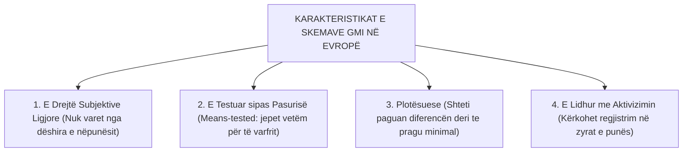
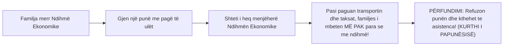
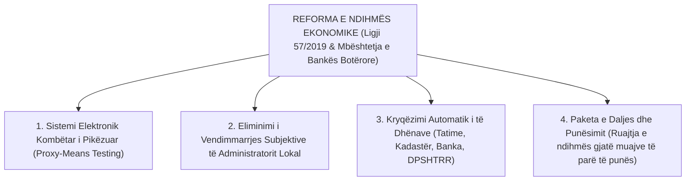

# 📌 Tema 09: Lufta Kundër Varfërisë dhe Skemat e Asistencës Sociale

`[[Tema 08 - Politikat e Tregut të Punës dhe Modeli i Fleksiguritetit|⬅️ Tema 08: Tregu i Punës & Fleksiguriteti]]` | `[[00 - Harta e Lëndës dhe Udhëzuesi i Studimit (MOC)|Indeksi]]` | `[[Tema 10 - Politikat Familjare dhe Barazia Gjinore në Evropë|Tema 10: Politikat Familjare ➡️]]`

---

> [!summary] Përmbledhje Ekzekutive
> Asistenca sociale përfaqëson "rrjetën e fundit të sigurisë" (*Safety Net*) të shtetit të mirëqenies, e cila aktivizohet kur sigurimet shoqërore, tregu dhe familja kanë dështuar. Ky leksion krahason modelet e **Të Ardhurave Minimale të Garantuara (GMI)** në Evropë, analizën e **Kurtheve të Varfërisë dhe Papunësisë**, si dhe reformën rrënjësore të **Ndihmës Ekonomike në Shqipëri** përmes formulës së pikëzimit elektronik (**Proxy-Means Testing**) dhe nxitjes së daljes nga skema përmes paketës së riintegrimit.

---

## 🎯 Objektivat e Mësimit
Pas studimit të këtij leksioni, ju do të jeni në gjendje të:
1. Përkufizoni skemat e **Të Ardhurave Minimale të Garantuara (GMI - Guaranteed Minimum Income)**.
2. Analizoni tensionin midis **Mbulimit Universal** dhe **Shënjestrimit me Testim Pasurie (Means-Testing)**.
3. Shpjegoni konceptet ekonomike të **"Kurthit të Varfërisë" (Poverty Trap)** dhe **"Kurthit të Papunësisë" (Unemployment Trap)**.
4. Zbërtheni reformën e **Ndihmës Ekonomike në Shqipëri**: Nga vlerësimi subjektiv i këshillit bashkiak te sistemi me pikë (*Proxy-Means Testing*).
5. Vlerësoni rolin e **Fondit Social (Ligji 121/2016)** për decentralizimin e shërbimeve shoqërore pranë bashkive.

---

## 1. Skemat e të Ardhurave Minimale të Garantuara (GMI) në Evropë

Në shumicën e vendeve të Bashkimit Evropian, çdo qytetar ka të drejtë ligjore të kërkojë një të ardhur minimale nga shteti nëse nuk mund të sigurojë mbijetesën:

### Llojet e Skemave të Asistencës Sociale:
* **Asistenca e Pastër Pasive**: Pagesë mujore parash pa asnjë kusht (rrezikon pasivitet afatgjatë).
* **Transfertat Monetare të Kushtëzuara (Conditional Cash Transfers - CCT)**: Pagesa kushtëzohet me sjellje pozitive familjare (p.sh. vaksinimi i detyrueshëm i fëmijëve, frekuentimi i rregullt 90% i shkollës).

---

## 2. Kurthet e Varfërisë dhe Papunësisë

Një nga dilemat më të mëdha të politikës sociale është: *Si të ndihmojmë të varfrit pa u hequr dëshirën për të punuar?*

* **Kurthi i Varfërisë (Poverty Trap)**: Situata ku rritja e të ardhurave nga puna shoqërohet me humbjen e menjëhershme të ndihmave sociale dhe rritjen e taksave, duke e lënë individin njëlloj ose më keq financiarisht.
* **Kurthi i Papunësisë (Unemployment Trap)**: Diferenca midis pagesës së asistencës dhe pagës minimale neto është aq e vogël, sa nuk ia vlen të punosh.

---

## 3. Reforma e Ndihmës Ekonomike në Shqipëri (Proxy-Means Testing)

Para vitit 2014, sistemi i Ndihmës Ekonomike në Shqipëri vuante nga korrupsioni, abuzimi dhe vendimmarrja klienteliste (Këshillat Bashkiakë shpesh jepnin ndihmë për militantët partiakë):

### Si Funksionon Formula e Pikëzimit (Proxy-Means Test)?
Në vend që të besojë deklaratën verbale të qytetarit, sistemi kompjuterik llogarit një indeks varfërie bazuar në "tregues të tërthortë" (*proxies*):
* Karakteristikat e banesës (sipërfaqja, lloji i dyshemesë, pajisjet elektro-shtëpiake).
* Përbërja familjare (numri i fëmijëve, personat me aftësi të kufizuara, kryefamiljaret gra).
* Pronësia e aseteve (nëse ke makinë të regjistruar në DPSHTRR apo tokë, përjashtohesh automatikisht nga sistemi).

---

## 4. Decentralizimi dhe Fondi Social (Ligji 121/2016)

Reforma moderne kuptoi se paraja në dorë nuk e zgjidh varfërinë pa **shërbime shoqërore**:
* **Fondi Social**: Mekanizëm i Ministrisë që u jep grante bashkive për të hapur qendra komunitare ditore, shërbime të kujdesit në shtëpi dhe strehëza emergjente.
* **Paketa e Riintegrimit**: Përfituesit e aftë për punë regjistrohen në zyrat e punës (AKPA) dhe u ofrohen kurse trajnimi falas; nëse refuzojnë ofertën e përshtatshme të punës, hiqen nga skema.

---

## 📖 Fjalori i Termave Kyç

- **Asistencë Sociale (Ndihma Ekonomike)**: Skemë mbështetjeje financiare jorishpërndarëse e financuar nga taksat për individët në varfëri ekstreme.
- **Proxy-Means Testing**: Metodë statistikore që vlerëson nivelin e të ardhurave të familjes përmes karakteristikave të vëzhgueshme (asetet, pajisjet, banesa).
- **GMI (Guaranteed Minimum Income)**: E drejtë ligjore universale për një dysheme minimale të ardhurash.
- **Kurthi i Varfërisë**: Situatë disproporcionale ku dalja në punë nuk sjell rritje neto të ardhurash për shkak të ndërprerjes së menjëhershme të ndihmës sociale.
- **Fondi Social**: Fond buxhetor shtetëror për bashkëfinancimin e shërbimeve shoqërore në nivel vendor.

---

## 🧠 Seksioni i Memorizimit & Retrieval Practice

### 🔹 Flashcards të Fshehura (Kliko për Përgjigjen)

> [!question]- Pyetja 1: Çfarë është metoda "Proxy-Means Testing" dhe si u zbatua në reformën e Ndihmës Ekonomike në Shqipëri?
> **Përgjigjja:**
> Proxy-Means Testing është një formulë statistikore e pikëzuar që parashikon varfërinë e familjes jo thjesht nga deklarata e pagës, por nga tregues të tërthortë (kushtet e banesës, pajisjet elektroshtëpiake, përbërja e familjes). Në Shqipëri u fut me mbështetjen e Bankës Botërore për të eliminuar korrupsionin dhe vlerësimin subjektiv politik të administratorëve lokalë.

> [!question]- Pyetja 2: Çfarë është "Kurthi i Papunësisë" (Unemployment Trap) dhe si mund të parandalohet nga shteti?
> **Përgjigjja:**
> Është situata kur shuma e parave që individi merr nga ndihma sociale është shumë e afërt me pagën minimale neto në treg, duke e bërë punësimin ekonomikisht jo tërheqës. Parandalohet përmes:
> 1. Rritjes së pagës minimale.
> 2. Paketës së tranzicionit (ruajtja e një pjese të ndihmës sociale gjatë muajve të parë të punësimit).
> 3. Kushtëzimit të ndihmës me pjesëmarrje aktive në trajnime dhe punë.

> [!question]- Pyetja 3: Cili është qëllimi i krijimit të "Fondit Social" sipas Ligjit 121/2016 në Shqipëri?
> **Përgjigjja:**
> Qëllimi është financimi dhe ngritja e shërbimeve të reja të kujdesit shoqëror në nivel bashkiak (qendra ditore, kujdesi në shtëpi, strehëza), duke kaluar nga thjesht "dhënia e parave pasive në dorë" tek ofrimi i shërbimeve të integruara sociale të decentralizuara.

---

### 🔹 Flashcards për Obsidian Spaced Repetition (Plugin)
Proxy-Means Testing:: Vlerësim i varfërisë me formulë të pikëzuar elektronike bazuar në pasuritë dhe kushtet e jetesës.
Kurthi i Varfërisë:: Humbja e menjëhershme e përfitimeve sociale që dekurajon individin të rrisë orët e punës.
Ndihma Ekonomike:: Skema kryesore e asistencës sociale me para në dorë në Shqipëri për familjet në varfëri.
Skema GMI:: Të Ardhurat Minimale të Garantuara; e drejtë ligjore për një minimum jetik të mbrojtur nga shteti.

---

### 🔹 Plotëso Vendet Bosh (Cloze Recall)
1. Formula elektronike e pikëzuar për vlerësimin e varfërisë në Shqipëri quhet ==Proxy-Means Testing==.
2. Situata ku pranimi i një pune e lë familjen me më pak para se ndihma sociale quhet kurthi ==i papunësisë (ose i varfërisë)==.
3. Ligji shqiptar që krijoi Fondin Social për bashkitë është Ligji ==121/2016==.
4. E drejta universale me ligj për një shumë minimale jetese njihet me akronimin ==GMI (Guaranteed Minimum Income)==.

---

### 🔹 Checklist për Vetë-Vlerësim
- [ ] Di të shpjegoj si funksionon formula e pikëzimit në Ndihmën Ekonomike.
- [ ] Mund të shpjegoj mekanizmin ekonomik të kurthit të papunësisë.
- [ ] Kuptoj rolin e Fondit Social në decentralizimin e shërbimeve shoqërore.
