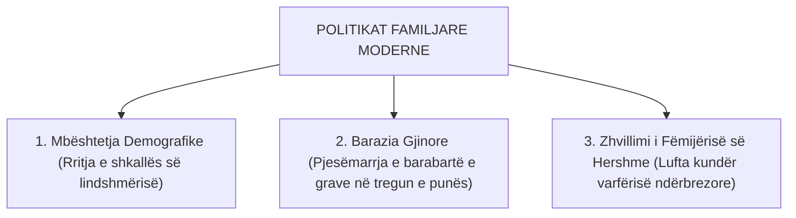

# 📌 Tema 10: Politikat Familjare dhe Barazia Gjinore në Evropë

`[[Tema 09 - Lufta Kundër Varfërisë dhe Skemat e Asistencës Sociale|⬅️ Tema 09: Asistenca Sociale]]` | `[[00 - Harta e Lëndës dhe Udhëzuesi i Studimit (MOC)|Indeksi]]` | `[[Tema 11 - Bashkimi Evropian dhe Globalizimi në Politikat Sociale|Tema 11: BE & Globalizimi ➡️]]`

---

> [!summary] Përmbledhje Ekzekutive
> Në të kaluarën, politikat familjare shiheshin thjesht si "çështje private e shtëpisë". Sot, në kushtet e rënies dramatike të lindshmërisë dhe nevojës për fuqi punëtore, politikat familjare janë bërë thelbi i konkurrueshmërisë evropiane. Ky leksion analizon modelet krahasuese të **Balancës Punë-Familje (Work-Life Balance)**, **Lejet Prindërore** (leja e lindjes, leja e atësisë dhe kuotat e baballarëve), shërbimet e **Kujdesit të Fëmijërisë së Hershme (ECEC)**, si dhe tranzicionin nga modeli **Male Breadwinner** te modeli **Dual-Earner / Dual-Caregiver**.

---

## 🎯 Objektivat e Mësimit
Pas studimit të këtij leksioni, ju do të jeni në gjendje të:
1. Përkufizoni qëllimet e **Politikave Familjare**: Rritja e lindshmërisë, barazia gjinore dhe reduktimi i varfërisë së fëmijëve.
2. Krahasoni sistemet e **Lejeve Prindërore** në Evropë (Modeli Nordik, Kontinental, Anglosakson dhe Mesdhetar).
3. Analizoni parimin skandinav të kuotës së babait (*"Use-it-or-lose-it" father's quota*).
4. Vlerësoni rolin e shërbimeve të **Kujdesit të Hershëm të Fëmijëve (ECEC - Çerdhet dhe Kopshtet)** në punësimin e grave.
5. Analizoni kuadrin ligjor dhe sfidat e politikave familjare në Shqipëri.

---

## 1. Tre Qëllimet Strategjike të Politikave Familjare Moderne

* **Paradoksi Evropian i Lindshmërisë**: Vende që shpenzojnë pak për familjen dhe i mbajnë gratë në shtëpi (p.sh. Italia, Spanja, Greqia) kanë shkallën **më të ulët të lindshmërisë në botë** (1.2 - 1.3 fëmijë për grua). Përkundrazi, vendet që ofrojnë çerdhe dhe stimulojnë punësimin e grave (Suedia, Franca) kanë lindshmërinë më të lartë në Evropë (1.8 - 1.9).
* *Konkluzioni Shkencor*: Gratë moderne lindin fëmijë vetëm atëherë kur shteti u garanton se **nuk do të humbasin karrierën e tyre profesionale**.

---

## 2. Tipologjia Krahasuese e Lejeve Prindërore

| Modeli Rajonal | Kohëzgjatja & Pagesa e Lejes | Kuota e Babait (Leja e Atësisë) | Shërbimet e Çerdheve (0-3 vjeç) |
| :--- | :--- | :--- | :--- |
| **Modeli Nordik** (Suedi, Norvegji) | Shumë bujare (12-16 muaj me 80-100% të pagës) | **E Detyrueshme (3 muaj të rezervuar për babanë)** | **Universale (Mbi 55-60% e fëmijëve në çerdhe)** |
| **Modeli Kontinental** (Gjermani, Francë) | E gjatë (deri në 1-3 vite), pagesë e moderuar | E moderuar (2 muaj shtesë nëse e merr babai) | E mesme / e lartë (veçanërisht në Francë) |
| **Modeli Liberal** (SHBA, Britani) | SHBA: 0 javë me pagesë nga shteti; MB: pagesë e ulët | Shumë e shkurtër ose e papaguar | Shërbim tërësisht privat dhe shumë i shtrenjtë |
| **Modeli Mesdhetar** (Itali, Spanjë) | Spanja: barazim 16 javë për të dy prindërit; Italia: e fragmentuar | Në rritje në Spanjë; e shkurtër në Itali | E ulët (mbështetje te gjyshërit) |

> [!important] Parimi Skandinav: "Use-it-or-lose-it" (Përdore ose e Humbisni)
> Për dekada, lejet prindërore mund të merreshin lirisht nga nëna ose babai. Në 98% të rasteve i merrnin gratë. Suedia dhe Norvegjia vendosën me ligj **"Kuotën e Babait"** (Father's quota): 2 deri në 3 muaj leje i rezervohen ekskluzivisht babait. Nëse babai nuk e merr këtë leje, familja e humbet atë periudhë të paguar. Rezultati: mbi 90% e baballarëve suedezë marrin leje prindërore, duke ndryshuar rrënjësisht kulturën gjinore.

---

## 3. Politikat Familjare në Shqipëri: Kuadri Ligjor dhe Sfidat

Në Shqipëri, kuadri ligjor (Kodi i Punës, Ligji 7703) përcakton:
* **Leja e Lindjes (Barrëlindja)**: 365 ditë kalendarike (me pagesë 80% të pagës mesatare për 6 muajt e parë dhe 50% për pjesën e mbetur).
* **Leja e Atësisë**: Vetëm 3 ditë të paguara nga punëdhënësi menjëherë pas lindjes. Babai mund të marrë pjesën tjetër të lejes prindërore vetëm nëse nëna vendos të kthehet në punë (nuk ka kuotë të detyruar për babanë).
* **Deficiti i Shërbimeve të Kujdesit (0-3 vjeç)**: Vetëm rreth 10-15% e fëmijëve të vegjël në Shqipëri kanë akses në çerdhe publike (shumica në Tiranë; mungesë totale në zonat rurale). Kjo detyron nënat e reja të largohen nga tregu i punës ose të varen nga ndihma e gjyshërve.

---

## 📖 Fjalori i Termave Kyç

- **ECEC (Early Childhood Education and Care)**: Edukimi dhe përkujdesja për fëmijërinë e hershme (çerdhet dhe kopshtet).
- **Kuota e Babait (Father's Quota)**: Periudhë e patransferueshme e lejes prindërore e rezervuar me ligj vetëm për baballarët.
- **Dual-Earner Model**: Model shoqëror ku të dy bashkëshortët marrin pjesë të barabartë në punësim dhe në përkujdesjen shtëpiake.
- **Gender Pay Gap (Hendeku Gjinor i Pagave)**: Diferenca mesatare në përqindje midis pagës së burrave dhe grave për të njëjtën punë.
- **Child Penalty**: Rënia e menjëhershme dhe afatgjatë e të ardhurave të grave në karrierë pas lindjes së fëmijës së parë.

---

## 🧠 Seksioni i Memorizimit & Retrieval Practice

### 🔹 Flashcards të Fshehura (Kliko për Përgjigjen)

> [!question]- Pyetja 1: Çfarë është "Paradoksi Evropian i Lindshmërisë" dhe cili është shpjegimi i tij sociologjik?
> **Përgjigjja:**
> Është fakti se vendet konservatore mesdhetare që e shohin gruan tradicionalisht si kujdestare në shtëpi (Italia, Spanja) kanë shkallën më të ulët të lindshmërisë, ndërsa vendet skandinave me punësimin më të lartë të grave kanë lindshmërinë më të lartë. Shpjegimi është se gratë moderne vendosin të lindin fëmijë vetëm kur shteti u garanton shërbime publike çerdhesh dhe leje prindërore që nuk u shkatërrojnë karrierën.

> [!question]- Pyetja 2: Si funksionon parimi i "Kuotës së Babait" (Father's quota) në vendet skandinave?
> **Përgjigjja:**
> Shteti rezervon një pjesë të lejes prindërore (p.sh. 2-3 muaj) ekskluzivisht për babanë sipas parimit *"Përdore ose e humbiste"* (use-it-or-lose-it). Këta muaj nuk mund t'i transferohen nënës; nëse babai refuzon t'i marrë, familja humbet paratë dhe kohën e pushimit. Kjo ka rritur pjesëmarrjen e baballarëve në mbi 90%.

---

### 🔹 Flashcards për Obsidian Spaced Repetition (Plugin)
Kuota e Babait:: Leje prindërore e patransferueshme e rezervuar me ligj vetëm për babanë për të nxitur barazinë gjinore.
Dual-Earner Model:: Modeli bashkëkohor ku të dy prindërit punojnë dhe ndajnë barabartë kujdesin e fëmijëve.
ECEC:: Shërbimet publike dhe private të çerdheve dhe kopshteve për edukimin e fëmijërisë së hershme.
Child Penalty:: Humbja e përparimit në karrierë dhe rënia e pagës që pësojnë gratë pas lindjes së fëmijëve.

---

### 🔹 Plotëso Vendet Bosh (Cloze Recall)
1. Modeli familjar ku të dy bashkëshortët punojnë dhe ndajnë kujdesin njihet si modeli ==Dual-Earner (ose Dual-Caregiver)==.
2. Sistemi skandinav që detyron baballarët të marrin pushim quhet ==kuota e babait (father's quota)==.
3. Rënia afatgjatë e pagës së grave pas lindjes së fëmijës njihet në ekonomi si ==child penalty==.
4. Shërbimet e çerdheve dhe kopshteve në literaturën ndërkombëtare njihen me akronimin ==ECEC==.

---

### 🔹 Checklist për Vetë-Vlerësim
- [ ] Di të shpjegoj dallimet midis lejeve prindërore në Skandinavi dhe Shqipëri.
- [ ] Kuptoj lidhjen midis çerdheve publike dhe shkallës së lindshmërisë.
- [ ] Di të analizoj pasojat gjinore të modelit tradicional Male Breadwinner.
