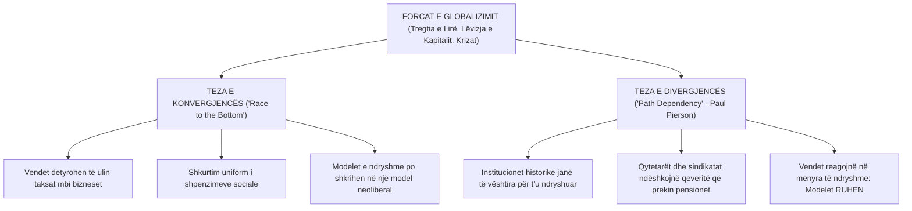
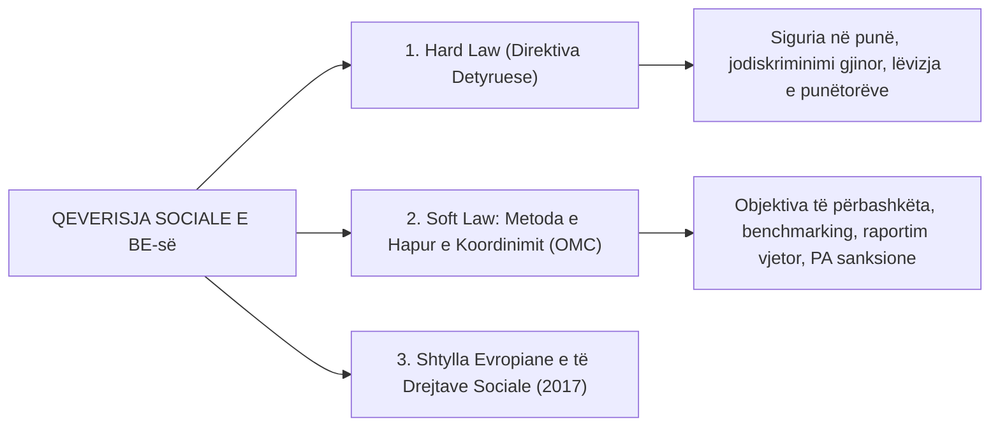

# 📌 Tema 11: Bashkimi Evropian dhe Globalizimi në Politikat Sociale

`[[Tema 10 - Politikat Familjare dhe Barazia Gjinore në Evropë|⬅️ Tema 10: Politikat Familjare]]` | `[[00 - Harta e Lëndës dhe Udhëzuesi i Studimit (MOC)|Indeksi]]` | `[[Tema 12 - Politikat Sociale në Shqipëri dhe Ballkanin Perëndimor|Tema 12: Shqipëria & Ballkani ➡️]]`

---

> [!summary] Përmbledhje Ekzekutive
> A po e shkatërron globalizimi shtetin e mirëqenies? Teoria e **Konvergjencës (Race to the Bottom)** pretendon se presioni për taksa të ulëta dhe liberalizim po zhduk dallimet midis shteteve. Nga ana tjetër, Teoria e **Divergjencës dhe Varësisë nga Shtegu (Path Dependency - Paul Pierson)** vërteton se institucionet historike dhe rezistenca e qytetarëve ruajnë dallimet midis regjimeve. Ky leksion trajton gjithashtu **Dimensionin Social të BE-së**, qeverisjen përmes **OMC (Metoda e Hapur e Koordinimit)** dhe kërkesat e **Kapitullit 19 të Integrimit** për Shqipërinë.

---

## 🎯 Objektivat e Mësimit
Pas studimit të këtij leksioni, ju do të jeni në gjendje të:
1. Analizoni debatin madhor: **Konvergjenca (Race to the Bottom)** vs. **Divergjenca (Path Dependency)**.
2. Shpjegoni teorinë e Paul Pierson mbi **"Politikën e Zmbrapsjes së Mirëqenies" (Welfare Retrenchment)**.
3. Zbërtheni asimetrinë midis integrimit ekonomik të BE-së dhe sovranitetit kombëtar social.
4. Shpjegoni funksionimin e **Metodës së Hapur të Koordinimit (OMC - Open Method of Coordination)**.
5. Përshkruani 20 parimet e **Shtyllës Evropiane të të Drejtave Sociale (Gothenburg 2017)**.
6. Analizoni detyrimet e Shqipërisë në **Kapitullin 19 të Negociatave me BE-në**.

---

## 1. Debati Madhor: Konvergjencë vs. Divergjencë

### Koncepti i "Path Dependency" (Paul Pierson, 1994, 2001):
* Reformat sociale nuk nisin nga zero. Çdo politikë e kaluar krijon përfitues (*klientela elektorale*), si pensionistët apo të punësuarit publikë.
* Shkurtimi i shtetit të mirëqenies është **politikisht shumë i rrezikshëm** (sjell humbje votash). Prandaj, qeveritë zbatojnë taktika zbutëse (*blame avoidance*), dhe modelet sociale vazhdojnë të ruajnë identitetin e tyre unik historik (**Divergjenca**).

---

## 2. Dimensioni Social i Bashkimit Evropian: Asimetria Historike

BE ka lindur si bashkim ekonomik dhe treg i përbashkët. Politikat sociale kanë mbetur historikisht nën sovranitetin e shteteve anëtare:
* **Asimetria Thelbësore**: Rregullat ekonomike dhe fiskale të BE-së janë ligje të forta me sanksione financiare (*Hard Law* - Traktati i Mastrihtit, Pakti i Stabilitetit), ndërsa politikat sociale janë kryesisht rekomandime me vullnet të lirë (*Soft Law*).

---

## 3. Metoda e Hapur e Koordinimit (OMC)

E krijuar në Samitin e Lisbonës (2000), **OMC** funksionon si një mekanizëm mësimi dhe presioni moral midis shteteve:
1. Shtetet bien dakord për **Objektiva të Përbashkëta** (p.sh. ulja me 15 milionë e numrit të qytetarëve në rrezik varfërie).
2. Përcaktohen **Tregues të Matshëm** (Social Dashboard: norma AROPE, koeficienti Gini, braktisja e shkollës).
3. Çdo shtet harton **Planet Kombëtare të Reformave**.
4. Komisioni Evropian bën vlerësimin dhe renditjen krahasuese (**Benchmarking & Peer Review**).
* *Pika e Dobët*: Nuk ka gjykata apo gjoba; nëse një vend nuk e zbaton, ndëshkimi i vetëm është "turpërimi publik" (*Naming and shaming*).

---

## 4. Kapitulli 19 i Integrimit të Shqipërisë në BE: "Politika Sociale dhe Punësimi"

Për t'u anëtarësuar në BE, Shqipëria duhet të plotësojë detyrimet strikte të Kapitullit 19:
* **Legjislacioni i Punës dhe Inspektimi**: Zbatimi real i Kodit të Punës dhe forcimi i Inspektoriatit Shtetëror të Punës për të luftuar punën e zezë.
* **Barazia Gjinore dhe Jodiskriminimi**: Mbrojtja e personave me aftësi të kufizuara dhe minoriteteve (veçanërisht komunitetit Rom dhe Egjiptian).
* **Dialogu Social**: Funksionimi i mirëfilltë i Këshillit Kombëtar të Punës (Qeveri - Sindikata - Punëdhënës).
* **Reforma e Shërbimeve Shoqërore**: Zbatimi i plotë i decentralizimit, akreditimi i standardeve dhe eliminimi i institucioneve të mbyllura të fëmijëve (de-institucionalizimi).

---

## 📖 Fjalori i Termave Kyç

- **Path Dependency (Varësia nga Shtegu)**: Teori që provon se vendimet dhe institucionet historike kushtëzojnë dhe kufizojnë mundësitë e reformave të sotme.
- **Race to the Bottom**: Teza që pretendon se konkurrenca globale detyron shtetet të ulin taksat dhe mbrojtjen sociale në nivelet më të ulëta.
- **OMC (Open Method of Coordination)**: Mekanizëm i qeverisjes së butë në BE i bazuar te objektivat e përbashkëta, indikatorët dhe shkëmbimi i përvojave.
- **Kapitulli 19**: Kapitulli themelor negociues i anëtarësimit në BE për Politikat Sociale dhe Punësimin.
- **Shtylla Evropiane e të Drejtave Sociale**: Dokumenti i vitit 2017 me 20 parime për punësimin e drejtë dhe mbrojtjen sociale në Evropë.

---

## 🧠 Seksioni i Memorizimit & Retrieval Practice

### 🔹 Flashcards të Fshehura (Kliko për Përgjigjen)

> [!question]- Pyetja 1: Cili është dallimi kryesor midis Tezës së Konvergjencës ("Race to the Bottom") dhe Tezës së Divergjencës ("Path Dependency")?
> **Përgjigjja:**
> - **Konvergjenca**: Argumenton se globalizimi ushtron presion të njëjtë ekonomik, duke i detyruar të gjitha shtetet të bëjnë shkurtime dhe të konvergojnë drejt një modeli të vetëm neoliberal me mbrojtje minimale.
> - **Divergjenca (Path Dependency)**: Argumenton se institucionet historike dhe presioni i votuesve krijojnë rezistencë të fortë; prandaj shtetet reagojnë ndryshe dhe dallimet midis regjimeve të mirëqenies mbeten të qëndrueshme.

> [!question]- Pyetja 2: Çfarë është Metoda e Hapur e Koordinimit (OMC) dhe pse cilësohet si "Soft Law"?
> **Përgjigjja:**
> OMC është një instrument i BE-së për koordinimin e politikave sociale pa ligje detyruese. Shtetet bien dakord për synime të përbashkëta, përdorin indikatorë statistikorë dhe krahasohen me kolegët (*peer review*). Cilësohet "Soft Law" sepse nuk parashikon asnjë sanksion ligjor apo gjobë financiare në rast mospërmbushjeje.

---

### 🔹 Flashcards për Obsidian Spaced Repetition (Plugin)
Path Dependency:: Teoria e Paul Pierson se institucionet historike kushtëzojnë reformat dhe pengojnë shpërbërjen e shtetit social.
OMC (Open Method of Coordination):: Metodë e qeverisjes së butë në BE përmes objektivave vullnetare, treguesve dhe benchmarking-ut.
Kapitulli 19 i BE-së:: Kapitulli i negociatave të anëtarësimit mbi Politikat Sociale dhe Punësimin.
Race to the Bottom:: Teza teorike se globalizimi shkakton ulje reciproke të taksave dhe standardeve sociale midis shteteve.

---

### 🔹 Plotëso Vendet Bosh (Cloze Recall)
1. Teoria e rezistencës institucionale dhe varësisë nga shtegu u zhvillua nga ==Paul Pierson==.
2. Mekanizmi i qeverisjes së butë të BE-së për politikat sociale njihet si ==OMC (Metoda e Hapur e Koordinimit)==.
3. Kapitulli i negociatave të anëtarësimit në BE për mbrojtjen sociale dhe punën është ==Kapitulli 19==.
4. Teza që parashikon shkatërrimin e shtetit social për shkak të konkurrencës globale njihet si gara drejt fundit ose ==Race to the Bottom==.

---

### 🔹 Checklist për Vetë-Vlerësim
- [ ] Di të shpjegoj debatin konvergjencë vs. divergjencë.
- [ ] Kuptoj konceptin e Paul Pierson mbi "Path Dependency".
- [ ] Di si funksionon metoda OMC në Bashkimin Evropian.
