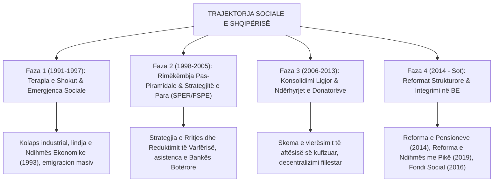

# 📌 Tema 12: Politikat Sociale në Shqipëri dhe Ballkanin Perëndimor

`[[Tema 11 - Bashkimi Evropian dhe Globalizimi në Politikat Sociale|⬅️ Tema 11: BE & Globalizimi]]` | `[[00 - Harta e Lëndës dhe Udhëzuesi i Studimit (MOC)|Indeksi]]` | `[[13 - Banka e Pyetjeve dhe Simulimi i Provimit Final (Master Retrieval)|Banka e Pyetjeve të Provimit ➡️]]`

---

> [!summary] Përmbledhje Ekzekutive
> Ky leksion përmbyllës zbaton të gjitha mjetet e analizës krahasuese mbi realitetin e **Shqipërisë dhe Ballkanit Perëndimor**. Ai analizon trajektoren e mbrojtjes sociale shqiptare: nga rënia e sistemit komunist te tregu i egër i viteve '90, ndikimi i krizës piramidale të 1997-s, roli i **remitancave dhe familjes si rrjetë kryesore mbijetese**, reformat e mëdha të dekadës së fundit (**Reforma e Pensioneve 2014, Reforma e Ndihmës Ekonomike me pikë 2019, Ligji për Shërbimet Shoqërore 121/2016**), si dhe sfidat ekzistenciale të **emigrimit masiv dhe plakjes së shpejtë të popullsisë**.

---

## 🎯 Objektivat e Mësimit
Pas studimit të këtij leksioni, ju do të jeni në gjendje të:
1. Përshkruani fazat historike të evolucionit të politikave sociale në Shqipëri (1991 - sot).
2. Krahasoni treguesit e mbrojtjes sociale në Shqipëri me vendet e rajonit (Kosovë, Maqedoni e V., Serbi) dhe mesataren e BE-së.
3. Zbërtheni reformën e **decentralizimit të shërbimeve shoqërore dhe rolin e Fondit Social**.
4. Analizoni ndikimin e **emigrimit masiv të rinisë** mbi qëndrueshmërinë e skemës së pensioneve dhe kujdesit për të moshuarit.
5. Vlerësoni rolin e profesionit të rregulluar të **Punonjësit Social** në transformimin e shërbimeve në nivel vendor.

---

## 1. Fazat e Zhvillimit të Politikave Sociale në Shqipërinë e Tranzicionit

---

## 2. Krahasimi i Treguesve Socialë: Shqipëria vs. Rajoni dhe BE-ja

| Treguesi Kryesor | Shqipëria | Ballkani Perëndimor (Mesatare) | Bashkimi Evropian (EU-27) |
| :--- | :---: | :---: | :---: |
| **Shpenzimet Sociale (% e PBB-së)** | **~9% - 11%** | ~14% - 17% | **~28% - 30%** |
| **Shpenzimet nga Xhepi në Shëndetësi (OOP)** | **~55% - 60%** | ~35% - 40% | **~15%** |
| **Shkalla e Informalitetit në Punë** | **~30% - 35%** | ~20% - 25% | **~10%** |
| **Të rinjtë NEET (15-29 vjeç)** | **~25%** | ~20% | **~11%** |
| **Roli i Remitancave (% e PBB-së)** | **~8% - 10%** | ~7% - 9% | Neglizhues |

> [!important] Diagnoza Krahasuese
> Shqipëria shpenzon për mbrojtjen sociale **më pak se gjysmën e mesatares së vendeve të BE-së** në raport me madhësinë e ekonomisë së saj. Mbrojtja sociale reale nuk sigurohet nga buxheti i shtetit, por nga **solidariteti i detyruar familjar** dhe **remitancat e dërguara nga mërgata**.

---

## 3. Reformat e Mëdha të Dekadës së Fundit

### A. Reforma e Sigurimeve Shoqërore dhe Pensioneve (2014/2015):
* Hoqi kufizimin absurd të pensionit maksimal (që dekurajonte deklarimin e pagave reale).
* Vendosi **Pensionin Social** për herë të parë në historinë e vendit, duke mbrojtur moshat mbi 70 vjeç nga uria.
* Rriti moshën e pensionit për burrat dhe gratë drejt 67 vjeç deri në vitin 2056.

### B. Reforma e Ndihmës Ekonomike (Ligji 57/2019):
* Zëvendësoi listat me dorë dhe vendimet e këshillave bashkiakë me **Sistemin Elektronik të Pikëzuar (Proxy-Means Test)**.
* Krijoi regjistrin elektronik të integruar që kryqëzon të dhënat me tatimet, bankat dhe regjistrin e makinave.

### C. Ligji 121/2016 "Për Shërbimet e Kujdesit Shoqëror" dhe Fondi Social:
* Detyroi 61 bashkitë e vendit të hartojnë **Planet Sociale Vendore**.
* Ngriti **Fondin Social**, i cili mundëson financimin e shërbimeve të reja ditore për fëmijët me aftësi të kufizuara, viktimat e dhunës dhe të moshuarit e vetmuar (shembulli i Bashkisë Patos).
* Profesionalizoi shërbimin duke kërkuar punësimin e punonjësve socialë të licencuar me urdhër profesional.

---

## 4. Sfidat Ekzistenciale për të Ardhmen

1. **Plakja e Shpejtë e Kombinuar me Emigrimin (Hollimi Demografik)**:
   - Ndërsa të moshuarit mbeten në fshatra dhe qytete të vogla, brezi i ri emigron masivisht. Kush do të kujdeset për të moshuarit në Shqipëri pas 10 vitesh?
2. **Kapacitetet e Kufizuara Fiskale të Bashkive të Vogla**:
   - Shumë bashki nuk kanë buxhet të mjaftueshëm as për të paguar rrogat e administratës, duke e lënë shërbimin social 100% të varur nga grantet e qeverisë qendrore dhe donatorëve të huaj.
3. **Përafrimi me BE-në (Kapitulli 19)**:
   - Kërkon rritjen e buxhetit social, formalizimin e punës dhe garantimin e të drejtave të personave vulnerabël sipas standardeve evropiane.

---

## 📖 Fjalori i Termave Kyç

- **Plani Social Vendor**: Dokument strategjik 3-vjeçar që çdo bashki shqiptare duhet të hartojë për identifikimin e nevojave dhe shërbimeve sociale lokale.
- **Fondi Social**: Skemë financiare e Ministrisë së Shëndetësisë dhe Mbrojtjes Sociale për bashkëfinancimin e shërbimeve shoqërore në bashki.
- **De-institucionalizimi**: Procesi i mbylljes së jetimoreve dhe shtëpive të mëdha të fëmijëve, duke i kaluar ata në familje kujdestare (Foster Care) ose qendra komunitare.
- **Pensioni Social**: Pagesë mujore fikse nga buxheti i shtetit për qytetarët e moshuar pa të ardhura dhe pa sigurime.
- **NEET në Shqipëri**: Përqindja e lartë e rinisë shqiptare jashtë tregut të punës dhe sistemit arsimor.

---

## 🧠 Seksioni i Memorizimit & Retrieval Practice

### 🔹 Flashcards të Fshehura (Kliko për Përgjigjen)

> [!question]- Pyetja 1: Cilat janë 3 veçoritë specifike që e dallojnë sistemin e mbrojtjes sociale në Shqipëri nga vendet e Bashkimit Evropian?
> **Përgjigjja:**
> 1. **Nivel tejet i ulët i shpenzimeve sociale publike** (rreth 9-11% të PBB-së, krahasuar me 28-30% në BE).
> 2. **Nivel shumë i lartë i shpenzimeve direkte nga xhepi (Out-of-Pocket) në shëndetësi** (mbi 55-60%, krahasuar me 15% në BE).
> 3. **Varësi jetike nga burimet jozyrtare**: Solidariteti i detyruar familjar, remitancat e emigrantëve dhe shërbimet e ofruara nga OJQ-të zëvendësojnë shërbimet e munguara publike.

> [!question]- Pyetja 2: Cili është qëllimi dhe funksionimi i "Fondit Social" sipas Ligjit 121/2016 në Shqipëri?
> **Përgjigjja:**
> Fondi Social është një mekanizëm grantesh i qeverisë qendrore që bashkëfinancon projektet e bashkive për ngritjen e shërbimeve të reja komunitare (qendra ditore, kujdes në shtëpi, strehëza). Ai kërkon që bashkia të hartojë Planin Social Vendor dhe të sigurojë një përqindje bashkëfinancimi lokal.

> [!question]- Pyetja 3: Cila është lidhja midis shkallës së lartë të informalitetit në tregun e punës dhe deficitit të skemës së pensioneve në Shqipëri?
> **Përgjigjja:**
> Duke qenë se mbi 30-35% e punonjësve punojnë në të zezë ose deklarohen me pagë minimale fiktive, ata nuk derdhin kontribute të mjaftueshme në arkën e Institutit të Sigurimeve Shoqërore (ISSH). Si pasojë, paratë e mbledhura nuk mjaftojnë për të paguar pensionet e pensionistëve aktualë, dhe shteti detyrohet të mbulojë deficitin çdo vit nga taksat e përgjithshme.

---

### 🔹 Flashcards për Obsidian Spaced Repetition (Plugin)
Sistemi i Mbrojtjes Sociale në Shqipëri:: Model hibrid post-komunist i nënfinancuar, me informalitet të lartë dhe varësi nga remitancat.
Fondi Social Shqiptar:: Mekanizëm buxhetor shtetëror për hapjen dhe bashkëfinancimin e shërbimeve shoqërore në 61 bashkitë.
De-institucionalizimi në Shqipëri:: Kalimi i fëmijëve dhe personave me aftësi të kufizuara nga institucionet e mbyllura në shërbime komunitare e familje kujdestare.
Pensioni Social:: Mbështetje financiare minimale për qytetarët mbi 70 vjeç pa vite pune të siguruara.

---

### 🔹 Plotëso Vendet Bosh (Cloze Recall)
1. Shpenzimet e mbrojtjes sociale në Shqipëri përbëjnë rreth ==9% deri 11%== të PBB-së.
2. Pagesat e qytetarëve nga xhepi për shëndetësinë në Shqipëri arrijnë në mbi ==55% - 60%== të totalit.
3. Ligji që ngriti Fondin Social dhe decentralizoi shërbimet e kujdesit shoqëror është Ligji ==121/2016==.
4. Paratë që emigrantët dërgojnë në atdhe dhe që funksionojnë si mbrojtje sociale private quhen ==remitanca==.

---

### 🔹 Checklist për Vetë-Vlerësim
- [ ] Di të krahasoj treguesit kryesorë socialë të Shqipërisë me ata të BE-së.
- [ ] Mund të shpjegoj tre reformat madhore sociale të dekadës së fundit në Shqipëri.
- [ ] Kuptoj sfidën e madhe demografike të plakjes dhe emigrimit për politikat sociale.
