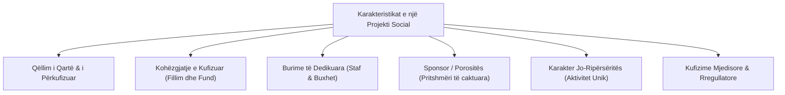
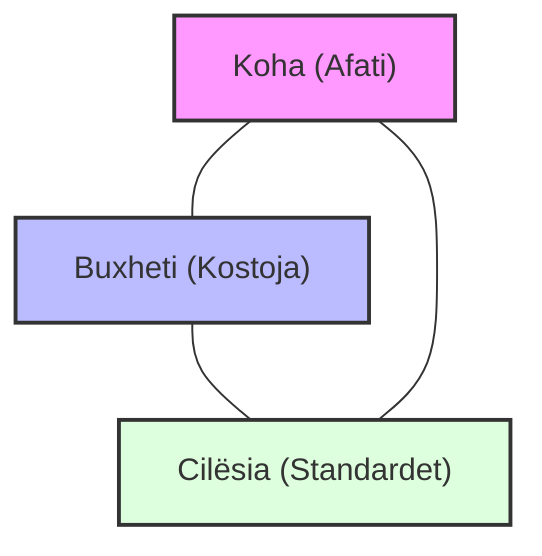
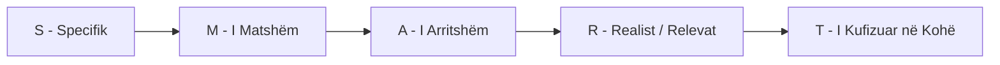

# 📌 Tema 01: Çfarë është një Projekt Social?

`[[00 - Harta e Lëndës dhe Udhëzuesi i Studimit (MOC)|⬅️ Kthehu tek Harta e Lëndës]]` | `[[Tema 02 - Qëllimi dhe Fusha e Projektit (Scope)|Tema 02: Qëllimi dhe Fusha e Projektit ➡️]]`

---

> [!summary] Përmbledhje Ekzekutive
> Një **projekt** në fushën e shërbimeve sociale dhe shëndetësore është një sipërmarrje e përkohshme, e dallueshme qartë nga rutina e përditshme administrative, e cila synon të sjellë një ndryshim pozitiv brenda kufizimeve të përcaktuara të **kohës**, **buxhetit** dhe **standardeve të cilësisë**. Suksesi i tij varet nga balancimi i këtij trekëndëshi kufizues së bashku me vëmendjen ndaj **njerëzve** (përfituesve dhe stafit) dhe qartësimin e **objektivave SMART**.

---

## 🎯 Objektivat e Mësimit
Pas përvetësimit të këtij leksioni, ju do të jeni në gjendje të:
1. Dalloni saktë një projekt nga puna e përditshme operacionale (rutinë).
2. Përkufizoni karakteristikat thelbësore të një projekti në shërbimet sociale dhe shëndetësore.
3. Shpjegoni rolin e projekteve si mekanizma kyç për **menaxhimin e ndryshimit**.
4. Analizoni dimensionet thelbësore: **Koha**, **Buxheti**, **Cilësia**, **Njerëzit** dhe **Rezultatet**.
5. Formuloni synime dhe objektiva sipas kriterit **SMART**.
6. Identifikoni faktorët kryesorë që përcaktojnë suksesin ose dështimin e një projekti social.

---

## 1. Konteksti i Shërbimeve Sociale dhe Shëndetësore

Në organizatat e përkujdesit social dhe shëndetësisë në Shqipëri dhe ndërkombëtarisht, shërbimet janë në qendër të vëmendjes publike për shkak se prekin drejtpërdrejt mirëqenien e grupeve vulnerabël (fëmijët, të moshuarit, personat me aftësi të kufizuara, individët me probleme të shëndetit mendor).

### Faktorët e Presionit për Ndryshim:
* **Ndryshimet demografike**: Plakja e popullsisë, migracioni dhe ndryshimi i strukturës familjare.
* **Kufizimet buxhetore**: Nevoja për të bërë më shumë me më pak burime financiare publike.
* **Rritja e pritshmërive të qytetarëve**: Kërkesa për shërbime më cilësore, transparente dhe të personalizuara.
* **Standardet e reja ligjore**: Ligji për Shërbimet Shoqërore, decentralizimi dhe krijimi i Fondit Social.

> [!important] Parim Themelor
> **Projektet janë mjeti kryesor përmes të cilit organizatat e shërbimeve shoqërore menaxhojnë ndryshimin.** Ndërsa ndryshimi organizativ mund të jetë i gjerë dhe kompleks, një projekt merr një aspekt specifik dhe të menaxhueshëm të atij ndryshimi.

---

## 2. Përkufizimi dhe Karakteristikat e një Projekti

Termi **"Projekt"** përdoret për t'iu referuar një aktiviteti që **nuk është pjesë e operacioneve të përditshme**, por ka një qëllim të caktuar dhe karakter unik.

### Karakteristikat Kryesore:
1. **Qëllim i qartë**: Synon një zgjidhje konkrete ose përmirësim të një situate të caktuar sociale.
2. **Afat i kufizuar**: Ka një datë fillimi dhe një datë përfundimi të paracaktuar.
3. **Burime të kufizuara**: Operon me staf, pajisje dhe fonde specifike të ndara posaçërisht për të.
4. **Ekzistenca e një sponsori/donatori**: Një entitet (Ministri, Bashki, Donator ndërkombëtar) që financon dhe pret llogaridhënie.
5. **Natyra unike (jo-rutinë)**: Nuk është aktivitet ciklik i përditshëm; sapo arrihet rezultati, projekti mbyllet.

### Tabela Krahasuese: Projekt vs. Punë Operative (Rutina)

| Karakteristika | Punë Operative (Rutina e Përditshme) | Projekt Social |
| :--- | :---: | :---: |
| **Qëllimi** | Ruajtja e vazhdimësisë së shërbimit ekzistues | Arritja e një ndryshimi ose krijimi i diçkaje të re |
| **Kufiri Kohor** | E vazhdueshme, e përsëritshme, pa afat fundor | E përkohshme, me afat të përcaktuar qartë fillimi dhe fundi |
| **Struktura e Ekipit** | Departamente funksionale hierarkike | Ekip multidisiplinar i përkohshëm |
| **Niveli i Pasigurisë** | I ulët; procedurat janë standarde | I lartë; përmban rreziqe dhe të papritura të reja |
| **Menaxhimi** | Mbikëqyrje e proceseve të përditshme | Menaxhim ndryshimi, koordinim dhe zgjidhje problemesh |

---

## 3. Dimensionet Kryesore të një Projekti: Trekëndëshi i Kufizimeve

Çdo projekt zhvillohet brenda një trekëndëshi tensionesh, ku ndryshimi i njërit dimension ndikon menjëherë dy të tjerët:

1. **Koha (Afati)**: Kohëzgjatja nga fillimi deri në dorëzim. Vonesat shkaktojnë kosto shtesë dhe humbje besimi te donatori.
2. **Buxheti (Kostoja)**: Fondi monetar në dispozicion. Tejkalimi i buxhetit mund të paralizojë organizatën.
3. **Cilësia (Standardet)**: Përmbushja e specifikimeve dhe nevojave reale të përfituesve. Në shërbimet sociale, ulja e cilësisë dëmton drejtpërdrejt jetën e qytetarëve.

### Dy Dimensionet Plotësuese në Shërbimet Sociale:
* **Njerëzit (Dimensioni Njerëzor)**: Projektet sociale zbatohen nga njerëz për njerëz. Kërkohet empati, motivim stafi, etiko-profesionalizëm dhe përfshirje e komunitetit.
* **Rezultatet dhe Rezultatet e Shumëfishta**: Përveç rezultatit të drejtpërdrejtë (p.sh. hapja e një qendre ditore), projekti sjell rezultate sekondare: ngritje kapacitetesh, ndërgjegjësim qytetar, bashkëpunim ndërinstitucional.

> [!example] Shembulli 1.4 nga Leksionet: Projekti i Pabalancuar
> Një njësi shërbimesh sociale donte të hapte me shpejtësi një qendër komunitare për fëmijët me aftësi të kufizuara brenda 3 muajve me buxhet minimal. Për të respektuar kohën dhe koston, u reduktuan trajnimet e stafit dhe u modifikuan sipërfaqësisht mjediset. Rezultati: Brenda një muaji pas hapjes, qendra pati ankesa të shumta nga prindërit për mungesë sigurie dhe cilësie shërbimi, duke detyruar mbylljen e përkohshme dhe shpenzimin e fondeve të dyfishta për riparim. Ky rast vërteton se kompromentimi i cilësisë shkatërron suksesin e projektit.

---

## 4. Synimet vs. Objektivat SMART

Dallimi midis synimit dhe objektivit është themelor në menaxhim:
* **Synimi (Aim / Goal)**: Përshkruan drejtimin e përgjithshëm strategjik, gjendjen e dëshiruar në të ardhmen (p.sh. *"Përmirësimi i cilësisë së jetës për të moshuarit e vetmuar në Bashkinë Patos"*).
* **Objektivat (Objectives)**: Hapat operacionalë, konkretë dhe të matshëm që nevojiten për të arritur synimin.

### Kriteret SMART:
* **S (Specific - Specifike)**: Përcakton saktë çfarë do të bëhet, kush përfiton dhe ku.
* **M (Measurable - Të matshme)**: Ka tregues sasiorë dhe cilësorë (sa përfitues, sa përqind përmirësim).
* **A (Achievable - Të arritshme)**: Është e mundur të realizohet me stafin dhe kapacitetet ekzistuese.
* **R (Realistic/Relevant - Realiste & Përkatëse)**: Përputhet me nevojat reale të komunitetit dhe mundësitë financiare.
* **T (Time-bound - Të kufizuara në kohë)**: Ka afat të qartë përfundimi (p.sh. *"brenda 6 muajve të parë"*).

> [!example] Krahasimi i një Objektivi të Paqartë me një SMART
> ❌ **I Paqartë**: *"Do të ndihmojmë fëmijët e varfër të qytetit të kenë mbështetje mësimore."*
>  **SMART**: *"Brenda 10 muajve të vitit shkollor 2026-2027, të ofrohen 120 orë mësim plotësues pas-shkollor dhe 1 vakt ushqimor ditor për 45 fëmijë të familjeve në skemën e ndihmës ekonomike në Lagjen 1 të qytetit."*

---

## 5. Faktorët e Suksesit të një Projekti Social

Sipas literaturës së lëndës (Rama & Sota; Panariti), suksesi nuk matet vetëm nga dorëzimi formal i letrave, por nga këta faktorë:
1. **Përcaktimi i qartë i qëllimit dhe objektivave që në krye të herës**.
2. **Përfshirja e stakeholderave dhe dëgjimi i përfituesve direktë**.
3. **Lidership i fortë dhe komunikim i vazhdueshëm brenda ekipit**.
4. **Vlerësim realist i kohës dhe kostove (shmangia e optimizmit naiv)**.
5. **Menaxhim proaktiv i risqeve** (të mos presësh krizën për të reaguar).
6. **Mbështetja e palëkundur nga sponsori/donatori**.

---

## 📖 Fjalori i Termave Kyç

- **Projekt Social**: Sipërmarrje e përkohshme me qëllim adresimin e një nevoje specifike shoqërore, me fillim e mbarim të qartë.
- **Trekëndëshi i Kufizimeve**: Marrëdhënia e ndërsjellë midis Kohës, Kostos dhe Cilësisë në menaxhimin e projektit.
- **Sponsor / Donator**: Individi, institucioni apo agjencia financuese që komisionon projektin dhe kërkon llogaridhënie.
- **Objektiva SMART**: Metodologji e formulimit të objektivave: Specifike, të Matshme, të Arritshme, Realiste dhe me Afat Kohor.
- **Puna Operative**: Veprimtaria e përditshme administrative, e vazhdueshme dhe e përsëritshme e një organizate.

---

## 🧠 Seksioni i Memorizimit & Retrieval Practice

> [!tip] Udhëzim për Vetë-Testim
> Përpara se të lexoni përgjigjet e fshehura në kutitë e mëposhtme, përpiquni t'i përgjigjeni pyetjes me zë të lartë ose ta shkruani në bllokun tuaj. Vetëm atëherë klikoni për të hapur callout-in!

### 🔹 Flashcards të Fshehura (Klikoni mbi shigjetën për përgjigjen)

> [!question]- Pyetja 1: Cilat janë 5 karakteristikat thelbësore që dallojnë një projekt nga puna e përditshme?
> **Përgjigjja:**
> 1. Ka një **qëllim të qartë** dhe të përcaktuar mirë.
> 2. Ka një **afat të kufizuar** kohor (datë fillimi dhe mbarimi).
> 3. Ka **burime të dedikuara** (staf dhe buxhet specifik).
> 4. Ka një **sponsor/donator** që pret rezultate konkrete.
> 5. Është një aktivitet **unik, jo-ripërsëritës** (nuk është punë rutinë).

> [!question]- Pyetja 2: Cilat janë tri brinjët e "Trekëndëshit të Hekurt" dhe çfarë ndodh nëse shkurtohet koha pa shtuar burimet?
> **Përgjigjja:**
> Tri brinjët janë: **Koha**, **Kostoja (Buxheti)** dhe **Cilësia (Standardet)**.
> Nëse shkurtohet koha pa rritur buxhetin (pa shtuar staf/pajisje), rënia bie automatikisht mbi **Cilësinë**, e cila do të degradojë dhe mund të çojë në dështimin e shërbimit social.

> [!question]- Pyetja 3: Cili është dallimi thelbësor midis një Synimi (Aim) dhe një Objektivi (Objective)?
> **Përgjigjja:**
> **Synimi** përfaqëson drejtimin e përgjithshëm strategjik, gjendjen e dëshiruar në të ardhmen (qëllimin final).
> **Objektivat** janë hapat konkretë, të prekshëm, të matshëm dhe të kufizuar në kohë (SMART) që duhen përmbushur për të bërë realitet atë synim.

> [!question]- Pyetja 4: Çfarë nënkupton çdo shkronjë e akronimit SMART në formulimin e objektivave?
> **Përgjigjja:**
> - **S** - Specifike (Specific)
> - **M** - E Matshme (Measurable)
> - **A** - E Arritshme (Achievable)
> - **R** - Realiste / Relevante (Realistic/Relevant)
> - **T** - E Kufizuar në Kohë (Time-bound)

---

### 🔹 Flashcards për Obsidian Spaced Repetition (Plugin)
Projekt Social:: Një sipërmarrje e përkohshme e ndërmarrë për të krijuar një shërbim ose rezultat unik social brenda kufizimeve të kohës, kostos dhe cilësisë.
Trekëndëshi i Menaxhimit të Projektit:: Balanca midis Kohës, Buxhetit (Kostos) dhe Cilësisë së projektit.
SMART:: Specifike, e Matshme, e Arritshme, Realiste, e Kufizuar në Kohë.
Dallimi Projekt vs Rutinë:: Projekti është i përkohshëm dhe unik me qëllim ndryshimin; rutina është e vazhdueshme dhe e përsëritshme me qëllim mirëmbajtjen e funksionimit ekzistues.

---

### 🔹 Plotëso Vendet Bosh (Cloze Recall)
1. Projektet në shërbimet sociale shërbejnë si mekanizma për menaxhimin e ==ndryshimit== organizativ.
2. Tre kufizimet kryesore tradicionale të çdo projekti janë ==koha==, ==buxheti== dhe ==cilësia==.
3. Në shërbimet sociale, përveç trekëndëshit tradicional, thelbësore janë dimensionet e ==njerëzve== dhe ==rezultateve==.
4. Një objektiv i formuluar mirë duhet të plotësojë 5 kriteret e akronimit ==SMART==.

---

### 🔹 Checklist për Vetë-Vlerësim
- [ ] Mund të dalloj pa hezituar një detyrë operative nga një projekt social.
- [ ] Mund të vizatoj dhe shpjegoj trekëndëshin e kufizimeve të projektit.
- [ ] Mund të shkruaj nga e para një objektiv SMART për një shërbim social.
- [ ] Mbaj mend të paktën 5 faktorë suksesi të një projekti.
