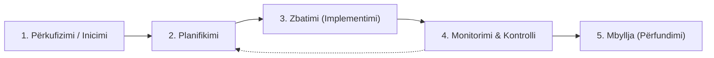
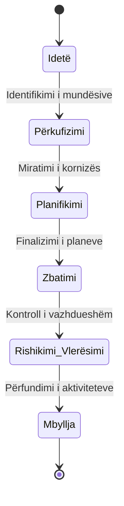

# 📌 Tema 02: Qëllimi dhe Fusha e Projektit (Scope)

`[[Tema 01 - Çfarë është një Projekt Social|⬅️ Tema 01: Çfarë është një Projekt Social]]` | `[[00 - Harta e Lëndës dhe Udhëzuesi i Studimit (MOC)|Indeksi]]` | `[[Tema 03 - Marrja e Vendimeve të Bazuara në Informacion|Tema 03: Marrja e Vendimeve ➡️]]`

---

> [!summary] Përmbledhje Ekzekutive
> Përcaktimi i **fushës (scope)** përbën kufirin që ndan atë çfarë bën dhe çfarë **nuk bën** një projekt. Në organizatat sociale, presioni për të ndihmuar të gjithë shpesh çon në fenomenin shkatërrues të **"Scope Creep"** (zgjerimit të pakontrolluar të projektit). Për të ruajtur kontrollin, menaxhimi i projektit mbështetet në dy modele kryesore: **Modeli i Ciklit të Jetës me 5 Faza** dhe **Modeli Klasik 6-Fazësh**.

---

## 🎯 Objektivat e Mësimit
Pas studimit të këtij leksioni, ju do të jeni në gjendje të:
1. Përkufizoni konceptin e **Fushës së Projektit (Project Scope)** dhe rëndësinë e kufijve të qartë.
2. Identifikoni rreziqet e mungesës së kufijve dhe kuptoni fenomenin **Scope Creep**.
3. Shpjegoni dhe skiconi **Modelin e Ciklit të Jetës me 5 Faza**.
4. Shpjegoni dhe krahasoni **Modelin Klasik 6-Fazësh të Menaxhimit të Projektit**.
5. Zbatoni modelet e ciklit të jetës për të strukturuar një ide konkrete projekti në shërbimet sociale.

---

## 1. Përcaktimi i Qëllimit dhe Fushës së Projektit (Project Scope)

Një nga gabimet më të shpeshta në fazat nismëtare është dëshira për të zgjidhur shumë probleme njëherazi. Shërbimet sociale përballen me nevoja të pafundme, por projektet disponojnë **burime dhe kohë të kufizuar**.

### Pse është thelbësor përcaktimi i fushës?
* **Përcakton kufijtë e saktë**: Tregon qartë çfarë përfshihet brenda projektit dhe çfarë mbetet jashtë tij.
* **Mbron nga mbingarkesa**: Parandalon shpërndarjen e panevojshme të energjive të stafit.
* **Krijon marrëveshje të përbashkët**: Siguron që donatori, menaxheri, stafi dhe përfituesit të kenë të njëjtat pritshmëri.

> [!warning] Rreziku Kryesor: "Scope Creep" (Zvarritja/Zgjerimi i Pakontrolluar i Fushës)
> **Scope Creep** ndodh kur kërkesa, aktivitete apo përfitues të rinj i shtohen vazhdimisht projektit pas fillimit të tij, pa rritur përkatësisht as **kohën**, as **buxhetin**. Në shërbimet sociale, kjo ndodh nga ndjeshmëria e punonjësve socialë ("hajde të ndihmojmë edhe këtë grup tjetër"). Rezultati është djegia profesionale (burnout) e stafit, mbarimi i buxhetit para kohe dhe dështimi i projektit.

### Çfarë ndodh nëse nuk përcaktohet fusha?
1. Qëllimet mbeten të paqarta dhe interpretohen sipas qejfit nga aktorë të ndryshëm.
2. Projektet zvarriten në pafundësi pa arritur asnjëherë një përfundim zyrtar.
3. Donatori ndihet i zhgënjyer sepse produktet fillestare të premtuara nuk dorëzohen.

---

## 2. Modeli i Ciklit të Jetës së Projektit (5 Fazat)

Cikli i jetës së një projekti përfaqëson rrugëtimin e plotë të një nisme që nga lindja e idesë deri te mbyllja dhe vlerësimi përfundimtar.

### Karakteristikat e 5 Fazave:

1. **Faza 1: Përkufizimi (Inicimi)**
   - Identifikohet nevoja dhe gjenerohet ideja e projektit.
   - Përcaktohet qëllimi dhe fizibiliteti paraprak.
   - Merret aprovimi fillestar nga drejtuesit ose donatori.

2. **Faza 2: Planifikimi**
   - Hartohet plani i detajuar: aktivitetet, përgjegjësitë, afatet dhe grafiku kohor.
   - Ndërtohet buxheti i hollësishëm dhe llogariten burimet e nevojshme.
   - Analizohen risqet dhe përcaktohet plani i kontigjencës.

3. **Faza 3: Zbatimi (Implementimi)**
   - Ekipi fillon kryerjen e aktiviteteve praktike në terren (p.sh. trajnimet, shpërndarja e ndihmave, ngritja e shërbimit).
   - Konsumohet pjesa më e madhe e buxhetit dhe kohës.

4. **Faza 4: Monitorimi dhe Kontrolli**
   - Zhvillohet paralelisht me zbatimin.
   - Krahasohet ecuria reale me planin fillestar (A jemi brenda buxhetit? A po ecim sipas grafikut?).
   - Ndërmerren veprime korrigjuese nëse ka devijime.

5. **Faza 5: Mbyllja (Përfundimi)**
   - Dorëzohen produktet përfundimtare te sponsori ose komuniteti.
   - Mbyllen llogaritë financiare dhe lirohet/shpërndahet ekipi.
   - Realizohet vlerësimi përfundimtar dhe dokumentohen mësimet e nxjerra.

---

## 3. Modeli Klasik 6-Fazësh i Menaxhimit të Projektit

Teksti universitar (Rama & Sota) përshkruan gjithashtu **Modelin Klasik me 6 Faza**, i cili e thellon më tej strukturën e menaxhimit:

### Përshkrimi i 6 Fazave Klasike:
1. **Idetë (Ideas)**: Lindja e ideve të ndryshme bazuar në nevojat e komunitetit. Zgjedhja e idesë më prioritare dhe më premtuese.
2. **Përkufizimi (Definition)**: Përcaktimi i synimeve, fushës dhe kufijve. Përgatitja e propozimit fillestar (Project Brief) për donatorin.
3. **Planifikimi (Planning)**: Zbërthimi i hollësishëm i detyrave (WBS), alokimi i roleve, programimi në kohë (Gantt) dhe buxhetimi.
4. **Zbatimi (Execution / Implementation)**: Mobilizimi i ekipit, menaxhimi i komunikimit dhe realizimi i punës së përditshme të projektit.
5. **Rishikimi dhe Vlerësimi (Review & Evaluation)**: Monitorimi i progresit, matja e rezultateve kundrejt indikatorëve dhe vlerësimi i impaktit.
6. **Mbyllja (Closure)**: Dorëzimi zyrtar i shërbimit, arkivimi i dokumentacionit, festimi i arritjeve dhe nxjerrja e mësimeve.

---

## 4. Modelet si Vegla Përcaktimi dhe Shmangia e Gabimeve

Pse menaxherët përdorin këto modele?
* **Si hartë navigimi**: Të kuptosh gjithmonë se në cilën pikë të projektit ndodhesh.
* **Si listë kontrolli (checklist)**: Të sigurohesh që nuk po kapërcen direkt te zbatimi pa bërë planifikimin e duhur.
* **Për të menaxhuar tranzicionet**: Çdo kalim nga një fazë në tjetrën kërkon një vendim ("Go / No-Go checkpoint").

> [!example] Shembulli 2.1 nga Leksionet: Entela dhe Qendra e Këshillimit
> Entela, një drejtuese shërbimi social, mori fonde për ngritjen e një shërbimi të ri këshillimi për gratë e dhunuara. Fillimisht, ajo donte të niste menjëherë punën me klientët. Duke përdorur modelin e ciklit të jetës, ajo kuptoi se pa kaluar fazën e *Përkufizimit* (kush konsiderohet grua e dhunuar, çfarë shërbimesh do të jepen dhe cilat do të referohen te policia/spitali) dhe të *Planifikimit* (trajnimi i stafit për protokollin e sigurisë), nisma do të rrezikonte jetën e klienteve. Modeli e shpëtoi projektin nga dështimi fatal.

---

## 📖 Fjalori i Termave Kyç

- **Fusha e Projektit (Project Scope)**: Tërësia e produkteve, shërbimeve dhe kufijve të punës që do të kryhen gjatë projektit.
- **Scope Creep**: Zgjerimi gradual dhe i pakontrolluar i fushës së projektit pa miratim zyrtar dhe pa shtim të buxhetit/kohës.
- **Cikli i Jetës së Projektit**: Sekuenca e fazave kronologjike përmes të cilave kalon një projekt nga fillimi deri në mbyllje.
- **Inicimi (Përkufizimi)**: Faza e parë ku përcaktohet arsyeja e ekzistencës së projektit dhe miratohet autorizimi i tij.
- **Pika e Kontrollit (Checkpoint / Gate)**: Moment vendimmarrës midis dy fazave ku vlerësohet nëse projekti mund të ecë përpara.

---

## 🧠 Seksioni i Memorizimit & Retrieval Practice

### 🔹 Flashcards të Fshehura (Kliko për Përgjigjen)

> [!question]- Pyetja 1: Çfarë nënkupton termi "Fushë e Projektit" (Project Scope) dhe pse është i rëndësishëm kufiri "çfarë NUK bën projekti"?
> **Përgjigjja:**
> Fusha e projektit përcakton kufijtë e saktë të punës, produktet dhe shërbimet që do të dorëzohen. Përcaktimi i asaj që **nuk** bën projekti është po aq jetik sa ajo që bën, sepse parandalon keqkuptimet e donatorëve/përfituesve dhe frenon mbingarkesën e stafit.

> [!question]- Pyetja 2: Çfarë është "Scope Creep" dhe cili është shkaku kryesor i tij në projektet sociale?
> **Përgjigjja:**
> Scope Creep është shtimi i pakontrolluar i detyrave, kërkesave dhe përfituesve të rinj pa rritur kohën dhe buxhetin. Në fushën sociale, shkaku kryesor është presioni emocional dhe dëshira e mirë e punonjësve për të mos refuzuar askënd në nevojë, çka çon në mbarimin para kohe të burimeve.

> [!question]- Pyetja 3: Cilët janë 5 hapat e Modelit të Ciklit të Jetës së një Projekti?
> **Përgjigjja:**
> 1. Përkufizimi (Inicimi)
> 2. Planifikimi
> 3. Zbatimi (Implementimi)
> 4. Monitorimi dhe Kontrolli
> 5. Mbyllja (Përfundimi)

> [!question]- Pyetja 4: Cilat janë 6 fazat e Modelit Klasik të Menaxhimit të Projektit?
> **Përgjigjja:**
> 1. Idetë (Ideas)
> 2. Përkufizimi (Definition)
> 3. Planifikimi (Planning)
> 4. Zbatimi (Execution)
> 5. Rishikimi dhe Vlerësimi (Review & Evaluation)
> 6. Mbyllja (Closure)

---

### 🔹 Flashcards për Obsidian Spaced Repetition (Plugin)
Scope Creep:: Zgjerimi i pakontrolluar i fushës së projektit pa shtuar kohë dhe buxhet përkatës.
Fusha e Projektit (Scope):: Tërësia e aktiviteteve dhe produkteve të përcaktuara që përfshihen brenda kufijve të një projekti.
5 Fazat e Ciklit të Jetës:: Përkufizimi, Planifikimi, Zbatimi, Monitorimi/Kontrolli, Mbyllja.
Roli i Modelit Klasik:: Siguron një strukturë hap-pas-hapi për të garantuar se ideja vlerësohet, planifikohet, zbatohet dhe rishikohet para mbylljes.

---

### 🔹 Plotëso Vendet Bosh (Cloze Recall)
1. Kufiri midis asaj që përfshihet dhe nuk përfshihet në projekt quhet ==fusha e projektit (scope)==.
2. Zgjerimi i vazhdueshëm i aktiviteteve pa burime shtesë njihet si ==scope creep==.
3. Faza ku konsumohet pjesa më e madhe e kohës dhe buxhetit është faza e ==zbatimit (implementimit)==.
4. Vendimet midis fazave të një projekti shpesh quhen porta vendimmarrjeje ose ==pika kontrolli (checkpoints)==.

---

### 🔹 Checklist për Vetë-Vlerësim
- [ ] Mund të shpjegoj konceptin e Scope dhe rrezikun e Scope Creep.
- [ ] Mund të rendis përmendsh 5 fazat e ciklit të jetës.
- [ ] Mund të rendis 6 fazat e modelit klasik.
- [ ] Di të shpjegoj pse kalimi direkt nga ideja te zbatimi pa planifikim është shkatërrues.
