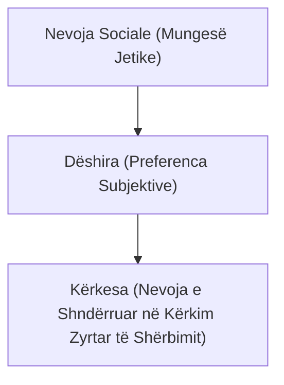
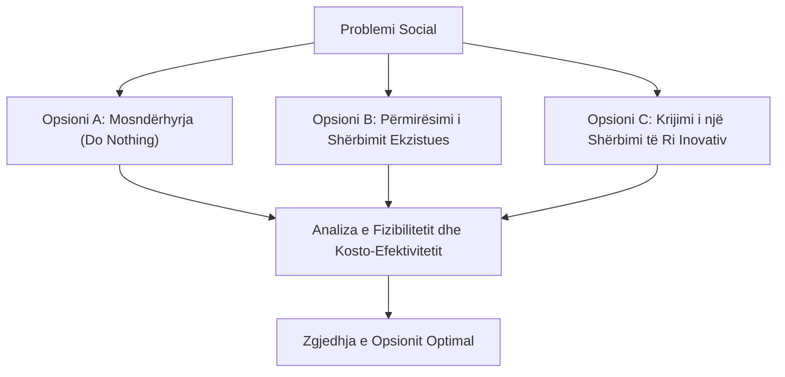

# 📌 Tema 03: Marrja e Vendimeve të Bazuara në Informacion

`[[Tema 02 - Qëllimi dhe Fusha e Projektit (Scope)|⬅️ Tema 02: Qëllimi dhe Fusha e Projektit]]` | `[[00 - Harta e Lëndës dhe Udhëzuesi i Studimit (MOC)|Indeksi]]` | `[[Tema 04 - Përcaktimi dhe Korniza e Projektit (Charter & Stakeholders)|Tema 04: Përcaktimi dhe Korniza ➡️]]`

---

> [!summary] Përmbledhje Ekzekutive
> Vendimi për të nisur një projekt social nuk mund të bazohet thjesht në intuitë apo entuziazëm personal, por kërkon prova rigoroze të bazuara në të dhëna reale. Tre pyetjet kyçe nismëtare janë: **(1) A adreson projekti një nevojë reale? (2) A përputhet me misionin dhe planin strategjik të organizatës? (3) A është projekti i realizueshëm (fizibiliteti teknik, operacional dhe financiar)?** Mjetet kryesore përfshijnë **Vlerësimin e Nevojave (Needs Assessment)**, **Analizën Kosto-Efektivitet** dhe **Studimin Pilot**.

---

## 🎯 Objektivat e Mësimit
Pas studimit të këtij leksioni, ju do të jeni në gjendje të:
1. Analizoni dhe dalloni konceptet: **Nevojë**, **Dëshirë** dhe **Kërkesë**.
2. Shpjegoni tipologjinë e nevojave sociale sipas Bradshaw: **Normative**, **E Ndjerë**, **E Shprehur** dhe **Krahasuese**.
3. Vlerësoni përshtatshmërinë strategjike të projektit me planin e biznesit dhe misionin e organizatës.
4. Kryeni analizën e opsioneve alternative dhe analizën **Kosto-Përfitim / Kosto-Efektivitet**.
5. Përcaktoni dimensionet e **Fizibilitetit** (a ia vlen dhe a mund të bëhet?).
6. Shpjegoni qëllimin, avantazhet dhe rreziqet e një **Studimi Pilot**.

---

## 1. A Adreson Projekti një Nevojë Reale?

Në shërbimet sociale dhe të shëndetit publik, një projekt duhet të justifikojë çdo qindarkë të investuar duke provuar se po zgjidh një problem të prekshëm shoqëror.

### Nevojat vs. Dëshirat vs. Kërkesat:
* **Nevoja (Need)**: Një mungesë thelbësore që lidhet me mbijetesën, shëndetin, sigurinë apo integrimin dinjitoz të individit (p.sh. mungesa e strehimit për fëmijët e rrugës).
* **Dëshira (Want)**: Mënyra se si individët preferojnë ta plotësojnë një nevojë (p.sh. dëshira për një qendër me ambiente luksoze argëtimi).
* **Kërkesa (Demand)**: Nevoja e artikuluar qartë nga qytetarët, e cila shoqërohet me gatishmërinë për të përdorur dhe kërkuar shërbimin.

### Tipologjia e Nevojave Sociale (Modeli i Bradshaw):
1. **Nevoja Normative**: E përcaktuar nga ekspertët ose standardet ligjore (p.sh. standardi i Ministrisë: 1 punonjës social për 3,000 banorë).
2. **Nevoja e Ndjerë (Felt Need)**: Ajo çfarë vetë njerëzit në komunitet përjetojnë dhe thonë se u mungon (identifikohet me pyetësorë e fokus-grupe).
3. **Nevoja e Shprehur (Expressed Need)**: Nevoja e ndjerë e kthyer në veprim (p.sh. lista e pritjes në një çerdhe publike ose numri i kërkesave për ndihmë ekonomike).
4. **Nevoja Krahasuese (Comparative Need)**: Zbulohet duke krahasuar dy zona apo komunitete të ngjashme (p.sh. Bashkia A ofron qendër ditore për të moshuarit, ndërsa Bashkia B me të njëjtën popullsi nuk ka asnjë shërbim të tillë).

> [!important] Rëndësia e Vlerësimit të Nevojave (Needs Assessment)
> Vlerësimi i nevojave mbledh të dhëna sasiore (statistika zyrtare, INSTAT, të dhëna bashkiake) dhe cilësore (intervista, takime komunitare). Pa një vlerësim nevojash, rrezikohet të ndërtohet një shërbim që askush nuk e përdor!

---

## 2. Përshtatshmëria Strategjike (Lidhja me Misionin e Organizatës)

Një projekt mund të adresojë një nevojë të vërtetë, por mund të mos jetë i përshtatshëm për organizatën tuaj.

### Pyetjet Kryesore të Përshtatshmërisë:
* A përputhet projekti me **misionin themelor** të organizatës sonë?
* A kemi ne mandatin ligjor dhe ekspertizën profesionale për këtë fushë?
* A kontribuon projekti në arritjen e objektivave të Planit Strategjik / Planit të Biznesit?

> [!example] Shembulli 3.1 nga Leksionet: Rreziku i Humbjes së Misionit
> Një shoqatë që merret ekskluzivisht me mbrojtjen e të drejtave të fëmijëve jetimë aplikoi për një grant të majmë donatori për riciklimin e mbetjeve urbane, me arsyetimin se "fondet janë fonde". Rezultati: Organizata shpërdoroi burimet njerëzore, stafi nuk kishte njohuri për mjedisin dhe humbi donatorët tradicionalë të fushës së fëmijëve, duke dëmtuar reputacionin e saj profesional.

---

## 3. Vlerësimi i Opsioneve dhe Analiza Kosto-Përfitim

Për çdo problem social ekzistojnë disa rrugëzgjidhje të ndryshme. Menaxheri duhet të analizojë të paktën 2-3 opsione para se të vendosë.

### Kriteret e Vlerësimit të Opsioneve:
1. **Kosto-Efektiviteti (Cost-Effectiveness)**: Cili opsion sjell ndikimin më të madh social me koston më të arsyeshme për përfitues?
2. **Pranueshmëria nga Komuniteti**: A është zgjidhja kulturalisht e pranueshme për përfituesit?
3. **Qëndrueshmëria (Sustainability)**: Çfarë ndodh kur të mbarojë financimi i donatorit? A mund të mbijetojë shërbimi?

---

## 4. Fizibiliteti i Projektit (Feasibility Study)

Fizibiliteti i përgjigjet pyetjes: **"A është realisht i mundur ky projekt?"**

### Tri Shtyllat e Fizibilitetit:
* **Fizibiliteti Teknik**: A ekzistojnë teknologjitë, pajisjet dhe metodologjitë e duhura për ta realizuar?
* **Fizibiliteti Financiar**: A janë fondet e mjaftueshme për të mbuluar të gjitha kostot reale, përfshirë kostot e fshehura dhe inflacionin?
* **Fizibiliteti Operacional / Ligjor**: A e lejon legjislacioni në fuqi? A ka personeli licencat dhe aftësitë e duhura? A ka vullnet politik nga bashkia?

---

## 5. Studimi Pilot (Pilot Study)

Një **studim pilot** është një version në shkallë të vogël, provë, i një projekti më të madh, i zbatuar në një zonë të kufizuar ose me një numër të vogël klientësh, me qëllim testimin e metodologjisë para zbatimit masiv.

### Përparësitë e Studimit Pilot:
* Identifikon defektet, vështirësitë dhe kostot e paparashikuara në një mjedis të sigurt.
* Ofron prova konkrete për donatorët se modeli funksionon.
* Ndihmon në trajnimin e ekipit bërthamë të projektit.

### Kufizimet dhe Rreziqet:
* Kërkon kohë shtesë (zgjat fillimin e projektit të plotë).
* Përfituesit e pilotit mund të kenë pritshmëri të larta që ndërpriten nëse projekti i plotë nuk financohet.
* Rezultatet e një kampioni të vogël mund të mos jenë 100% të përgjithësueshme për të gjithë popullsinë.

---

## 📖 Fjalori i Termave Kyç

- **Vlerësimi i Nevojave (Needs Assessment)**: Proces sistematik i mbledhjes dhe analizës së të dhënave për të identifikuar hendekun midis gjendjes aktuale dhe asaj të dëshiruar në komunitet.
- **Nevoja Normative**: Nevojë e përcaktuar nga ekspertët dhe standardet profesionale/ligjore.
- **Nevoja e Ndjerë**: Nevojë e përjetuar dhe e deklaruar nga vetë anëtarët e komunitetit.
- **Fizibiliteti**: Studimi dhe vlerësimi i mundësisë reale për zbatimin e suksesshëm të një projekti brenda kufizimeve ekzistuese.
- **Studimi Pilot**: Zbatimi eksperimental i një projekti në shkallë të reduktuar për të testuar realizueshmërinë dhe efikasitetin e tij.

---

## 🧠 Seksioni i Memorizimit & Retrieval Practice

### 🔹 Flashcards të Fshehura (Kliko për Përgjigjen)

> [!question]- Pyetja 1: Cili është dallimi thelbësor midis "Nevojës", "Dëshirës" dhe "Kërkesës" në shërbimet sociale?
> **Përgjigjja:**
> - **Nevoja**: Një mungesë thelbësore për mirëqenien/mbijetesën e individit.
> - **Dëshira**: Preferenca individuale sesi dëshirohet të plotësohet kjo nevojë.
> - **Kërkesa**: Nevoja e formalizuar që shoqërohet me gatishmërinë për të kërkuar dhe konsumuar shërbimin.

> [!question]- Pyetja 2: Cilat janë 4 llojet e nevojave sipas tipologjisë së Bradshaw? Jepni një shembull për secilën.
> **Përgjigjja:**
> 1. **Normative**: Standardi i caktuar nga ligji (p.sh. 1 psikolog për shkollë).
> 2. **E Ndjerë**: Çfarë thonë qytetarët në anketë (p.sh. prindërit kërkojnë kënd lojërash).
> 3. **E Shprehur**: Kërkesat konkrete në zyrë (p.sh. 50 persona në listë pritjeje për ndihmë).
> 4. **Krahasuese**: Krahasimi me një zonë tjetër (p.sh. qyteti fqinj ka strehëz, ky qytet jo).

> [!question]- Pyetja 3: Pse është i rrezikshëm zbatimi i një projekti që sjell fonde, por del jashtë misionit të organizatës?
> **Përgjigjja:**
> Sepse shpërndan dhe konsumon burimet në fusha ku stafi nuk ka ekspertizë, dëmton identitetin dhe besueshmërinë e organizatës dhe largon donatorët strategjikë tradicionalë.

> [!question]- Pyetja 4: Çfarë është një Studim Pilot dhe cilat janë 2 avantazhet kryesore të tij?
> **Përgjigjja:**
> Një studim pilot është testimi i projektit në shkallë të vogël para zbatimit masiv.
> Dy avantazhet:
> 1. Zbulon problemet dhe gabimet me kosto minimale.
> 2. Ofron prova të besueshme për donatorët se zgjidhja funksionon.

---

### 🔹 Flashcards për Obsidian Spaced Repetition (Plugin)
Nevojë Normative:: Nevojë e përcaktuar nga ekspertët ose standardet zyrtare e ligjore.
Nevojë e Ndjerë:: Nevoja që vetë anëtarët e komunitetit e përjetojnë dhe deklarojnë se e kanë.
Nevojë e Shprehur:: Nevoja e kthyer në veprim përmes kërkesave zyrtare apo listave të pritjes.
Studim Pilot:: Provë eksperimentale në shkallë të vogël e një projekti për të testuar fizibilitetin e metodologjisë.
Fizibiliteti Financiar:: Vlerësimi nëse të gjitha kostot reale mund të mbulohen nga fondet në dispozicion.

---

### 🔹 Plotëso Vendet Bosh (Cloze Recall)
1. Katër kategoritë e nevojave sipas Bradshaw janë: normative, e ndjerë, ==e shprehur== dhe ==krahasuese==.
2. Një nevojë e shndërruar në aplikim zyrtar në sportel konsiderohet nevojë ==e shprehur==.
3. Studimi që vërteton nëse një projekt mund të zbatohet realisht quhet studim ==fizibiliteti==.
4. Testimi paraprak në shkallë të vogël i një nisme njihet si studim ==pilot==.

---

### 🔹 Checklist për Vetë-Vlerësim
- [ ] Mund të shpjegoj të 4 llojet e nevojave sipas Bradshaw.
- [ ] Mund të dalloj nevojën nga dëshira dhe kërkesa.
- [ ] Di të shpjegoj 3 shtyllat e fizibilitetit (teknike, financiare, operacionale).
- [ ] Di të argumentoj avantazhet dhe kufizimet e një studimi pilot.
