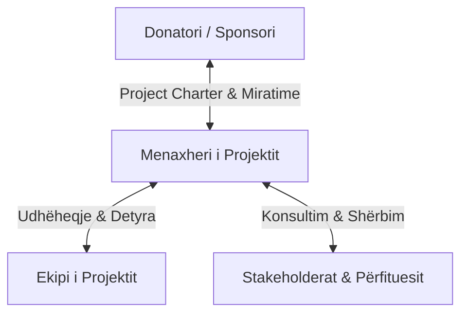
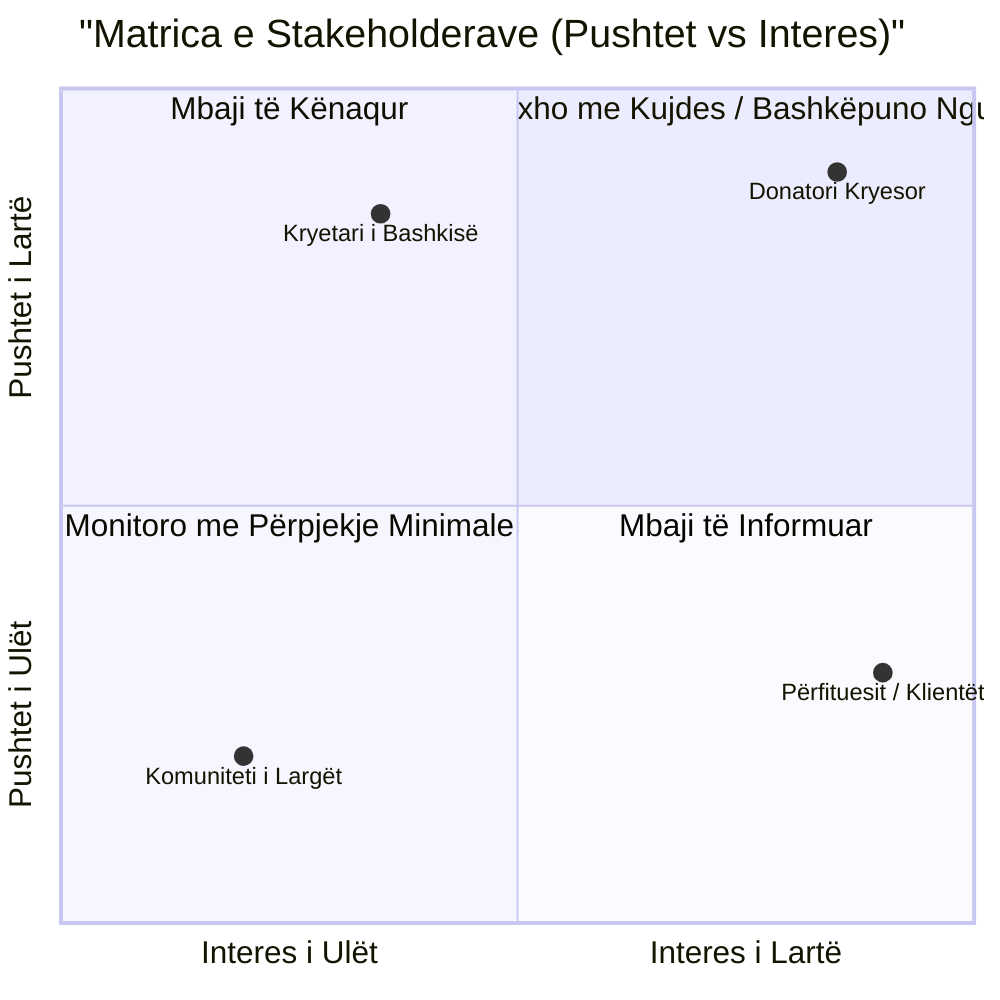

# 📌 Tema 04: Përcaktimi dhe Korniza e Projektit (Charter & Stakeholders)

`[[Tema 03 - Marrja e Vendimeve të Bazuara në Informacion|⬅️ Tema 03: Marrja e Vendimeve]]` | `[[00 - Harta e Lëndës dhe Udhëzuesi i Studimit (MOC)|Indeksi]]` | `[[Tema 05 - Menaxhimi i Riskut në Projektet Sociale|Tema 05: Menaxhimi i Riskut ➡️]]`

---

> [!summary] Përmbledhje Ekzekutive
> Pasi ideja e projektit vlerësohet e nevojshme dhe e realizueshme, hidhet hapi vendimtar i formalizimit të saj përmes **Përmbledhjes së Projektit (Project Brief / Charter)** dhe **Hartëzimit të Stakeholderave (Palëve të Interesuara)**. Marrëdhënia me **donatorin/sponsorin** kërkon qartësi kontraktuale rreth pritshmërive, ndërsa identifikimi i të gjithë aktorëve që ndikojnë ose ndikohen nga projekti garanton mbështetje politike dhe komunitare.

---

## 🎯 Objektivat e Mësimit
Pas studimit të këtij leksioni, ju do të jeni në gjendje të:
1. Përkufizoni rolin dhe përgjegjësitë e **Donatorit / Sponsorit** të projektit.
2. Identifikoni dhe kategorizoni **Stakeholderat** (palët e interesuara) në projekte sociale.
3. Ndërtoni dhe interpretoni **Matricën e Stakeholderave (Pushtet vs. Interes)**.
4. Hartoni një **Përmbledhje Projekti (Project Brief / Charter)** sipas standardeve profesionale.
5. Përdorni listën e kontrollit për të siguruar dakordësinë e të gjithë aktorëve kyç përpara planifikimit të detajuar.

---

## 1. Puna me Donatorin dhe Sponsorin e Projektit

**Donatori (ose sponsori)** është personi, bordi drejtues ose agjencia financuese që porosit projektin, siguron fondet dhe ka autoritetin final për të miratuar rezultatet e tij.

### Rollet dhe Pritshmëritë e Donatorit:
* **Përcaktimi i vizionit të përgjithshëm**: Donatori vendos kufijtë strategjikë dhe impaktin e dëshiruar.
* **Sigurimi i burimeve financiare**: Lëvron fondet sipas kësteve të rëna dakord.
* **Zgjidhja e pengesave madhore**: Ndërhyn kur lindin bllokime burokratike ose politike jashtë kontrollit të menaxherit.
* **Kërkesa për llogaridhënie**: Kërkon raporte narrative dhe financiare periodike sipas formave strikte.

> [!important] Këshillë Menaxheriale
> Menaxheri i projektit duhet të ndërtojë një marrëdhënie **transparente dhe besimi** me sponsorin. Asnjëherë mos fshihni vonesat apo vështirësitë; donatorët tolerojnë problemet kur raportohen herët, por ndëshkojnë ashpër surprizat në momentin e dorëzimit.

---

## 2. Hartëzimi i Stakeholderave (Palët e Interesuara)

Një **stakeholder** është çdo individ, grup apo organizatë që ka një interes të ligjshëm në projekt, ose që mund të **ndikojë pozitivisht/negativisht** në ecurinë e tij.

### Tipologjia e Stakeholderave në Shërbimet Sociale:
1. **Përfituesit Direktë (Primarë)**: Personat që marrin drejtpërdrejt shërbimin (p.sh. fëmijët me aftësi të kufizuara, prindërit e tyre).
2. **Përfituesit Indirektë (Sekondarë)**: Komuniteti i gjerë, shkollat, bizneset lokale që përfitojnë nga ulja e problemeve sociale.
3. **Ofruesit e Shërbimit**: Punonjësit socialë, psikologët, mjekët, edukatorët dhe vullnetarët.
4. **Autoritetet Publike dhe Rregullatore**: Bashkia, Ministria, Shërbimi Social Shtetëror, Policia.
5. **Opozitarët / Skeptikët Potencialë**: Fqinjët që mund të ankohen për zhurmë ose ndërtimin e një strehëze në lagjen e tyre.

---

## 3. Matrica e Stakeholderave: Pushtet vs. Interes

Për të menaxhuar energjitë e komunikimit, përdoret matrica e famshme **Pushtet (Power) x Interes (Interest)**:

### Strategjitë e Menaxhimit sipas Kuadrateve:
* **Pushtet i Lartë / Interes i Lartë (Kuadrati 1)**: *Menaxho me shumë kujdes!* (P.sh. Donatori, Drejtori i Shërbimeve Sociale). Kërkojnë përfshirje të vazhdueshme dhe konsultim të rregullt.
* **Pushtet i Lartë / Interes i Ulët (Kuadrati 2)**: *Mbaji të kënaqur!* (P.sh. Kryetari i Bashkisë, Inspektorati Tatimor). Nuk duan detaje teknike të përditshme, por duhet të sigurohet që nuk kanë ankesa.
* **Pushtet i Ulët / Interes i Lartë (Kuadrati 4)**: *Mbaji të informuar!* (P.sh. Përfituesit, prindërit, stafi zbatues). Janë shumë të apasionuar, por nuk kanë pushtet vendimmarrës ligjor; komunikimi i rregullt shmang frustrimin e tyre.
* **Pushtet i Ulët / Interes i Ulët (Kuadrati 3)**: *Monitoro me përpjekje minimale!* (P.sh. publiku i gjerë jo-përfitues). Komunikim i përgjithshëm përmes mediave ose njoftimeve periodike.

---

## 4. Përmbledhja e Projektit (Project Brief / Project Charter)

**Project Brief (Përmbledhja e Projektit)** është dokumenti themeltar i shkruar që përcakton zyrtarisht marrëveshjen midis menaxherit dhe donatorit përpara se të nisë planifikimi i hollësishëm.

### Struktura Standarde e një Project Brief:
1. **Titulli i Projektit dhe Kodi i Referencës**.
2. **Sfondi dhe Arsyetimi (Racionali)**: Pse po ndërmerret ky projekt tani? Cilat nevoja adreson?
3. **Synimi i Përgjithshëm dhe Objektivat SMART**.
4. **Fusha e Projektit (Scope)**: Çfarë përfshihet dhe çfarë përjashtohet shprehimisht.
5. **Produktet Kryesore (Deliverables)**: Shërbimet konkrete, raportet, ambientet e ngritura.
6. **Afati Kohor Fillestar (Datat e fillimit, fazat kryesore dhe data e mbylljes)**.
7. **Plafon Buxhetor Fillestar (Buxheti total i vënë në dispozicion)**.
8. **Struktura e Qeverisjes**: Emri i Menaxherit të Projektit, roli i Sponsorit dhe mekanizmat e raportimit.
9. **Risqet Kryesore Fillestare**.

> [!example] Shembulli 4.2 nga Leksionet: Sistemi i Ri i Menaxhimit të Rasteve
> Një njësi e mbrojtjes së fëmijëve po instalonte një sistem elektronik të ri për mbajtjen e dosjeve. Nëse menaxheri i projektit do të fliste vetëm me donatorin e IT-së dhe do të harronte punonjësit socialë në terren (stakeholderat kryesorë me interes të lartë), stafi do ta refuzonte sistemin për shkak të ndërlikimit administrativ. Përfshirja e stafit në hartimin e Project Brief garantoi suksesin e përdorimit.

---

## 📖 Fjalori i Termave Kyç

- **Project Brief / Charter**: Dokumenti zyrtar miratues që sanksionon autoritetin e menaxherit dhe përcakton kornizën e përgjithshme të projektit.
- **Stakeholder (Palë e Interesuar)**: Çdo individ apo grup që ndikohet nga projekti ose ka aftësi të ushtrojë ndikim mbi të.
- **Sponsor**: Personi me autoritet të lartë organizativ që mbështet politikisht dhe financiarisht projektin.
- **Matrica Pushtet/Interes**: Vegël analitike për të klasifikuar stakeholderat dhe përcaktuar intensitetin e duhur të komunikimit me ta.

---

## 🧠 Seksioni i Memorizimit & Retrieval Practice

### 🔹 Flashcards të Fshehura (Kliko për Përgjigjen)

> [!question]- Pyetja 1: Çfarë është një Project Brief (Charter) dhe pse është i rrezikshëm planifikimi i detajuar pa të?
> **Përgjigjja:**
> Project Brief është kontrata fillestare midis menaxherit dhe donatorit që përcakton qëllimin, fushën, buxhetin dhe kufijtë. Planifikimi pa të është i rrezikshëm sepse menaxheri mund të harxhojë javë të tëra duke planifikuar aktivitete që donatori nuk ka ndërmend t'i financojë ose miratojë.

> [!question]- Pyetja 2: Cilat janë 4 kuadratet e Matricës së Stakeholderave dhe cila është strategjia për secilin?
> **Përgjigjja:**
> 1. **Pushtet i Lartë / Interes i Lartë**: Menaxho ngushtë / Bashkëpuno ngushtë.
> 2. **Pushtet i Lartë / Interes i Ulët**: Mbaji të kënaqur.
> 3. **Pushtet i Ulët / Interes i Lartë**: Mbaji të informuar rregullisht.
> 4. **Pushtet i Ulët / Interes i Ulët**: Monitoro me përpjekje minimale.

> [!question]- Pyetja 3: Përmendni 4 grupe të ndryshme stakeholderash në një projekt për hapjen e një qendre ditore për të moshuarit në një bashki.
> **Përgjigjja:**
> 1. Përfituesit direktë (të moshuarit e vetmuar).
> 2. Përfituesit indirektë (familjarët e të moshuarve).
> 3. Stafi ofrues (punonjësit socialë, infermierët, shoferët).
> 4. Autoriteti publik / financuesi (Kryetari i Bashkisë, Këshilli Bashkiak, Fondi Social).

---

### 🔹 Flashcards për Obsidian Spaced Repetition (Plugin)
Project Brief (Charter):: Dokumenti themeltar që përcakton zyrtarisht synimin, fushën, kufijtë dhe qeverisjen e një projekti.
Stakeholder:: Individ apo grup që ka një interes në projekt ose aftësi për të ndikuar në ecurinë e tij.
Strategjia për Pushtet të Lartë dhe Interes të Lartë:: Bashkëpunim i ngushtë dhe menaxhim me kujdes maksimal.
Strategjia për Pushtet të Ulët dhe Interes të Lartë:: Informim i vazhdueshëm dhe i rregullt për të shmangur pakënaqësinë.

---

### 🔹 Plotëso Vendet Bosh (Cloze Recall)
1. Dokumenti që zyrtarizon marrëveshjen midis menaxherit dhe donatorit quhet ==Project Brief (ose Project Charter)==.
2. Në matricën e stakeholderave, boshtet kryesore janë ==pushteti (ndikimi)== dhe ==interesi==.
3. Palët me pushtet të lartë por interes të ulët duhet të ==mbahen të kënaqura==.
4. Përfituesit kryesorë të një shërbimi social bëjnë pjesë në stakeholderat me interes të lartë por shpesh me pushtet të ==ulët== vendimmarrës.

---

### 🔹 Checklist për Vetë-Vlerësim
- [ ] Mund të skicoj dhe plotësoj matricën Pushtet vs. Interes.
- [ ] Di të rendis elementet kryesore përbërëse të një Project Brief.
- [ ] Di të përcaktoj rolin e sponsorit përballë rolit të menaxherit të projektit.
