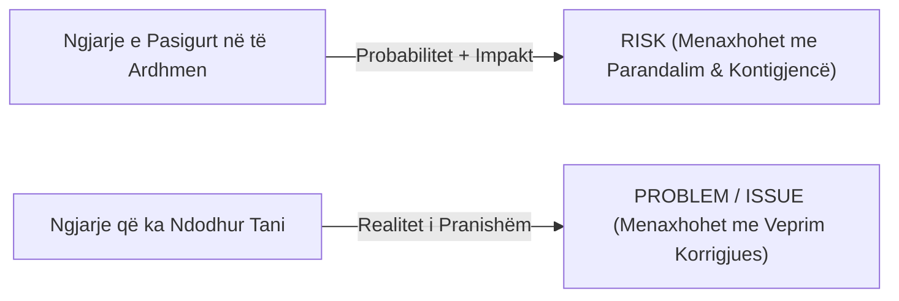
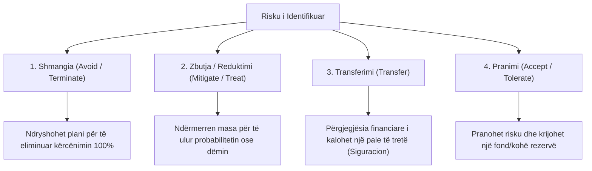

# 📌 Tema 05: Menaxhimi i Riskut në Projektet Sociale

`[[Tema 04 - Përcaktimi dhe Korniza e Projektit (Charter & Stakeholders)|⬅️ Tema 04: Përcaktimi dhe Korniza]]` | `[[00 - Harta e Lëndës dhe Udhëzuesi i Studimit (MOC)|Indeksi]]` | `[[Tema 06 - Skicimi i Planit të Projektit dhe WBS|Tema 06: Skicimi i Planit ➡️]]`

---

> [!summary] Përmbledhje Ekzekutive
> Ngjarjet rrallëherë ndodhin ekzaktësisht siç i presim. **Risku** është mundësia e ndodhjes së një ngjarjeje të paparashikuar që ndikon negativisht në arritjen e objektivave të projektit. Menaxhimi efektiv i riskut nuk nënkupton shmangien e çdo rreziku, por **identifikimin e hershëm**, **vlerësimin e Probabilitetit dhe Impaktit**, përzgjedhjen e një **strategjie trajtimi** (Shmangie, Zbutje, Transferim, Pranimi) dhe përgatitjen e një **Plani Kontigjence** konkret.

---

## 🎯 Objektivat e Mësimit
Pas studimit të këtij leksioni, ju do të jeni në gjendje të:
1. Përkufizoni **Riskun** dhe ta dalloni atë nga një **Problem aktual (Issue)**.
2. Klasifikoni risqet në **të brendshme** dhe **të jashtme**, si dhe sipas kategorive kryesore organizative.
3. Ndërtoni dhe përdorni **Matricën e Vlerësimit të Riskut (Probabilitet x Impakt)**.
4. Shpjegoni 4 strategjitë kryesore të trajtimit të riskut: **Shmangia**, **Zbutja (Mitigimi)**, **Transferimi** dhe **Pranimi**.
5. Hartoni një **Plan Kontigjence (Contingency Plan)** dhe të përcaktoni rezervat e projektit.
6. Përshkruani metodologjinë e integruar **PRAM (Project Risk Analysis and Management)**.
7. Analizoni sjelljen e stakeholderave si burim risku përmes matricës: **Ndalojnë / Lejojnë / Ndihmojnë**.

---

## 1. Çfarë është Risku dhe Dallimi nga Problemi Aktual

* **Risku (Risk)**: Një ngjarje **e pasigurt në të ardhmen**, e cila nëse ndodh, ka një ndikim negativ në kohën, koston ose cilësinë e projektit (p.sh. *"Ekziston risku që legjislacioni mbi ndihmën ekonomike të ndryshojë vitin e ardhshëm"*).
* **Problemi aktual (Issue)**: Një vështirësi që **po ndodh tani në të tashmen** dhe kërkon zgjidhje të menjëhershme (p.sh. *"Psikologu i qendrës dha dorëheqjen sot"*).

---

## 2. Kategoritë e Risqeve në Shërbimet Sociale

Risqet mund të ndahen sipas origjinës së tyre në:
1. **Risqe të Brendshme (Nën kontrollin e projektit)**:
   - Fluktuacioni i stafit dhe largimi i profesionistëve kyç.
   - Vlerësimi i pasaktë i buxhetit dhe shpenzimeve.
   - Komunikim i dobët brenda ekipit.
   - Dështim i pajisjeve teknologjike ose infrastrukturës.
2. **Risqe të Jashtme (Jashtë kontrollit të drejtpërdrejtë)**:
   - Ndryshime politike pas zgjedhjeve vendore (humbje e mbështetjes nga bashkia).
   - Vonesa në lëvrimin e kësteve nga donatori ndërkombëtar.
   - Ndryshime legjislative ose burokratike.
   - Rezistenca dhe stigma e komunitetit ndaj përfituesve (p.sh. fqinjët refuzojnë një qendër për përdoruesit e substancave).

---

## 3. Matrica e Vlerësimit të Riskut: Probabilitet x Impakt

Për të mos u humbur në detaje, çdo risk i identifikuar vlerësohet sipas dy dimensioneve:
* **Probabiliteti (P)**: Sa janë gjasat që kjo ngjarje të ndodhë? (I Ulët, I Mesëm, I Lartë).
* **Impakti / Ashpërsia (I)**: Nëse ndodh, sa dëm do t'i shkaktojë projektit? (I Ulët, I Mesëm, I Lartë).

$$Niveli\ i\ Riskut = Probabiliteti 	imes Impakti$$

| Probabilitet / Impakt | Impakt i Ulët | Impakt i Mesëm | Impakt i Lartë |
| :--- | :---: | :---: | :---: |
| **Probabilitet i Lartë** | Risk Mesatar (Mbikëqyrje) | **Risk i Lartë (Kujdes i Madh)** | 🚨 **RISK KRITIK (Veprim Urgjent!)** |
| **Probabilitet i Mesëm** | Risk i Ulët (Pranohet) | Risk Mesatar (Plan Veprimi) | **Risk i Lartë (Kujdes i Madh)** |
| **Probabilitet i Ulët** | Risk i Papërfillshëm | Risk i Ulët (Pranohet) | Risk Mesatar (Plan Kontigjence) |

> [!important] Rregulli i Artë i Menaxhimit
> Fokusi kryesor i menaxherit duhet të jetë mbi zonën e kuqe (Probabilitet i Lartë + Impakt i Lartë). Një risk me probabilitet të ulët por impakt katastrofik (p.sh. djegia e godinës) trajtohet nëpërmjet siguracionit (transferimit).

---

## 4. Katër Strategjitë për Përballimin e Riskut (4T-të)

Kur një risk identifikohet dhe vlerësohet, menaxheri përzgjedh një nga katër rrugët:

1. **Shmangia (Avoidance)**: Ndryshimi i tërësishëm i planit ose heqja dorë nga një aktivitet shumë i rrezikshëm për të eliminuar mundësinë e ndodhjes.
2. **Zbutja / Reduktimi (Mitigation)**: Marrja e masave parandaluese për të ulur probabilitetin ose për të kufizuar impaktin (p.sh. trajnimi i stafit para fillimit të punës për të evituar gabimet).
3. **Transferimi (Transfer)**: Kalimi i pasojës financiare te një palë e tretë (p.sh. nënkontraktimi i transportit të fëmijëve tek një kompani e licencuar e siguruar, sigurimi i pasurisë).
4. **Pranimi (Acceptance)**: Pranimi i ndërgjegjshëm se risku mund të ndodhë, sepse kostoja e parandalimit është më e madhe se dëmi. Përballohet me anë të **Planit të Kontigjencës**.

---

## 5. Plani i Kontigjencës (Contingency Plan)

**Plani i Kontigjencës** (Plani B) është një grup veprimesh konkrete të përgatitura paraprakisht, të cilat futen në zbatim vetëm nëse një risk i caktuar materializohet.

### Elementet e një Plani Kontigjence:
* **Faktori Nxitës (Trigger)**: Cila është shenja paralajmëruese që sinjalizon aktivizimin e Planit B?
* **Veprimet konkrete**: Çfarë do të bëhet ekzaktësisht, hap pas hapi?
* **Përgjegjësi i caktuar**: Kush nga anëtarët e stafit është i ngarkuar për ta zbatuar?
* **Buxheti i Kontigjencës (Rezerva)**: Një shumë parash (zakonisht 5-10% e buxhetit total) e lënë mënjanë për të përballuar të papriturat.

---

## 6. Metoda e Integruar PRAM (Project Risk Analysis and Management)

Sipas literaturës së lëndës (Panariti; Rama & Sota), metoda **PRAM** është një cikël i integruar që ndjek këto faza:
1. **Përcaktimi (Define)**: Qartësimi i fushës së projektit dhe kontekstit të riskut.
2. **Fokusimi (Focus)**: Përcaktimi i fushave me pasiguri më të lartë.
3. **Identifikimi (Identify)**: Zbulimi i kërcënimeve dhe mundësive përmes teknikave *Brainstorming*, *Delphi*, dhe intervistave.
4. **Strukturimi (Structure)**: Klasifikimi dhe grupimi logjik i risqeve.
5. **Përcaktimi i Pronësisë (Ownership)**: Caktimi i një "pronari risku" për çdo kërcënim madhor.
6. **Vlerësimi dhe Analiza (Quantify & Estimate)**: Matja cilësore dhe sasiore e gjasave dhe impaktit.
7. **Përgjigjja (Plan Responses)**: Hartimi i planeve të zbutjes dhe kontigjencës.
8. **Menaxhimi i Vazhdueshëm (Manage)**: Monitorimi dhe rishikimi periodik gjatë gjithë ciklit të jetës.

---

## 7. Matrica e Ndikimit të Stakeholderave: Ndalojnë / Lejojnë / Ndihmojnë

Teksti thekson se stakeholderat nuk janë pasivë; sjellja e tyre mund të jetë vetë një risk i madh ose një faktor ndihmës. Për këtë hartohet tabela:

| Kategoria e Stakeholderit | Ndalojnë (Bllokojnë) | Lejojnë (Pasivë) | Ndihmojnë (Proaktivë) | Veprimi i Menaxherit |
| :--- | :---: | :---: | :---: | :--- |
| **Kryetari i Bashkisë** | | | **X** | Mbaj partneritet të hapur; informo rregullisht |
| **Komuniteti Fqinj** | **X** | | | Dialog, takime sqaruese për të shmangur paragjykimet |
| **Inspektorati Sanitar** | | **X** | | Plotëso të gjitha standardet ligjore paraprakisht |
| **Donatori Financues** | | | **X** | Dorëzim transparent dhe në kohë i raporteve |

---

## 📖 Fjalori i Termave Kyç

- **Risk**: Mundësia e ndodhjes së një ngjarjeje të pasigurt që ndikon negativisht mbi objektivat e projektit.
- **Problem (Issue)**: Një kërcënim që tashmë ka ndodhur dhe kërkon zgjidhje të menjëhershme.
- **Zbutje e Riskut (Mitigation)**: Veprime parandaluese për të reduktuar probabilitetin ose dëmin e një risku.
- **Plan Kontigjence**: Plani alternativ (Plani B) që aktivizohet kur një risk ndodh realisht.
- **PRAM**: Metodë e integruar e analizës dhe menaxhimit të vazhdueshëm të riskut në projekte.
- **Pronar i Riskut (Risk Owner)**: Personi i stafit i ngarkuar me monitorimin dhe reagimin ndaj një risku të caktuar.

---

## 🧠 Seksioni i Memorizimit & Retrieval Practice

### 🔹 Flashcards të Fshehura (Kliko për Përgjigjen)

> [!question]- Pyetja 1: Cili është dallimi kryesor midis një "Risku" dhe një "Problemi (Issue)"?
> **Përgjigjja:**
> **Risku** është një ngjarje potenciale në të ardhmen me probabilitet pasigurie (parandalohet ose zbutet). **Problemi (Issue)** është një ngjarje që ka ndodhur tashmë në të tashmen (kërkon ndërhyrje korrigjuese të menjëhershme).

> [!question]- Pyetja 2: Cilat janë 4 strategjitë themelore për përballimin e riskut në një projekt?
> **Përgjigjja:**
> 1. **Shmangia**: Ndryshimi i planit për të eliminuar kërcënimin.
> 2. **Zbutja (Mitigimi)**: Veprime parandaluese për të ulur probabilitetin ose dëmin.
> 3. **Transferimi**: Kalimi i pasojës te një palë e tretë (sigurim, nënkontraktim).
> 4. **Pranimi**: Mbajtja e riskut dhe krijimi i një plani kontigjence/rezerve buxhetore.

> [!question]- Pyetja 3: Si llogaritet niveli i riskut në matricën e vlerësimit të riskut?
> **Përgjigjja:**
> Niveli i riskut llogaritet duke shumëzuar:
> $$	ext{Niveli i Riskut} = 	ext{Probabiliteti (gjasat e ndodhjes)} 	imes 	ext{Impakti (ashpërsia e dëmit)}$$

> [!question]- Pyetja 4: Çfarë është një Plan Kontigjence dhe cilat janë 3 elementet kryesore të tij?
> **Përgjigjja:**
> Plani i Kontigjencës është plani rezervë i veprimit që futet në fuqi kur risku ndodh.
> Elementet kryesore:
> 1. Shenja paralajmëruese (trigger) që e aktivizon.
> 2. Hapat konkretë të veprimit.
> 3. Personi përgjegjës dhe fondi rezervë i dedikuar.

---

### 🔹 Flashcards për Obsidian Spaced Repetition (Plugin)
Risk:: Mundësia e një ngjarjeje të pasigurt të ardhshme që mund të dëmtojë objektivat e projektit.
Zbutja e Riskut (Mitigation):: Marrja e masave parandaluese për të ulur gjasat ose impaktin e një ngjarjeje negative.
Transferimi i Riskut:: Kalimi i pasojave të riskut te një palë e tretë (p.sh. kompania e sigurimeve).
Plani i Kontigjencës:: Veprimet alternative të planifikuara paraprakisht që zbatohen vetëm nëse risku ndodh.
PRAM:: Metodë e integruar e menaxhimit të riskut (Project Risk Analysis and Management).

---

### 🔹 Plotëso Vendet Bosh (Cloze Recall)
1. Matrica e riskut vlerëson kryqëzimin midis ==probabilitetit== dhe ==impaktit (ashpërsisë)==.
2. Kalimi i riskut te një kompani sigurimi përfaqëson strategjinë e ==transferimit==.
3. Plani që zbatohet vetëm nëse risku ndodh quhet plan ==kontigjence==.
4. Shenja që përcakton momentin e hyrjes në veprim të planit rezervë quhet faktori nxitës ose ==trigger==.

---

### 🔹 Checklist për Vetë-Vlerësim
- [ ] Mund të dalloj me saktësi një risk nga një problem i tashëm.
- [ ] Di të ndërtoj dhe lexoj matricën e vlerësimit të riskut.
- [ ] Di të shpjegoj të 4 strategjitë e trajtimit të riskut.
- [ ] Di të hartoj një plan kontigjence për një projekt të shërbimeve sociale.
