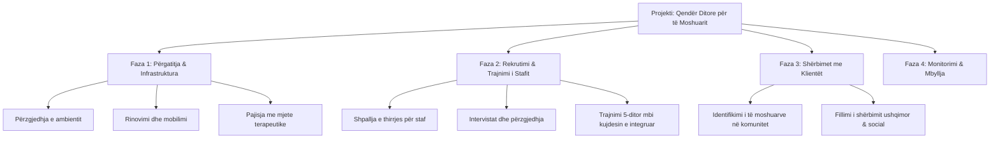
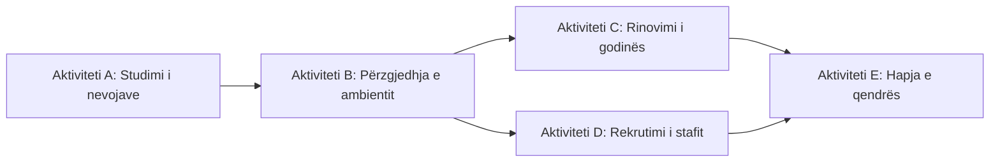

# 📌 Tema 06: Skicimi i Planit të Projektit dhe WBS

`[[Tema 05 - Menaxhimi i Riskut në Projektet Sociale|⬅️ Tema 05: Menaxhimi i Riskut]]` | `[[00 - Harta e Lëndës dhe Udhëzuesi i Studimit (MOC)|Indeksi]]` | `[[Tema 07 - Vlerësimi i Kohës dhe Kostos (Buxhetimi & VNP)|Tema 07: Vlerësimi i Kohës dhe Kostos ➡️]]`

---

> [!summary] Përmbledhje Ekzekutive
> Planifikimi shndërron synimet e përgjithshme në veprime konkrete të përditshme. Mjeti qendror i kësaj faze është **WBS (Work Breakdown Structure / Struktura e Ndarjes së Punës)**, e cila zbërthen projektin e madh në faza, **paketa pune (work packages)** dhe aktivitete të menaxhueshme duke zbatuar **Rregullin 100%**. Paralelisht, ndërtimi i **Diagramës Logjike** përcakton sekuencën dhe varësitë e detyrave, ndërsa identifikimi i qartë i **produkteve (deliverables)** garanton llogaridhënie të plotë.

---

## 🎯 Objektivat e Mësimit
Pas studimit të këtij leksioni, ju do të jeni në gjendje të:
1. Shpjegoni rëndësinë e planifikimit dhe t'u përgjigjeni pyetjeve thelbësore: *Çfarë? Kush? Si? Kur?*
2. Përkufizoni dhe ndërtoni një **WBS (Struktura e Ndarjes së Punës)** për një projekt social.
3. Zbatoni **Rregullin 100%** gjatë dekompozimit të projektit.
4. Ndërtoni një **Diagramë Logjike (Rrjeti i Aktiviteteve)** për të përcaktuar rrjedhën e punës.
5. Dalloni dhe listoni **Produktet e prekshme (Tangible)** dhe **të paprekshme (Intangible)**.
6. Përcaktoni **Piketat kryesore (Milestones)** të një projekti.

---

## 1. Hapat Fillestarë: Nga Ideja te Plani i Veprimit

Planifikimi nis sapo Project Brief të jetë miratuar nga sponsori. Asnjë projekt nuk fillon të zbatohet pa një plan të qartë me shkrim.

### Pyetjet Thelbësore të Planifikimit:
* **Çfarë (What)** duhet arritur? (Produktet dhe rezultatet e projektit).
* **Si (How)** do të realizohet? (Metodat, proceset dhe aktivitetet konkrete).
* **Kush (Who)** do ta bëjë? (Stafi, ekspertët, partnerët dhe përgjegjësitë).
* **Kur (When)** do të bëhet? (Afatet kohore, sekuenca dhe datat përfundimtare).
* **Me çfarë (With what)** do të realizohet? (Buxheti, pajisjet, mjediset).

---

## 2. Çfarë është WBS (Work Breakdown Structure)?

**WBS (Struktura e Ndarjes së Punës)** është një dekompozim hierarkik i të gjithë punës që duhet të kryhet nga ekipi për të përmbushur objektivat e projektit dhe për të krijuar produktet e kërkuara.

### Rregulli 100% në WBS:
> [!important] Rregulli 100%
> WBS duhet të përfshijë **100% të punës** së kërkuar nga projekti dhe **asnjë punë shtesë**. Totali i nën-detyrave në çdo nivel duhet të jetë ekzaktësisht i barabartë me tërësinë e detyrës mëmë. Nëse diçka nuk është në WBS, ajo nuk është pjesë e projektit!

### Nivelet e Dekompozimit:
1. **Niveli 1**: Titulli i Projektit.
2. **Niveli 2**: Fazat kryesore ose Produktet madhore (Deliverables).
3. **Niveli 3**: Paketat e Punës (Work Packages) — njësia më e vogël e menaxhueshme që mund t'i delegohet një personi me një afat dhe buxhet të caktuar.
4. **Niveli 4**: Aktivitetet dhe Detyrat individuale.

---

## 3. Ndërtimi i Diagramës Logjike (Rrjeti i Aktiviteteve)

WBS tregon *çfarë* do të bëhet, por nuk tregon *radhën* e tyre. Për të kuptuar sekuencën, përdoret **Diagrama Logjike**.

### Llojet e Varësive midis Detyrave:
* **Varësi e detyrueshme (Logjike)**: Aktiviteti B nuk mund të fillojë pa mbaruar Aktiviteti A (p.sh. nuk mund të trajnoni stafin para se ta keni rekrutuar).
* **Varësi diskrecionale (Preferenciale)**: Zgjedhje menaxheriale bazuar në praktikat më të mira.
* **Varësi e jashtme**: Varet nga një faktor jashtë projektit (p.sh. rinovimi nuk nis dot pa marrë lejen nga Bashkia).

---

## 4. Identifikimi i Produkteve të Projektit (Deliverables)

Një **produkt (deliverable)** është çdo rezultat, e mirë materiale apo shërbim unik dhe i verifikueshëm që duhet të dorëzohet gjatë ose në fund të projektit.

### Tipet e Produkteve në Shërbimet Sociale:
1. **Produkte të Prekshme (Tangible)**:
   - Godina ose mjedisi i rikonstruktuar.
   - Manuali i trajnimit ose broshura e shërbimeve.
   - Raporti i vlerësimit me shkrim.
   - Databaza e regjistrimit të klientëve.
2. **Produkte të Paprekshme (Intangible)**:
   - Aftësitë e fituara nga stafi i trajnuar.
   - Rritja e vetëbesimit te fëmijët pjesëmarrës.
   - Përmirësimi i bashkëpunimit midis OJQ-ve dhe policisë.

---

## 5. Piketat Kryesore (Milestones)

Një **pikëtë (milestone)** është një pikë referimi e rëndësishme në grafikun kohor të projektit që shënon përfundimin e një etape madhore (p.sh. *"Miratimi i lejes së operimit"*, *"Përfundimi i fazës së rekrutimit"*, *"Data e inaugurimit"*).
* Piketat kanë **kohëzgjatje ZERO**; ato nuk janë aktivitete me orë pune, por ngjarje sinjalizuese për të matur progresin.

---

## 📖 Fjalori i Termave Kyç

- **WBS (Work Breakdown Structure)**: Zbërthimi hierarkik i fushës totale të punës në njësi më të vogla dhe të menaxhueshme.
- **Rregulli 100%**: Parimi që kërkon përfshirjen e të gjithë punës së projektit në WBS, pa asnjë boshllëk dhe pa asnjë tepricë.
- **Paketë Pune (Work Package)**: Niveli më i ulët i një WBS, i cili përmban aktivitete që mund të vlerësohen saktë për kosto dhe kohë.
- **Diagramë Logjike**: Paraqitje grafike e sekuencës dhe varësive ndërmjet aktiviteteve të projektit.
- **Produkt (Deliverable)**: Rezultat i matshëm dhe i prekshëm ose i paprekshëm që i dorëzohet sponsorit/përfituesve.
- **Piketë (Milestone)**: Moment kyç pa kohëzgjatje që shënjon arritjen e një etape kryesore.

---

## 🧠 Seksioni i Memorizimit & Retrieval Practice

### 🔹 Flashcards të Fshehura (Kliko për Përgjigjen)

> [!question]- Pyetja 1: Çfarë është WBS dhe cili është qëllimi kryesor i ndërtimit të saj?
> **Përgjigjja:**
> WBS (Struktura e Ndarjes së Punës) është zbërthimi hierarkik i të gjithë punës së projektit në paketa dhe detyra më të vogla. Qëllimi kryesor është të shndërrojë një projekt kompleks në pjesë të menaxhueshme, duke lehtësuar caktimin e përgjegjësive, vlerësimin e kohës dhe kostove.

> [!question]- Pyetja 2: Çfarë thotë "Rregulli 100%" në ndërtimin e WBS?
> **Përgjigjja:**
> Rregulli 100% kërkon që WBS të përfshijë 100% të punës së nevojshme të projektit, as më shumë e as më pak. Shuma e punës së niveleve më të ulëta duhet të jetë ekzaktësisht e barabartë me 100% të nivelit më lart.

> [!question]- Pyetja 3: Cili është dallimi thelbësor midis një Aktiviteti dhe një Pikete (Milestone)?
> **Përgjigjja:**
> Një **aktivitet** konsumon kohë dhe burime (ka kohëzgjatje, p.sh. rinovimi zgjat 3 javë). Një **piketë (milestone)** ka kohëzgjatje **zero**, dhe shënon vetëm momentin e përfundimit të një faze kyçe (p.sh. marrja e çelësave të godinës).

> [!question]- Pyetja 4: Përmendni një shembull të një produkti të prekshëm (tangible) dhe një të paprekshëm (intangible) në një projekt social.
> **Përgjigjja:**
> - **I prekshëm**: Manuali i shërbimit për punonjësit socialë (libër i printuar) ose mjedisi i rikonstruktuar i qendrës.
> - **I paprekshëm**: Rritja e njohurive dhe aftësive të punonjësve pas trajnimit, ose ndjenja e sigurisë së komunitetit.

---

### 🔹 Flashcards për Obsidian Spaced Repetition (Plugin)
WBS:: Struktura e Ndarjes së Punës; zbërthimi hierarkik i projektit në njësi të menaxhueshme.
Rregulli 100% në WBS:: WBS duhet të përfshijë ekzaktësisht të gjithë punën e përcaktuar të projektit, asgjë më pak e asgjë më shumë.
Milestone (Piketë):: Moment kyç pa kohëzgjatje që shënon arritjen e një rezultati madhor në projekt.
Diagrama Logjike:: Skicimi i renditjes sekuenciale dhe marrëdhënieve të varësisë ndërmjet aktiviteteve të projektit.

---

### 🔹 Plotëso Vendet Bosh (Cloze Recall)
1. Akronimi WBS në shqip përkthehet ==Struktura e Ndarjes së Punës==.
2. Niveli më i ulët dhe i menaxhueshëm i një WBS njihet si ==paketë pune (work package)==.
3. Një pikëtë kryesore (milestone) karakterizohet nga një kohëzgjatje prej ==zero ditësh==.
4. Rregulli që siguron që e gjithë puna të pasqyrohet pa lënë asgjë jashtë quhet ==Rregulli 100%==.

---

### 🔹 Checklist për Vetë-Vlerësim
- [ ] Mund të zbërthej një projekt social në të paktën 3 nivele të një WBS.
- [ ] Di të shpjegoj dhe zbatoj Rregullin 100%.
- [ ] Di të dalloj një aktivitet nga një piketë (milestone).
- [ ] Mund të vizatoj një diagramë logjike të varësive midis detyrave.
