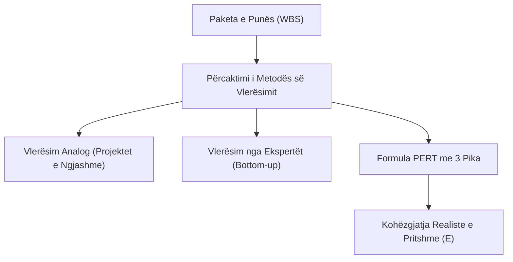

# 📌 Tema 07: Vlerësimi i Kohës dhe Kostos (Buxhetimi & VNP)

`[[Tema 06 - Skicimi i Planit të Projektit dhe WBS|⬅️ Tema 06: Skicimi i Planit]]` | `[[00 - Harta e Lëndës dhe Udhëzuesi i Studimit (MOC)|Indeksi]]` | `[[Tema 08 - Programimi i Projektit dhe Grafiku Gantt (CPM)|Tema 08: Programimi dhe Gantt ➡️]]`

---

> [!summary] Përmbledhje Ekzekutive
> Çdo aktivitet i zbërthyer në WBS kërkon dy burime thelbësore: **kohë** dhe **para**. Vlerësimi i pasaktë është shkaku numër një i dështimit të projekteve. Ky leksion trajton teknikat e parashikimit të kohës (përfshirë formulën **PERT me 3 pika**), ndërtimin e **buxhetit** sipas kategorive (direkte, indirekte, fikse, variabël), **shmangien e abuzimeve**, si dhe konceptet financiare të vlerësimit të investimit: **Afatin e Shlyerjes (Payback Period)** dhe **Vlerën Neto Prezente (VNP / NPV)**.

---

## 🎯 Objektivat e Mësimit
Pas studimit të këtij leksioni, ju do të jeni në gjendje të:
1. Përzgjidhni metodat e duhura për vlerësimin e kohëzgjatjes së aktiviteteve (Top-down, Bottom-up, Analoge, PERT).
2. Llogarisni kohëzgjatjen e pritshme me formulën **PERT me tri pika** ($O$, $M$, $P$).
3. Klasifikoni kostot e një projekti: **Direkte vs. Indirekte** dhe **Fikse vs. Variabël**.
4. Strukturoni buxhetin e një projekti social sipas linjave standarde (stafi, pajisjet, operacionet).
5. Identifikoni dhe shmangni praktikat abuzive në menaxhimin financiar.
6. Llogarisni dhe interpretoni **Afatin e Shlyerjes** dhe **Vlerën Neto Prezente (VNP)**.
7. Vlerësoni përfitimet e paprekshme (intangible) dhe vlerën sociale të projektit.

---

## 1. Vlerësimi i Kohës së Aktiviteteve

Vlerësimi i kohës bazohet në zbërthimin e paketave të punës nga WBS. Parashikimi bëhet nga njerëzit që do të kryejnë realisht punën, duke marrë parasysh eksperiencën e kaluar.

### Formula e Vlerësimit me Tre Pika (PERT):
Kur ka pasiguri të lartë, përdoren 3 vlerësime kohore:
1. **$O$ (Optimist)**: Koha nëse gjithçka shkon në mënyrë të përsosur, pa asnjë pengesë.
2. **$M$ (Më i mundshmi - Most Likely)**: Koha më realiste në kushte normale pune.
3. **$P$ (Pesimist)**: Koha nëse ndodh çdo e papritur dhe pengesë e mundshme.

$$	ext{Koha e Pritshme } (E) = rac{O + 4M + P}{6}$$

> [!example] Ushtrim: Llogaritja e Kohës me Formulën PERT
> Për trajnimin e 20 punonjësve socialë:
> - Vlerësimi optimist ($O$): 2 ditë
> - Vlerësimi më i mundshëm ($M$): 4 ditë
> - Vlerësimi pesimist ($P$): 12 ditë
> 
> $$E = rac{2 + 4(4) + 12}{6} = rac{2 + 16 + 12}{6} = rac{30}{6} = 5 	ext{ ditë}$$
> Menaxheri do të planifikojë **5 ditë** në grafikun e projektit, duke eliminuar optimizmin naiv.

---

## 2. Klasifikimi dhe Struktura e Kostove

Buxheti është përkthimi monetar i planit të aktiviteteve. Kostot e projektit ndahen në disa kategori kryesore:

### A. Sipas Lidhjes me Projektin:
* **Kosto Direkte (Direct Costs)**: Shpenzime që i atribuohen 100% dhe ekskluzivisht projektit.
  - Pagat e personelit të dedikuar të projektit (p.sh. koordinator, punonjës social).
  - Materialet dhe pajisjet e blera vetëm për projektin (p.sh. lodra terapeutike, kompjutera).
  - Qiraja e sallës së trajnimit, transporti i përfituesve.
* **Kosto Indirekte / Administrative (Overhead / Indirect Costs)**: Shpenzime të përbashkëta të organizatës që mbështesin edhe projektin.
  - Përqindje e qirasë së zyrës qendrore, interneti, shërbimet e kontabilistit të përgjithshëm, pastrimi. Zakonisht donatorët lejojnë 7% deri në 10% të buxhetit total për këto kosto.

### B. Sipas Sjelljes ndaj Vëllimit:
* **Kosto Fikse**: Nuk ndryshojnë pavarësisht sa klientë trajtohen (p.sh. qiraja mujore e qendrës, blerja e furgonit).
* **Kosto Variabël**: Rriten me rritjen e numrit të përfituesve (p.sh. pakot ushqimore, numri i testeve psikologjike, shpenzimet e drekës).

---

## 3. Shmangia e Praktikave Abuzuese në Buxhetim

Menaxhimi etik i fondeve në sektorin social është jetik për të ruajtur besimin e donatorëve dhe opinionit publik.

### Gabimet dhe Praktikat e Dënueshme:
1. **Optimizmi Taktik (Nënvlerësimi i Qëllimshëm)**: Paraqitja e kostove shumë të ulëta vetëm për të fituar grantin, me shpresën se do të kërkohen para shtesë më vonë.
2. **Fryrja e Kostove (Padding)**: Rritja artificiale e çmimeve të tregut për të krijuar rezerva të fshehura.
3. **Mungesa e Transparencës**: Blerje pa procedura konkurruese me të paktën 3 oferta tregu.
4. **Shpërblime të Pajustifikuara**: Përdorimi i parave të destinuara për shërbimet e fëmijëve për dieta dhe udhëtime luksi të stafit drejtues.

---

## 4. Konceptet Financiare të Vlerësimit të Investimit

Në menaxhimin modern të projekteve (Panariti), vlerësohet realizueshmëria ekonomike nëpërmjet dy treguesve:

### A. Afati i Shlyerjes (Payback Period):
Koha (në vite ose muaj) që i duhet një investimi për të rikthyer koston fillestare përmes flukseve hyrëse neto monetare.
$$	ext{Afati i Shlyerjes} = rac{	ext{Kostoja Fillestare e Investimit}}{	ext{Fluksi Vjetor Neto i Parave}}$$
* Preferohen projektet me afat shlyerjeje sa më të shpejtë, pasi ulin rrezikun e likuiditetit.

### B. Vlera Neto Prezente (VNP / Net Present Value - NPV):
Vlera aktuale e të gjitha flukseve hyrëse të ardhshme të zbritura me normën e skontimit ($r$), minus investimin fillestar ($C_0$). Paraja sot vlen më shumë se e njëjta sasi parash pas 3 vitesh për shkak të inflacionit dhe interesit.

$$	ext{VNP} = \sum_{t=1}^{n} rac{C_t}{(1 + r)^t} - C_0$$

* **Rregulli i Vendimit**:
  - Nëse $	ext{VNP} > 0$: Projekti është financiarisht i pranueshëm (gjeneron vlerë).
  - Nëse $	ext{VNP} < 0$: Projekti refuzohet financiarisht (humbje parash).

> [!important] Përshtatja në Sektorin Social: SROI (Social Return on Investment)
> Në projektet sociale, kthimi nuk matet thjesht në para, por në **Vlerë Sociale**. Për shembull: investimi i \$10,000 në riaftësimin e të rinjve nga varësitë parandalon kosto të ardhshme burgimi dhe shpenzime spitalore prej \$50,000 për shoqërinë. Kjo njihet si **SROI (Kthimi Social i Investimit)**.

---

## 📖 Fjalori i Termave Kyç

- **Kosto Direkte**: Shpenzim që lidhet drejtpërdrejt dhe ekskluzivisht me kryerjen e një aktiviteti të projektit.
- **Kosto Indirekte (Overhead)**: Kosto administrative e përbashkët operative e organizatës që ndahet proporcionalisht.
- **Formula PERT**: Metodë vlerësimi kohor me 3 pika (Optimist, Më i mundshëm, Pesimist) me formulën $(O+4M+P)/6$.
- **VNP (Vlera Neto Prezente)**: Diferenca midis vlerës aktuale të flukseve të ardhshme dhe investimit fillestar.
- **Afati i Shlyerjes (Payback Period)**: Koha e nevojshme për të mbuluar shpenzimin fillestar të projektit.

---

## 🧠 Seksioni i Memorizimit & Retrieval Practice

### 🔹 Flashcards të Fshehura (Kliko për Përgjigjen)

> [!question]- Pyetja 1: Cila është formula e vlerësimit të kohës me 3 pika (PERT) dhe çfarë përfaqëson çdo shkronjë?
> **Përgjigjja:**
> Formula është:
> $$E = rac{O + 4M + P}{6}$$
> Ku:
> - **O (Optimist)** = Koha më e shkurtër nëse gjithçka shkon në mënyrë të përsosur.
> - **M (Më i mundshmi)** = Koha më realiste në kushte normale.
> - **P (Pesimist)** = Koha më e gjatë nëse ndodhin të gjitha të papriturat negative.

> [!question]- Pyetja 2: Cili është dallimi thelbësor midis një Kostoje Direkte dhe një Kostoje Indirekte (Overhead)?
> **Përgjigjja:**
> - **Kosto Direkte**: I atribuohet 100% projektit (p.sh. rroga e psikologut të projektit, materialet didaktike).
> - **Kosto Indirekte**: Shpenzim i përbashkët i organizatës që mbështet edhe projektin (p.sh. qiraja e godinës qendrore, shpenzimet e kontabilitetit të zyrës).

> [!question]- Pyetja 3: Çfarë nënkupton rregulli i vendimmarrjes me Vlerën Neto Prezente (VNP / NPV)?
> **Përgjigjja:**
> - Nëse $	ext{VNP} > 0$: Projekti pranohet sepse vlera e përfitimeve të ardhshme (e skontuar) tejkalon koston fillestare.
> - Nëse $	ext{VNP} < 0$: Projekti refuzohet sepse sjell humbje ekonomike.

> [!question]- Pyetja 4: Çfarë është "Optimizmi Taktik" dhe pse përbën një praktikë abuzive në hartimin e projekteve?
> **Përgjigjja:**
> Optimizmi taktik është ulja artificiale dhe e qëllimshme e kostove apo kohës në formularin e aplikimit për t'u dukur tërheqës para donatorit dhe për të fituar grantin, duke ditur paraprakisht se fondet nuk do të dalin. Është abuzive sepse mashtron donatorin dhe çon projektin drejt krizës.

---

### 🔹 Flashcards për Obsidian Spaced Repetition (Plugin)
Kosto Direkte:: Shpenzim që lidhet drejtpërdrejt dhe ekskluzivisht me një aktivitet të caktuar të projektit.
Kosto Indirekte (Overhead):: Shpenzime administrative të përgjithshme operative të organizatës që i faturohen pjesërisht projektit.
Formula PERT:: Koha e pritshme llogaritet si (Optimiste + 4 * Më e mundshme + Pesimiste) / 6.
Vlera Neto Prezente (VNP):: Vlera e tashme e parave të ardhshme minus koston fillestare të investimit.
Afati i Shlyerjes:: Koha e nevojshme që flukset hyrëse të parave të mbulojnë plotësisht investimin fillestar.

---

### 🔹 Plotëso Vendet Bosh (Cloze Recall)
1. Në formulën PERT, peshën më të madhe me koeficient 4 e ka vlerësimi ==më i mundshmi (most likely)==.
2. Pagat e stafit të dedikuar të projektit bëjnë pjesë në kostot ==direkte==.
3. Donatorët zakonisht kufizojnë kostot indirekte administrative në rreth ==7% deri 10%== të buxhetit total.
4. Nëse VNP (Vlera Neto Prezente) e një projekti rezulton ==më e madhe se zero==, projekti konsiderohet i vlefshëm për investim.

---

### 🔹 Checklist për Vetë-Vlerësim
- [ ] Mund të zbatoj formulën PERT me 3 pika për të llogaritur kohën e një aktiviteti.
- [ ] Di të klasifikoj të paktën 5 shpenzime në direkte dhe indirekte.
- [ ] Di të shpjegoj konceptin e Vlerës Neto Prezente (VNP) dhe Afatit të Shlyerjes.
- [ ] Mund të shpjegoj konceptin e kthimit social të investimit (SROI).
