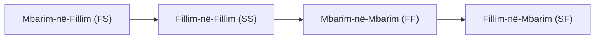
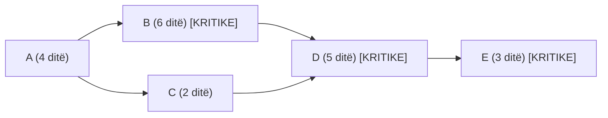

# 📌 Tema 08: Programimi i Projektit dhe Grafiku Gantt (CPM)

`[[Tema 07 - Vlerësimi i Kohës dhe Kostos (Buxhetimi & VNP)|⬅️ Tema 07: Vlerësimi i Kohës dhe Kostos]]` | `[[00 - Harta e Lëndës dhe Udhëzuesi i Studimit (MOC)|Indeksi]]` | `[[Tema 09 - Implementimi dhe Zbatimi i Projektit|Tema 09: Implementimi ➡️]]`

---

> [!summary] Përmbledhje Ekzekutive
> **Programimi (Scheduling)** është procesi i vendosjes së aktiviteteve të WBS në një kalendar real kohor, duke respektuar varësitë e tyre. Dy veglat më të fuqishme të programimit janë **Grafiku Gantt (Gantogrami)**, i cili ofron një pamje vizuale të qartë të shiritave kohorë dhe piketave, dhe **Metoda e Rrugës Kritike (CPM - Critical Path Method)**, e cila zbulon sekuencën e aktiviteteve që nuk lejojnë asnjë ditë vonesë (koha e lirë / slack = 0).

---

## 🎯 Objektivat e Mësimit
Pas studimit të këtij leksioni, ju do të jeni në gjendje të:
1. Përkufizoni programimin dhe të shpjegoni marrëdhëniet e varësisë midis detyrave (FS, SS, FF, SF).
2. Ndërtoni dhe interpretoni një **Grafik Gantt (Gantogram)**.
3. Shpjegoni përdorimin e piketave (milestones) brenda grafikut Gantt.
4. Identifikoni dhe llogarisni **Rrugën Kritike (Critical Path)** në një rrjet aktivitetesh.
5. Përllogarisni **Kohën e Lirë / Rezervën (Slack / Float)** të aktiviteteve jo-kritike.
6. Përshkruani teknikat e ngjeshjes së kohës së projektit: **Crashing** dhe **Fast-Tracking**.

---

## 1. Marrëdhëniet e Sekuencës dhe Varësive midis Aktiviteteve

Para se të vendosen datat në kalendar, duhet përcaktuar radha logjike e aktiviteteve:



1. **Mbarim-në-Fillim (Finish-to-Start - FS)** *(Më e zakonshmja, 90% e rasteve)*: Detyra B nuk mund të fillojë derisa të ketë mbaruar Detyra A (p.sh. nuk mund të lyhen muret e qendrës para se të mbarojnë suvatimet).
2. **Fillim-në-Fillim (Start-to-Start - SS)**: Detyra B mund të nisë sapo të ketë nisur Detyra A (p.sh. fushata e sensibilizimit në komunitet nis sapo të nisë shpërndarja e pyetësorëve).
3. **Mbarim-në-Mbarim (Finish-to-Finish - FF)**: Detyra B nuk mund të përfundojë derisa të përfundojë Detyra A (p.sh. shkrimi i raportit financiar përfundon kur mbaron dhe mbledhja e faturave të fundit).
4. **Vonesa (Lag)** dhe **Përparimi (Lead)**:
   - *Lag (+ ditë)*: Pritje e detyruar (p.sh. pas lyerjes së dyshemesë duhet pritur 2 ditë që të thahet para se të futen mobiliet).
   - *Lead (- ditë)*: Përshpejtim i mbivendosur i detyrës pasardhëse.

---

## 2. Ndërtimi dhe Përdorimi i Grafikut Gantt

I shpikur nga Henry Gantt, ky grafik është tabela më e përhapur e vizualizimit të kohës në botë.
* **Boshti horizontal**: Përfaqëson kohën (ditë, javë, muaj).
* **Boshti vertikal**: Paraqet listën e aktiviteteve dhe paketave të punës.
* **Shiritat horizontalë**: Gjatësia e shiritit tregon kohëzgjatjen e aktivitetit.

```mermaid
gantt
    title Grafiku Gantt: Projekti i Qendrës Komunitare
    dateFormat  YYYY-MM-DD
    section Përgatitja
    Vlerësimi i nevojave          :done,    des1, 2026-11-01, 2026-11-15
    Përzgjedhja e ambientit       :done,    des2, 2026-11-10, 2026-11-25
    section Rinovimi & Mobilimi
    Punimet e rinovimit           :active,  des3, 2026-11-26, 2026-12-20
    Blerja e pajisjeve/mobilieve  :         des4, 2026-12-10, 2026-12-24
    section Rekrutimi & Trajnimi
    Rekrutimi i stafit            :crit,    des5, 2026-11-20, 2026-12-10
    Trajnimi i personelit         :crit,    des6, 2026-12-11, 2026-12-23
    section Inaugurimi
    Piketë: Çelja Zyrtare         :milestone, m1, 2026-12-25, 0d
```

### Avantazhet e Grafikut Gantt:
* **Qartësi absolute**: Çdokush në ekip dhe donatori e kupton me një shikim ecurinë.
* **Lehtësi monitorimi**: Mund të ngjyrosen shiritat (p.sh. e gjelbër = përfunduar, e kuqe = me vonesë).
* **Tregohen piketat (milestones)** me simbole të veçanta (zakonisht romb).

### Kufizimi Kryesor:
Në projekte tejet komplekse me qindra detyra, Gantogrami nuk e tregon qartë varësinë e ndërlikuar rrjetore dhe nuk veçon automatikisht se cilat detyra janë **kritike** nëse nuk shoqërohet me analizën CPM.

---

## 3. Metoda e Rrugës Kritike (CPM - Critical Path Method)

**Rruga Kritike** është zinxhiri i aktiviteteve të lidhura nga fillimi në fund të projektit, i cili ka **kohëzgjatjen më të gjatë totale**.
* Ajo përcakton **kohën minimale të mundshme** për përfundimin e të gjithë projektit.



> [!important] Ligji i Rrugës Kritike
> Çdo vonesë në një aktivitet që ndodhet në **Rrugën Kritike** do të shkaktojë **menjëherë dhe automatikisht vonesë në të gjithë projektin**!
> Në të kundërt, aktivitetet që nuk janë në rrugën kritike kanë kohë rezervë (**Slack / Float**).

### Konceptet e Llogaritjes së Rrugës Kritike:
Për çdo aktivitet llogariten 4 parametra kohorë:
1. **ES (Early Start)**: Momenti më i hershëm i mundshëm kur mund të nisë aktiviteti.
2. **EF (Early Finish)**: Momenti më i hershëm kur mund të përfundojë ($EF = ES + 	ext{Kohëzgjatja}$).
3. **LF (Late Finish)**: Momenti më i vonshëm kur aktiviteti duhet të përfundojë pa vonuar projektin.
4. **LS (Late Start)**: Momenti më i vonshëm kur mund të nisë ($LS = LF - 	ext{Kohëzgjatja}$).

$$	ext{Koha e Lirë (Slack / Float)} = LS - ES = LF - EF$$

* **Aktivitetet Kritike** kanë gjithmonë:
$$	ext{Slack} = 0$$

---

## 4. Teknika për Përshpejtimin e Projektit (Schedule Compression)

Kur projekti ka mbetur prapa ose donatori kërkon dorëzim më të shpejtë, menaxheri ka dy teknika:
1. **Crashing (Shtypja/Ngjeshja e Kohës me Burime Shtesë)**:
   - Shtohen para ose staf shtesë në aktivitetet e rrugës kritike (p.sh. punëtorët punojnë me dy turne ose jashtë orarit).
   - *Kostoja e projektit rritet*.
2. **Fast-Tracking (Paralelizimi i Aktiviteteve)**:
   - Detyra që fillimisht ishin planifikuar të kryheshin njëra pas tjetrës (sekuenciale), kryhen paralelisht në të njëjtën kohë.
   - *Rreziku (risku i gabimeve) rritet*, pasi punohet para se faza paraardhëse të mbyllet plotësisht.

---

## 📖 Fjalori i Termave Kyç

- **Programimi (Scheduling)**: Përcaktimi i datave specifike kalendarike të fillimit dhe mbarimit për të gjitha detyrat e projektit.
- **Grafiku Gantt**: Tabela me shirita horizontalë që përfaqëson kohëzgjatjen dhe kronologjinë e aktiviteteve.
- **Rruga Kritike (Critical Path)**: Sekuenca më e gjatë e aktiviteteve të varura në projekt, ku asnjë aktivitet nuk ka kohë të lirë (Slack = 0).
- **Slack / Float (Koha e Lirë)**: Sasia e kohës që një aktivitet mund të vonohet pa vonuar datën përfundimtare të projektit.
- **Crashing**: Shkurtimi i kohës së projektit duke shtuar kosto dhe burime njerëzore në rrugën kritike.
- **Fast-Tracking**: Shkurtimi i kohës duke ekzekutuar paralelisht detyra që ishin planifikuar njëra pas tjetrës.

---

## 🧠 Seksioni i Memorizimit & Retrieval Practice

### 🔹 Flashcards të Fshehura (Kliko për Përgjigjen)

> [!question]- Pyetja 1: Çfarë është "Rruga Kritike" (Critical Path) dhe pse menaxheri duhet ta mbajë nën mbikëqyrje çdo ditë?
> **Përgjigjja:**
> Rruga Kritike është sekuenca e aktiviteteve nga fillimi në mbarim që merr kohën më të gjatë dhe përcakton afatin final të projektit. Menaxheri duhet ta vëzhgojë çdo ditë sepse **çdo ditë vonesë në një aktivitet kritik vonon automatikisht të gjithë projektin** (Slack = 0).

> [!question]- Pyetja 2: Çfarë është Slack (Float) dhe si llogaritet ai?
> **Përgjigjja:**
> Slack (Koha e Lirë) është sasia e kohës që një detyrë jo-kritike mund të shtyhet pa rrezikuar datën e mbylljes së projektit.
> Llogaritet si:
> $$	ext{Slack} = LS - ES \quad 	ext{ose} \quad LF - EF$$

> [!question]- Pyetja 3: Cili është dallimi midis dy teknikave të ngjeshjes së kohës: "Crashing" dhe "Fast-Tracking"?
> **Përgjigjja:**
> - **Crashing**: Shton burime financiare dhe njerëzore (p.sh. orë shtesë, punëtorë shtesë) për të shkurtuar kohën. *Rrit koston*.
> - **Fast-Tracking**: Realizon paralelisht aktivitete që ishin planifikuar njëri pas tjetrit. *Rrit rrezikun (riskun)*.

> [!question]- Pyetja 4: Përshkruani llojin e varësisë "Finish-to-Start" (Mbarim-në-Fillim) me një shembull nga një shërbim social.
> **Përgjigjja:**
> Në varësinë Finish-to-Start (FS), detyra e dytë nuk mund të fillojë derisa detyra e parë të ketë përfunduar plotësisht.
> *Shembull*: Nuk mund të fillojë trajnimi i stafit të ri mbi menaxhimin e rasteve pa përfunduar më parë procesi i intervistimit dhe rekrutimit të tyre.

---

### 🔹 Flashcards për Obsidian Spaced Repetition (Plugin)
Rruga Kritike (Critical Path):: Sekuenca më e gjatë e detyrave të varura që përcakton kohëzgjatjen minimale totale të projektit (Slack = 0).
Slack (Float):: Koha e lirë rezervë që ka një aktivitet para se vonesa e tij të prekë datën përfundimtare të projektit.
Grafiku Gantt:: Paraqitje vizuale e aktiviteteve përmes shiritave horizontalë mbi një shkallë kohore kalendarike.
Crashing:: Shkurtimi i kohës së një aktiviteti kritik përmes alokimit të burimeve shtesë me kosto financiare shtesë.
Fast-Tracking:: Kryerja e njëkohshme (paralele) e detyrave sekuenciale me qëllim fitimin e kohës me rrezik më të lartë.

---

### 🔹 Plotëso Vendet Bosh (Cloze Recall)
1. Aktiviteti që bën pjesë në rrugën kritike karakterizohet nga një kohë e lirë (slack) e barabartë me ==zero==.
2. Shkurtimi i kohëzgjatjes së projektit duke shtuar staf dhe orë pune shtesë njihet si ==crashing==.
3. Varësia më e shpeshtë midis dy aktiviteteve në programim është varësia ==Finish-to-Start (FS)==.
4. Në grafikun Gantt, piketat (milestones) paraqiten zakonisht me anë të simbolit ==romb==.

---

### 🔹 Checklist për Vetë-Vlerësim
- [ ] Di të interpretoj dhe lexoj një grafik Gantt me sy të lirë.
- [ ] Mund të shpjegoj konceptin e Rrugës Kritike dhe pse ajo ka Slack = 0.
- [ ] Di dallimin midis Crashing dhe Fast-Tracking.
- [ ] Di të shpjegoj të paktën 3 lloje varësish midis detyrave (FS, SS, FF).
