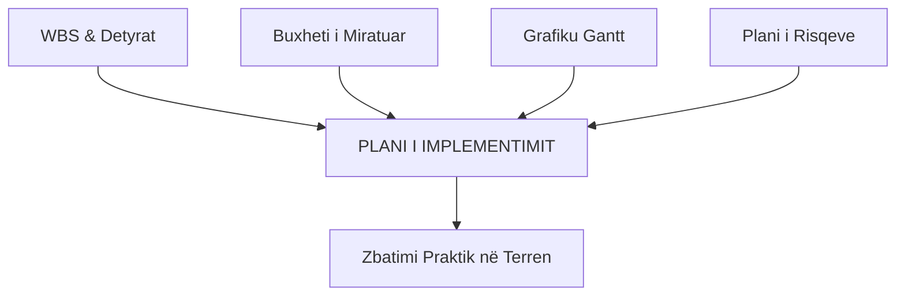
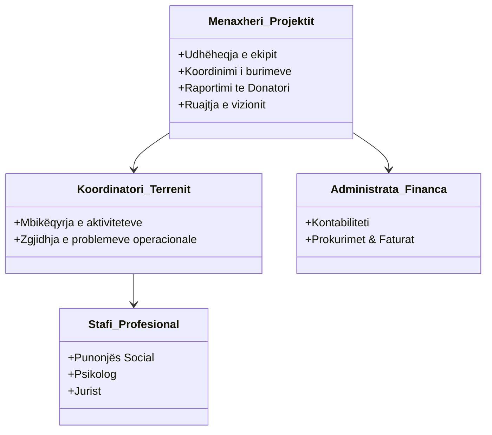

# 📌 Tema 09: Implementimi dhe Zbatimi i Projektit

`[[Tema 08 - Programimi i Projektit dhe Grafiku Gantt (CPM)|⬅️ Tema 08: Programimi dhe Gantt]]` | `[[00 - Harta e Lëndës dhe Udhëzuesi i Studimit (MOC)|Indeksi]]` | `[[Tema 10 - Monitorimi dhe Kontrolli i Projektit|Tema 10: Monitorimi dhe Kontrolli ➡️]]`

---

> [!summary] Përmbledhje Ekzekutive
> **Implementimi (Zbatimi)** shënon momentin kulmor kur planet teorike shndërrohen në veprim real në terren: "Bëje të ndodhë!". Kjo fazë konsumon pjesën dërrmuese të buxhetit dhe energjisë njerëzore. Suksesi kërkon ndërtimin e një **Plani Zbatimi** solid, ngritjen e një **strukture multidisiplinare ekipi**, caktimin e qartë të përgjegjësive me **Matricën RACI**, si dhe aftësinë e menaxherit për të mbajtur **panoramën e gjerë (Big Picture)** pa u mbytur në detajet e përditshme.

---

## 🎯 Objektivat e Mësimit
Pas studimit të këtij leksioni, ju do të jeni në gjendje të:
1. Përshkruani elementet përbërëse të një **Plani Implementimi**.
2. Ndërtoni strukturën organizative të ekipit të projektit social.
3. Zbërtheni dhe zbatoni **Matricën RACI (Responsible, Accountable, Consulted, Informed)**.
4. Menaxhoni alokimin e burimeve njerëzore dhe materiale gjatë operacioneve të përditshme.
5. Shpjegoni rëndësinë e balancimit të menaxhimit të detajeve operative me **"Panoramën e Gjerë" (Big Picture)**.
6. Menaxhoni informacionin "e butë" (disponimi, marrëdhëniet) paralelisht me të dhënat zyrtare.

---

## 1. Plani i Implementimit: Nga Letra te Terreni

Implementimi nuk është improvizim; ai bazohet në sintetizimin e planeve të mëparshme në një dokument operacional.

### Elementet Kryesore të Planit të Zbatimit:
* **Përmbledhja e aktiviteteve sipas kalendarit**: Kush bën çfarë, çdo ditë dhe javë.
* **Plani i lëvrimit të fondeve**: Kur dhe si bëhen pagesat për shërbimet dhe stafin.
* **Struktura e personelit dhe rekrutimi**: Kriteret e përzgjedhjes së ekspertëve.
* **Protokolli i komunikimit**: Si raportohen problemet e përditshme.
* **Plani i Vlerësimit**: Mekanizmat paraprakë të mbledhjes së dëshmive të progresit.

---

## 2. Struktura e Ekipit dhe Përcaktimi i Përgjegjësive

Në shërbimet sociale, ekipet e projekteve janë zakonisht **multidisiplinare** (punonjës socialë, psikologë, juristë, mjekë, financierë, shoferë).

---

## 3. Matrica RACI për Përcaktimin e Roleve

Mungesa e qartësisë rreth asaj se "kush e ka fajin" apo "kush vendos" shkatërron bashkëpunimin. Për këtë përdoret **Matrica RACI**:

* **R - Responsible (Përgjegjës për Ekzekutimin)**: Personi që bën realisht punën konkrete në terren ("bën detyrën").
* **A - Accountable (Llogaridhënës / Miratuesi Final)**: Personi që mban përgjegjësinë përfundimtare për suksesin ose dështimin. Ka autoritetin e "Vetos". **Rregull: Për çdo aktivitet duhet të ketë VETËM NJË "A"!**
* **C - Consulted (I Konsultuar)**: Eksperti me njohuri specifike që pyetet me komunikim të dyanshëm para se të merret vendimi.
* **I - Informed (I Informuar)**: Personi që vihet në dijeni me komunikim njëdrejtimor pas kryerjes së vendimit/veprimit.

### Shembull i Matricës RACI në një Projekt Social:

| Aktiviteti i Projektit | Menaxheri i Projektit | Punonjësi Social | Psikologu | Financieri | Donatori |
| :--- | :---: | :---: | :---: | :---: | :---: |
| **Vlerësimi psiko-social i klientit** | **A** | **R** | **R** | I | I |
| **Blerja e pajisjeve të qendrës** | **A** | C | I | **R** | I |
| **Hartimi i raportit financiar** | **A** | I | I | **R** | I |
| **Ndryshimi madhor i buxhetit** | **R** | I | I | C | **A** |

---

## 4. Menaxhimi i Aktiviteteve dhe Ruajtja e "Panoramës së Gjerë"

Gjatë implementimit, menaxheri përballet me tensionin midis:
* **Mikro-menaxhimit (Detajet e Përditshme)**: Zgjidhja e një fature që mungon, një zënkë midis dy anëtarëve të stafit, riparimi i printerit.
* **Makro-menaxhimit ("Big Picture" - Panorama e Gjerë)**: A po shkojmë drejt qëllimit strategjik? A po kënaqet donatori? A po sjellim impakt te komuniteti?

> [!warning] Kurthi i Zhytjes në Detaje
> Nëse menaxheri kalon gjithë ditën duke rregulluar detaje teknike të vogla, ai humbet timonin e anijes. Menaxheri duhet të delegojë detyrat operative dhe të ruajë vizionin e përgjithshëm të projektit!

---

## 5. Menaxhimi i Informacionit "të Butë" (Soft Information)

Në organizatat e përkujdesit social, suksesin e përcaktojnë shpesh faktorë jo-formalë:
* Disponimi, motivimi dhe stresi i punonjësve në kontakt me traumat e klientëve.
* Thashethemet dhe frika nga ndryshimet e procedurave.
* Marrëdhëniet e fshehta të pushtetit në bashki apo komunitet.
Një menaxher i zoti nuk lexon vetëm raporte në kompjuter; ai zbret në terren, flet me stafin, dëgjon zërat jo-formalë dhe zbut konfliktet para se të shpërthejnë.

---

## 📖 Fjalori i Termave Kyç

- **Implementimi (Zbatimi)**: Faza e ciklit të jetës ku aktivitetet e planifikuara ekzekutohen në praktikë dhe konsumohen burimet.
- **Matrica RACI**: Vegël e shpërndarjes së përgjegjësive që përcakton kush është Përgjegjës (R), Llogaridhënës (A), i Konsultuar (C) dhe i Informuar (I).
- **Llogaridhënës (Accountable)**: Personi i vetëm që mban përgjegjësinë ligjore dhe morale për rezultatin e një detyre.
- **Panorama e Gjerë (Big Picture)**: Kuptimi i përgjithshëm i misionit strategjik të projektit pa u kufizuar te pengesat e përditshme.
- **Informacioni i Butë (Soft Information)**: Të dhënat cilësore mbi marrëdhëniet njerëzore, motivimin, disponimin dhe kulturën e organizatës.

---

## 🧠 Seksioni i Memorizimit & Retrieval Practice

### 🔹 Flashcards të Fshehura (Kliko për Përgjigjen)

> [!question]- Pyetja 1: Çfarë kuptimi ka çdo shkronjë e akronimit RACI dhe cili është rregulli i artë për shkronjën "A"?
> **Përgjigjja:**
> - **R** = Responsible (Personi që kryen punën/veprimin).
> - **A** = Accountable (Personi që mban llogari përfundimtare dhe miraton).
> - **C** = Consulted (Personi ekspert që pyetet me komunikim të dyanshëm).
> - **I** = Informed (Personi që njoftohet për rezultatin).
> *Rregulli i Artë*: Për çdo aktivitet mund dhe duhet të ketë **vetëm një "A"** (një llogaridhënës të vetëm).

> [!question]- Pyetja 2: Cili është rreziku nëse menaxheri i projektit humbet "Panoramën e Gjerë" (Big Picture) gjatë fazës së zbatimit?
> **Përgjigjja:**
> Rreziku është që menaxheri të zhytet në zgjidhjen e problemeve mikroskopike operative (faturo, printo, rregullo orare) dhe të humbasë kontrollin mbi kohën globale, buxhetin total dhe qëllimin strategjik të projektit, duke çuar në devijim nga misioni.

> [!question]- Pyetja 3: Pse ekipet në projektet e shërbimeve sociale quhen "multidisiplinare"?
> **Përgjigjja:**
> Sepse përbëhen nga profesionistë të fushave të ndryshme (punonjës socialë, psikologë, mjekë, juristë, financierë) të cilët duhet të bashkëpunojnë ngushtë për të trajtuar nevojat komplekse psiko-sociale dhe ligjore të përfituesve.

---

### 🔹 Flashcards për Obsidian Spaced Repetition (Plugin)
Matrica RACI:: Vegël e menaxhimit që qartëson rolet: Responsible, Accountable, Consulted, Informed.
Roli i Llogaridhënësit (Accountable):: Personi i vetëm me autoritet përfundimtar miratimi dhe përgjegjësi totale për rezultatin e detyrës.
Roli i të Konsultuarit (Consulted):: Personi me ekspertizë që jep mendim të dyanshëm përpara se të kryhet detyra.
Panorama e Gjerë (Big Picture):: Ruajtja e fokusit te misioni, impakti dhe drejtimi strategjik i projektit gjatë operacioneve të përditshme.

---

### 🔹 Plotëso Vendet Bosh (Cloze Recall)
1. Faza ku realizohet pjesa më e madhe e punës praktike dhe shpenzimeve quhet faza e ==implementimit (zbatimit)==.
2. Në matricën RACI, shkronja që përfaqëson personin që bën punën konkrete është ==R (Responsible)==.
3. Rregulli bazë i matricës RACI përcakton se për çdo detyrë duhet të ekzistojë vetëm një ==A (Accountable)==.
4. Të dhënat mbi marrëdhëniet njerëzore, disponimin dhe perceptimet e komunitetit njihen si informacion ==i butë (soft information)==.

---

### 🔹 Checklist për Vetë-Vlerësim
- [ ] Di të ndërtoj një matricë RACI për të paktën 4 aktivitete të një projekti.
- [ ] Mund të shpjegoj dallimin midis Responsible (R) dhe Accountable (A).
- [ ] Kuptoj rëndësinë e ruajtjes së "Big Picture" përballë detajeve operative.
- [ ] Di si menaxhohet një ekip multidisiplinar në shërbimet sociale.
