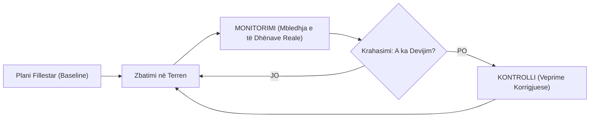
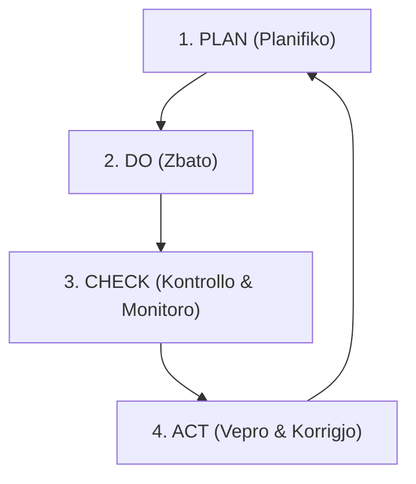
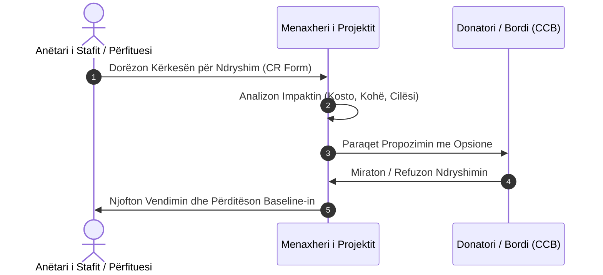

# 📌 Tema 10: Monitorimi dhe Kontrolli i Projektit

`[[Tema 09 - Implementimi dhe Zbatimi i Projektit|⬅️ Tema 09: Implementimi dhe Zbatimi]]` | `[[00 - Harta e Lëndës dhe Udhëzuesi i Studimit (MOC)|Indeksi]]` | `[[Tema 11 - Komunikimi në Menaxhimin e Projekteve|Tema 11: Komunikimi ➡️]]`

---

> [!summary] Përmbledhje Ekzekutive
> Në një botë ideale, projektet do të përfundonin fiks në kohë, brenda buxhetit dhe me standarde maksimale. Në realitet, të papriturat ndodhin përditë. **Monitorimi** është procesi i vazhdueshëm i mbledhjes së të dhënave dhe matjes së progresit real kundrejt planit, ndërsa **Kontrolli** përbën ndërmarrjen e veprimeve konkrete korrigjuese kur konstatohen devijime. Ky proces integrohet me **Ciklin PDCA** dhe me një sistem formal të **Kontrollit të Ndryshimeve (Change Control)**.

---

## 🎯 Objektivat e Mësimit
Pas studimit të këtij leksioni, ju do të jeni në gjendje të:
1. Dalloni qartë konceptin e **Monitorimit** nga ai i **Kontrollit**.
2. Zbatoni **Ciklin e Kontrollit të Deming-ut (PDCA: Plan, Do, Check, Act)**.
3. Përdorni **Piketat (Milestones)** dhe **Pikat e Kontrollit (Checkpoints)** për matjen e performancës.
4. Mbani ekuilibrin midis tre kufizimeve të trekëndëshit: Koha, Kostoja dhe Cilësia.
5. Shpjegoni dhe zbatoni **Procedurën Formale të Kontrollit të Ndryshimit (Change Control Process)**.
6. Përcaktoni dhe përditësoni vijën bazë të projektit (**Baseline**).

---

## 1. Dallimi midis Monitorimit dhe Kontrollit

Shpesh këto dy terma përdoren si sinonime, por kanë funksione krejt të ndryshme:

* **Monitorimi (Monitoring)**: Vëzhgimi, mbledhja e rregullt e të dhënave, regjistrimi dhe raportimi i ecurisë reale. Ai i përgjigjet pyetjes: *"Ku ndodhemi në krahasim me planin?"* (Funksion diagnostikues).
* **Kontrolli (Controlling)**: Vendimmarrja dhe ndërmarrja e veprimeve praktike korrigjuese kur vihet re një devijim. Ai i përgjigjet pyetjes: *"Çfarë do të bëjmë për t'i kthyer gjërat në binarë?"* (Funksion terapeutik / veprues).

---

## 2. Cikli i Kontrollit të Vazhdueshëm: Modeli PDCA

I konceptuar nga Edward Deming, cikli **PDCA** siguron përmirësim cilësor dhe mbikëqyrje të pandërprerë:

1. **Plan (Planifiko)**: Vendosja e objektivave, treguesve dhe standardeve të punës.
2. **Do (Zbato)**: Ekzekutimi i aktiviteteve sipas procedurës së rënë dakord.
3. **Check (Kontrollo)**: Matja e rezultateve, inspektimi i shërbimit dhe mbledhja e reagimeve nga përfituesit.
4. **Act (Vepro)**: Ndërhyrja korrigjuese për të eliminuar shkakun rrënjësor të devijimit.

---

## 3. Piketat (Milestones) dhe Pikat e Rishikimit (Checkpoints)

Për të mos e lënë vlerësimin vetëm në fund të projektit (kur do të ishte tepër vonë), hartohen pika të ndërmjetme:
* **Checkpoints (Pika Kontrolli Periodike)**: Takime të përjavshme ose mujore të ekipit ku rishikohen shpenzimet dhe orët e punës.
* **Milestones (Piketa Kryesore)**: Ngjarje thelbësore ku vlerësohet nëse një fazë e tërë është mbyllur me sukses para se të kalohet në fazën tjetër.

> [!example] Shembull nga Praktika Sociale
> Në një projekt trajnimi të të rinjve për integrim në tregun e punës:
> - *Monitorimi*: Zbulon se pas 3 muajsh kanë marrë pjesë vetëm 15 të rinj nga 50 të planifikuar (devijim negativ prej 70%).
> - *Kontrolli*: Menaxheri mbledh ekipin, analizon shkaqet (orari përkonte me mësimin në shkollë) dhe merr veprim korrigjues: zhvendos orarin në fundjavë dhe shton njoftimet në rrjete sociale, duke rikthyer pjesëmarrjen në normë.

---

## 4. Mbajtja e Ekuilibrave: Trekëndëshi i Kufizimeve në Veprim

Gjatë monitorimit, menaxheri duhet të mbajë ekuilibrin:
* Nëse **koha po ikën** dhe jemi vonë: Duhet shtuar buxheti (orë shtesë stafi) ose duhet reduktuar lehtë fusha e aktivitetit pa cënuar standardet bazë.
* Nëse **buxheti po tejkalohet**: Duhet gjetur mënyrë më e lirë ekzekutimi ose duhet rinegociuar me donatorin.
* **Cilësia** në shërbimet sociale nuk duhet të jetë kurrë elementi i parë që sakrifikohet, sepse dëmton drejtpërdrejt të drejtat e përfituesve vulnerabël.

---

## 5. Procesi i Kontrollit të Ndryshimit (Change Control Process)

Ndryshimet janë të pashmangshme, por ndryshimet e pastrukturuara shkatërrojnë projektin. Asnjë anëtar stafi nuk mund të ndryshojë aktivitetet kryesore pa ndjekur procedurën formale:

### Hapat e Procedurës së Ndryshimit:
1. **Formulari i Kërkesës për Ndryshim (Change Request Form)**: Dokumentohet saktë çfarë propozohet të ndryshohet dhe pse.
2. **Vlerësimi i Impaktit**: Menaxheri llogarit: *Sa ditë vonesë shkakton? Sa lekë shtesë kushton? A preket rruga kritike?*
3. **Vendimmarrja nga Autoriteti Përkatës**: Nëse ndryshimi prek më shumë se 5-10% të buxhetit apo afatin final, vendimi i takon ekskluzivisht Donatorit / Sponsorit.
4. **Përditësimi i Vijës Bazë (Baseline Update)**: Nëse miratohet, plani i ri bëhet standardi zyrtar sipas të cilit do të monitorohet projekti në vazhdim.

---

## 📖 Fjalori i Termave Kyç

- **Monitorim**: Mbledhja e vazhdueshme dhe sistematike e të dhënave për të krahasuar ecurinë reale me atë të planifikuar.
- **Kontroll**: Ndërhyrja korrigjuese dhe vendimmarrëse për të eliminuar devijimet dhe siguruar arritjen e objektivave.
- **Cikli PDCA**: Cikli Plan-Do-Check-Act i përmirësimit të vazhdueshëm të cilësisë.
- **Kërkesë për Ndryshim (Change Request)**: Dokument formal me shkrim që kërkon modifikimin e fushës, kohës ose buxhetit të projektit.
- **Vija Bazë (Baseline)**: Plani fillestar i miratuar i projektit (koha, kostoja, fusha) me të cilin krahasohet ecuria reale.

---

## 🧠 Seksioni i Memorizimit & Retrieval Practice

### 🔹 Flashcards të Fshehura (Kliko për Përgjigjen)

> [!question]- Pyetja 1: Cili është dallimi thelbësor midis "Monitorimit" dhe "Kontrollit"?
> **Përgjigjja:**
> - **Monitorimi** është vëzhgimi, mbledhja e të dhënave dhe konstatimi i gjendjes reale kundrejt planit (*diagnostikim*).
> - **Kontrolli** është vendimmarrja dhe ndërmarrja e veprimeve korrigjuese për të ndrequr devijimet (*veprim/terapi*).

> [!question]- Pyetja 2: Cilat janë 4 hapat e ciklit të Deming-ut (PDCA)?
> **Përgjigjja:**
> 1. **P - Plan**: Planifiko objektivat dhe metodat.
> 2. **D - Do**: Zbato aktivitetet në terren.
> 3. **C - Check**: Kontrollo dhe mat rezultatet reale kundrejt planit.
> 4. **A - Act**: Vepro dhe ndërmerr masa korrigjuese për përmirësim.

> [!question]- Pyetja 3: Përshkruani hapat e procesit formal të Kontrollit të Ndryshimeve (Change Control).
> **Përgjigjja:**
> 1. Plotësimi i formularit të kërkesës për ndryshim (Change Request).
> 2. Vlerësimi i impaktit mbi kohën, koston dhe cilësinë nga menaxheri.
> 3. Shqyrtimi dhe miratimi/refuzimi nga Donatori ose Bordi (CCB).
> 4. Përditësimi i planeve dhe i vijës bazë (baseline) nëse ndryshimi pranohet.

> [!question]- Pyetja 4: Çfarë është një "Baseline" (Vija Bazë) e projektit?
> **Përgjigjja:**
> Vija bazë (Baseline) është plani fillestar i miratuar zyrtarisht (për koston, kohën dhe fushën), i cili shërben si pikë referimi e pandryshueshme për të matur të gjitha devijimet e mëvonshme gjatë monitorimit.

---

### 🔹 Flashcards për Obsidian Spaced Repetition (Plugin)
Monitorim:: Mbledhja e vazhdueshme e të dhënave për të diagnostikuar ku ndodhet projekti në krahasim me planin.
Kontroll:: Marrja e masave praktike korrigjuese për të kthyer ecurinë e projektit drejt objektivave të përcaktuara.
Cikli PDCA:: Modeli 4-hapësh: Plan (Planifiko), Do (Zbato), Check (Kontrollo), Act (Vepro).
Change Request:: Kërkesë formale me shkrim për ndryshimin e fushës, buxhetit apo afateve të projektit.
Baseline:: Plani bazë i miratuar i referencës kundrejt të cilit matet ecuria reale e projektit.

---

### 🔹 Plotëso Vendet Bosh (Cloze Recall)
1. Matja dhe vëzhgimi i progresit përbën procesin e ==monitorimit==, ndërsa veprimi korrigjues përbën ==kontrollin==.
2. Cikli i famshëm i cilësisë së Deming-ut përfaqësohet nga akronimi ==PDCA==.
3. Çdo modifikim thelbësor në buxhet apo kohëzgjatje kërkon miratimin përmes një ==kërkese për ndryshim (change request)==.
4. Plani origjinal i miratuar që përdoret si standard krahasimi quhet ==vija bazë (baseline)==.

---

### 🔹 Checklist për Vetë-Vlerësim
- [ ] Di të shpjegoj dallimin midis monitorimit dhe kontrollit me shembuj praktikë.
- [ ] Mund të skicoj dhe shpjegoj ciklin PDCA.
- [ ] Di të përshkruaj të gjithë hapat e procedurës së kontrollit të ndryshimit.
- [ ] Kuptoj rolin e piketave (milestones) dhe pikave të kontrollit (checkpoints).
