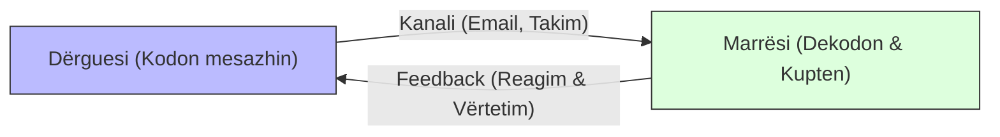
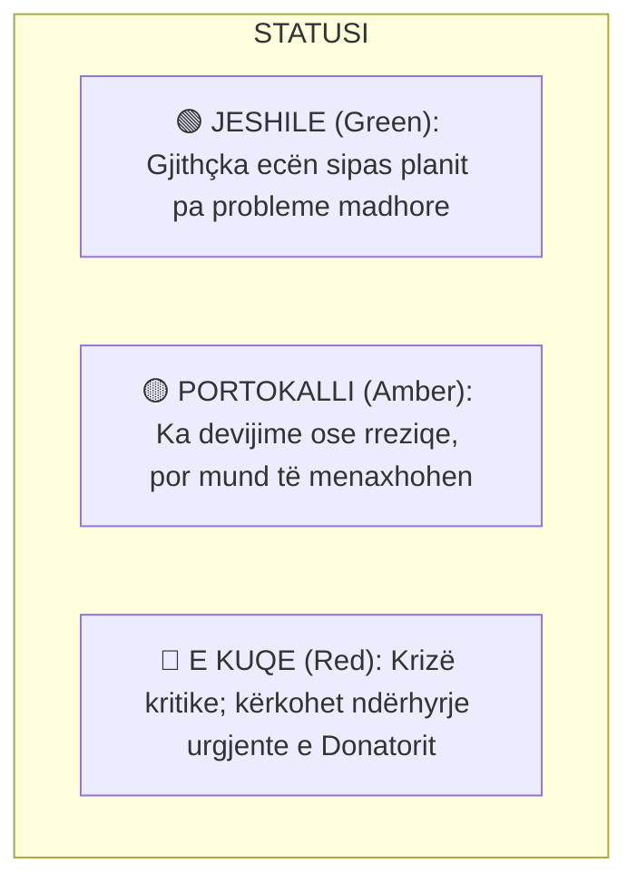

# 📌 Tema 11: Komunikimi në Menaxhimin e Projekteve

`[[Tema 10 - Monitorimi dhe Kontrolli i Projektit|⬅️ Tema 10: Monitorimi dhe Kontrolli]]` | `[[00 - Harta e Lëndës dhe Udhëzuesi i Studimit (MOC)|Indeksi]]` | `[[Tema 12 - Lidershipi dhe Puna në Ekip|Tema 12: Lidershipi dhe Puna në Ekip ➡️]]`

---

> [!summary] Përmbledhje Ekzekutive
> Studimet tregojnë se menaxheri i projektit shpenzon **nga 75% deri në 90% të kohës së tij duke komunikuar**. Komunikimi nuk është thjesht dërgim informacioni, por një **proces i dyanshëm** që kërkon dëgjim aktiv, feedback dhe përshtatje sipas audiencës. Në shërbimet sociale, komunikimi kërkon një ekuilibër delikat midis **transparencës me donatorin** dhe **ruajtjes së rreptë të konfidencialitetit** të të dhënave personale të përfituesve vulnerabël.

---

## 🎯 Objektivat e Mësimit
Pas studimit të këtij leksioni, ju do të jeni në gjendje të:
1. Përkufizoni komunikimin si proces të dyanshëm dhe të shpjegoni rëndësinë e dialogut.
2. Ndërtoni një **Plan Komunikimi të Projektit** (Kush, Çfarë, Kur, Si).
3. Hartoni një **Raport Statusi / Progresi** të projektit duke përdorur sistemin me ngjyra (Semafori: Jeshile, Portokalli, Kuqe).
4. Menaxhoni rrjedhën e informacionit dhe të shmangni mbingarkesën informative.
5. Balanconi kërkesën për akses në informacion me **Konfidencialitetin dhe Mbrojtjen e të Dhënave**.
6. Identifikoni dhe kapërceni barrierat kryesore të komunikimit efektiv.

---

## 1. Komunikimi si Proces i Dyanshëm: Dallimi midis Monologut dhe Dialogut

Në menaxhimin e projekteve sociale, komunikimi nuk është thjesht lëshimi i urdhrave nga lart-poshtë:
* **Komunikimi i njëanshëm (Transmetimi)**: Dërguesi dërgon një email ose njoftim pa u interesuar nëse marrësi e kuptoi apo e pranoi.
* **Komunikimi i dyanshëm (Dialogu)**: Përfshin dërgimin e mesazhit, marrjen e reagimit (feedback), sqarimin e paqartësive dhe ndërtimin e mirëkuptimit të ndërsjellë.



---

## 2. Plani i Komunikimit të Projektit

Për të shmangur kaosin, hartohet një **Matricë e Komunikimit** që përcakton rregullat e shkëmbimit të informacionit:

| Palët e Interesuara (Kush?) | Informacioni i Nevojshëm (Çfarë?) | Frekuenca (Kur?) | Kanali / Formati (Si?) | Përgjegjësi (Kush e dërgon?) |
| :--- | :--- | :--- | :--- | :--- |
| **Donatori Kryesor** | Raporti financiar & ecuria e objektivave | Çdo 3 muaj | Raport zyrtar me shkrim & Takim | Menaxheri i Projektit |
| **Ekipi i Terrenit** | Detyrat javore, problemet e rasteve | Çdo javë | Mbledhje e shkurtër operacionale | Koordinatori i Shërbimeve |
| **Përfituesit / Familjarët** | Orari i shërbimeve, aktivitete të reja | Çdo muaj | Fletëpalosje, SMS, Takime ballë për ballë | Punonjësi Social |
| **Kryetari i Bashkisë** | Përmbledhje ekzekutive mbi ndikimin | Çdo 6 muaj | Prezantim i shkurtër vizual (PowerPoint) | Menaxheri i Projektit |

---

## 3. Raporti i Statusit (Gjendjes) së Projektit: Sistemi i Semaforit

Raporti i statusit informon shpejt sponsorin mbi ecurinë e projektit. Një nga format më efikase ndërkombëtare është **Sistemi RAG (Red - Amber - Green)**:



### Elementet e Raportit të Progresit:
1. **Periudha e raportimit** dhe data.
2. **Statusi i përgjithshëm** (Jeshile / Portokalli / E Kuqe).
3. **Arritjet kryesore gjatë periudhës** (çfarë u përfundua me sukses).
4. **Krahasimi me grafikun kohor dhe buxhetin** (analiza e devijimeve).
5. **Problemet dhe risqet e reja të shfaqura**.
6. **Prioritetet dhe aktivitetet e planifikuara për periudhën vijuese**.

---

## 4. Aksesi në Informacion vs. Konfidencialiteti në Shërbimet Sociale

Ky është një nga dimensionet më delikate etike dhe profesionale:

```mermaid
balance
```

* **Nevoja për Transparencë**: Donatori, audituesit dhe publiku kanë të drejtë të dinë se si po shpenzohen fondet publike dhe sa persona janë ndihmuar.
* **Detyrimi i Konfidencialitetit**: Kodi i Etikës së Punonjësit Social dhe legjislacioni mbi mbrojtjen e të dhënave personale (GDPR / Ligji Shqiptar për Mbrojtjen e të Dhënave) **ndalojnë rreptësisht** publikimin e emrave, fotografive të paautorizuara, diagnozave mjekësore apo adresave të viktimave të dhunës dhe fëmijëve vulnerabël.

> [!important] Rregulli Profesional i Anonimizimit
> Në të gjitha raportet publike dhe prezantimet e projektit, të dhënat e klientëve paraqiten **të agreguara dhe të anonimizuara** (p.sh. *"Klienti A, 12 vjeç"* dhe jo me emër e mbiemër). Ruajtja e dosjeve duhet të bëhet me fjalëkalime të enkriptuara dhe çelës fizik.

---

## 5. Barrierat e Komunikimit Efektiv dhe Kapërcimi i Tyre

Pse shpesh komunikimi dështon në projekte?
1. **Barrierat Gjuhësore dhe Zhargoni Profesional**: Përdorimi i termave tepër teknikë midis punonjësit social, juristit dhe programuesit të IT-së krijon keqkuptime.
2. **Mbingarkesa me Informacion (Information Overload)**: Dërgimi i dhjetëra emaileve të gjata çdo ditë bën që anëtarët e stafit të mos i lexojnë dot mesazhet kritike.
3. **Barrierat Psikologjike dhe Frika**: Stafi heziton të raportojë gabimet apo vonesat nga frika e ndëshkimit të menaxherit.
4. **Mungesa e Dëgjimit Aktiv**: Njerëzit dëgjojnë për t'u përgjigjur dhe për t'u mbrojtur, jo për të kuptuar thelbin e shqetësimit të tjetrit.

---

## 📖 Fjalori i Termave Kyç

- **Komunikimi i Dyanshëm**: Proces shkëmbimi informacioni ku dërguesi dhe marrësi ndërveprojnë nëpërmjet feedback-ut të vazhdueshëm.
- **Plani i Komunikimit**: Dokument strategjik që specifikon kush merr çfarë informacioni, kur, si dhe nga kush.
- **Sistemi RAG (Semafori)**: Metodologji raportimi që përdor ngjyrat e kuqe, portokalli dhe jeshile për të treguar shëndetin e projektit.
- **Konfidencialiteti**: Detyrim ligjor dhe etik për mbrojtjen e privatësisë dhe sekretit profesional të përfituesve të shërbimit social.
- **Feedback (Reagimi Kthyes)**: Informacioni që marrësi i kthen dërguesit për të konfirmuar kuptueshmërinë e mesazhit.

---

## 🧠 Seksioni i Memorizimit & Retrieval Practice

### 🔹 Flashcards të Fshehura (Kliko për Përgjigjen)

> [!question]- Pyetja 1: Çfarë kuptimi ka secila ngjyrë në Sistemin e Raportimit me Semafor (RAG)?
> **Përgjigjja:**
> - 🟢 **Jeshile (Green)**: Projekti është në rrugën e duhur; koha, kostoja dhe cilësia janë brenda parametrave të planit.
> - 🟡 **Portokalli (Amber)**: Ka vonesa apo probleme të moderuara që kërkojnë vëmendje dhe masa nga menaxheri, por nuk janë kritike.
> - 🔴 **E Kuqe (Red)**: Situatë krize; projekti ka devijime madhore dhe nuk arrin dot objektivat pa ndërhyrjen e menjëhershme të sponsorit/donatorit.

> [!question]- Pyetja 2: Cili është dallimi midis komunikimit si "transmetim" dhe komunikimit si "dialog"?
> **Përgjigjja:**
> - **Transmetimi** është i njëanshëm (njëra palë flet/dërgon njoftim pa u kujdesur për reagimin e tjetrit).
> - **Dialogu** është i dyanshëm, ku dëgjimi aktiv dhe feedback-u krijojnë mirëkuptim të përbashkët dhe mundësojnë zgjidhjen e problemeve.

> [!question]- Pyetja 3: Si balancohet e drejta për transparencë e donatorit me detyrimin e konfidencialitetit të përfituesve në punë sociale?
> **Përgjigjja:**
> Duke paraqitur të dhëna sasiore të përgjithshme dhe tregues agregatë (p.sh. *"u trajtuan 120 gra viktima të dhunës"*), por duke anonimizuar plotësisht identitetin, emrat, fotografitë dhe adresat personale të përfituesve për të ruajtur dinjitetin dhe sigurinë e tyre sipas ligjit.

> [!question]- Pyetja 4: Cilat janë 4 pyetjet kyçe që duhet të marrin përgjigje në një Plan Komunikimi?
> **Përgjigjja:**
> 1. **Kush?** (Cila palë e interesuar ka nevojë për informacion).
> 2. **Çfarë?** (Cili informacion specifik do të komunikohet).
> 3. **Kur?** (Sa shpesh / frekuenca e raportimit).
> 4. **Si?** (Kanali dhe formati: takim, email, raport i shkruar).

---

### 🔹 Flashcards për Obsidian Spaced Repetition (Plugin)
Sistemi RAG (Semafori):: Metodë raportimi progresi me ngjyrat Red (Krizë), Amber (Kujdes), Green (Në vijë të mbarë).
Dëgjim Aktiv:: Dëgjimi me përqendrim të plotë për të kuptuar përmbajtjen dhe emocionin e bashkëbiseduesit para se të jepet përgjigjja.
Konfidencialiteti në Projektet Sociale:: Mbrojtja e detyrueshme etiko-ligjore e të dhënave personale të individëve dhe grupeve vulnerabël.
Mbingarkesa me Informacion:: Situatë ku sasia e tepërt e komunikimit dëmton aftësinë e ekipit për të veçuar mesazhet prioritare.

---

### 🔹 Plotëso Vendet Bosh (Cloze Recall)
1. Menaxheri i projektit shpenzon mesatarisht rreth ==75% deri 90%== të kohës së tij duke komunikuar.
2. Sistemi i raportimit të statusit që përdor ngjyrat e kuqe, portokalli dhe jeshile quhet sistemi ==RAG (ose Semafori)==.
3. Në fushën sociale, ruajtja e identitetit dhe privatësisë së klientëve njihet si parimi i ==konfidencialitetit==.
4. Informacioni që marrësi i kthen dërguesit për të verifikuar kuptueshmërinë e mesazhit quhet ==feedback (reagim)==.

---

### 🔹 Checklist për Vetë-Vlerësim
- [ ] Di të ndërtoj një matricë të planit të komunikimit për të gjithë stakeholderat.
- [ ] Mund të shpjegoj kuptimin e ngjyrave në sistemin RAG.
- [ ] Di si trajtohet konfidencialiteti i të dhënave të klientëve në një raport donatori.
- [ ] Mbaj mend të paktën 4 barriera komunikimi dhe mënyrat e eliminimit të tyre.
