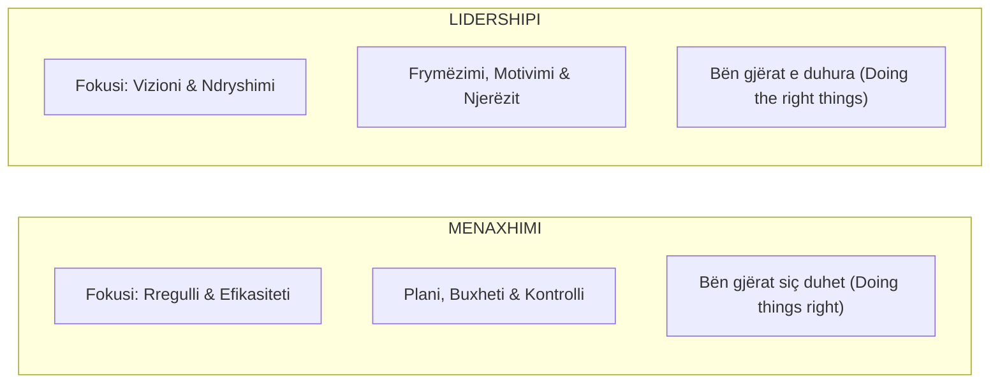
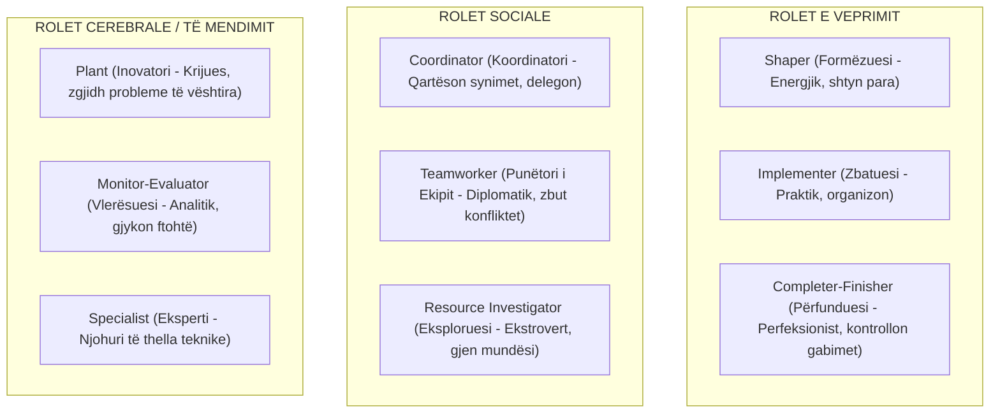
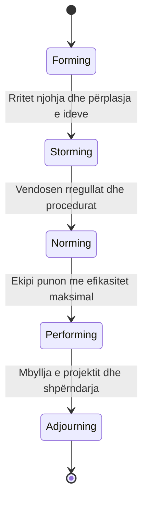

# 📌 Tema 12: Lidershipi dhe Puna në Ekip

`[[Tema 11 - Komunikimi në Menaxhimin e Projekteve|⬅️ Tema 11: Komunikimi]]` | `[[00 - Harta e Lëndës dhe Udhëzuesi i Studimit (MOC)|Indeksi]]` | `[[Tema 13 - Menaxhimi i Performancës dhe Konflikteve|Tema 13: Menaxhimi i Performancës ➡️]]`

---

> [!summary] Përmbledhje Ekzekutive
> Menaxhimi i një projekti social pa lidership është si të drejtosh një makinë pa timon. Ndërsa **menaxheri** kujdeset për rregullin, buxhetin dhe afatet, **lideri** frymëzon, motivon dhe udhëheq ekipin përmes pasigurisë. Ky leksion trajton **burimet e fuqisë/pushtetit** në organizata, **stilet e lidershipit**, 9 rolet e ekipit sipas **Dr. Meredith Belbin**, si dhe 5 fazat e domosdoshme të zhvillimit të një ekipi sipas **Bruce Tuckman** (Forming, Storming, Norming, Performing, Adjourning).

---

## 🎯 Objektivat e Mësimit
Pas studimit të këtij leksioni, ju do të jeni në gjendje të:
1. Analizoni dallimet thelbësore midis **Menaxherit** dhe **Liderit** të projektit.
2. Shpjegoni 5 burimet themelore të fuqisë (French & Raven): Pushteti Legjitim, i Shpërblimit, Koercitiv, i Ekspertit dhe Referues.
3. Përshtatni **Stilin e Lidershipit** sipas situatës (Direktiv, Mbështetës, Pjesëmarrës, Laissez-faire).
4. Identifikoni dhe balanconi **Rolet e Ekipit sipas Belbin** në një grup multidisiplinar.
5. Diagnostikoni dhe udhëhiqni ekipin nëpër 5 fazat e **Modelit të Tuckman**.
6. Menaxhoni vetveten, balancën e kohës dhe nivelin e stresit si drejtues projekti.

---

## 1. Menaxhimi vs. Lidershipi në Projekte

Bota e menaxhimit shpesh i ngatërron këto dy koncepte, por ato plotësojnë njëra-tjetrën:

| Dimensioni | Menaxheri i Projektit | Lideri i Projektit |
| :--- | :--- | :--- |
| **Fokusi Kryesor** | Strukturat, proceset, buxheti, afatet | Njerëzit, kultura, motivimi, e ardhmja |
| **Qasja ndaj Ndryshimit** | Menaxhon dhe minimizon devijimet | Krijon dhe promovon ndryshimin social |
| **Marrëdhënia me Stafin** | Mbështetet te kontrolli dhe autoriteti | Mbështetet te besimi, frymëzimi dhe shembulli |
| **Pyetja Bazë** | *"Si dhe kur do ta bëjmë?"* | *"Pse po e bëjmë dhe kush përfiton?"* |

---

## 2. Burimet e Fuqisë dhe Pushtetit (Modeli French & Raven)

Menaxherët e projekteve shpesh duhet të udhëheqin profesionistë mbi të cilët **nuk kanë autoritet formal administrativ** (p.sh. një mjek apo punonjës bashkie i deleguar përkohësisht). Prandaj duhet të njihen burimet e pushtetit:

1. **Pushteti Legjitim (I Pozicionit)**: Buron nga titulli formal zyrtar (p.sh. emërimi me vendim drejtori).
2. **Pushteti i Shpërblimit (Reward Power)**: Aftësia për të dhënë bonuse, lëvdata, promovime ose trajnime jashtë shtetit.
3. **Pushteti Ndëshkues / Koercitiv (Coercive Power)**: Aftësia për të vendosur sanksione, masa disiplinore ose shkarkim. *(Duhet përdorur me shumë kursim!)*
4. **Pushteti i Ekspertit (Expert Power)**: Respekti që fiton menaxheri nga njohuritë e tij të thella profesionale në fushën e punës sociale ose menaxhimit.
5. **Pushteti i Referencës / Karizmatik (Referent Power)**: Fuqia që vjen nga personaliteti, integriteti etik dhe aftësia për të bërë që të tjerët të të admirojnë dhe të duan të të ndjekin.
6. **Pushteti i Informacionit / Burimeve**: Zotërimi i të dhënave kyçe dhe kontrolli mbi fondet dhe mjetet e nevojshme të punës.

---

## 3. Stilet e Lidershipit Situacional

Nuk ka një stil të vetëm të përsosur; lideri efektiv e ndryshon stilin sipas pjekurisë së ekipit dhe natyrës së detyrës:
* **Stili Direktues (Autokratik / Udhëzues)**: *Unë vendos, ju zbatoni.* I domosdoshëm në situata emergjence, krizash apo kur stafi është tërësisht pa përvojë.
* **Stili Këshillues / Trajnues (Selling / Coaching)**: Lideri shpjegon arsyet, kërkon mendime, por vendimin përfundimtar e merr vetë.
* **Stili Pjesëmarrës / Demokratik (Participating)**: Vendimet merren së bashku me ekipin përmes konsensusit. Ideale për profesionistë me përvojë të lartë.
* **Stili Delegues (Laissez-faire)**: Lideri u jep liri të plotë anëtarëve të ekipit të marrin vendime dhe raportojnë vetëm rezultatet.

---

## 4. Rolet e Ekipit sipas Dr. Meredith Belbin

Një ekip i suksesshëm nuk përbëhet nga njerëz me aftësi të njëjta, por nga personalitete plotësuese. Dr. Belbin identifikoi 9 role kryesore:

> [!important] Rëndësia e Ekuilibrit
> Nëse një ekip ka vetëm "Inovatorë (Plants)", do të ketë shumë ide por asnjë veprim. Nëse ka vetëm "Formëzues (Shapers)", do të ketë grindje për pushtet. Suksesi qëndron te larmia e roleve!

---

## 5. Fazat e Zhvillimit të Ekipit sipas Bruce Tuckman

Çdo grup njerëzish që fillon të punojë bashkë kalon detyrimisht nëpër 5 faza kronologjike:

1. **Forming (Formimi)**: Anëtarët sapo janë mbledhur. Janë të sjellshëm, të pasigurt dhe të rezervuar. Roli i liderit duhet të jetë **shumë direktues** për të sqaruar synimet.
2. **Storming (Stuhia / Përplasja)**: Fillojnë fërkimet e para për pushtet, role dhe ngarkesë pune. Kjo fazë është **e pashmangshme dhe e shëndetshme**. Lideri duhet të menaxhojë konfliktet dhe të dëgjojë.
3. **Norming (Normimi / Stabilizimi)**: Ekipi krijon rregullat e brendshme, ndjenjën e përkatësisë ("ne") dhe metodat e punës. Rritet besimi.
4. **Performing (Performimi)**: Ekipi arrin pjekurinë e plotë. Konfliktet zgjidhen shpejt, motivimi është i lartë dhe fokusi është 100% te arritja e rezultateve.
5. **Adjourning (Shpërbërja / Mbyllja)**: Projekti përfundon. Ekipi ndjen keqardhje për ndarjen, por feston arritjet e përbashkëta.

---

## 📖 Fjalori i Termave Kyç

- **Lidership**: Aftësia për të frymëzuar, motivuar dhe udhëhequr individët drejt realizimit të një vizioni të përbashkët.
- **Pushteti i Referencës**: Ndikim i bazuar në admirimin personal, karizmën dhe integritetin e liderit.
- **Pushteti i Ekspertit**: Ndikim që buron nga zotërimi i njohurive dhe aftësive të thella profesionale.
- **Modeli Belbin**: Teori menaxheriale që klasifikon 9 rolet thelbësore të personaliteteve brenda një ekipi pune.
- **Modeli Tuckman**: Teoria e zhvillimit të ekipit nëpër 5 faza: Forming, Storming, Norming, Performing, Adjourning.

---

## 🧠 Seksioni i Memorizimit & Retrieval Practice

### 🔹 Flashcards të Fshehura (Kliko për Përgjigjen)

> [!question]- Pyetja 1: Cilat janë 5 fazat e zhvillimit të ekipit sipas modelit të Bruce Tuckman?
> **Përgjigjja:**
> 1. **Forming (Formimi)**: Njohja fillestare, sjellje e rezervuar.
> 2. **Storming (Stuhia)**: Përplasje idesh, rezistencë dhe konflikt për role.
> 3. **Norming (Normimi)**: Stabilizim, vendosje rregullash dhe bashkëpunim.
> 4. **Performing (Performimi)**: Efikasitet maksimal dhe punë e pavarur e ekipit.
> 5. **Adjourning (Shpërbërja)**: Mbyllja e projektit dhe vlerësimi përfundimtar.

> [!question]- Pyetja 2: Cili është dallimi thelbësor midis "Pushtetit të Pozicionit" (Legjitim) dhe "Pushtetit të Referencës"?
> **Përgjigjja:**
> - **Pushteti i Pozicionit** vjen nga titulli formal dhe hierarkia zyrtare në letër (njerëzit binden sepse janë të detyruar me kontratë).
> - **Pushteti i Referencës** buron nga karakteri, etika, karizma dhe respekti që gëzon personi (njerëzit e ndjekin sepse kanë besim dhe dëshirojnë ta ndjekin).

> [!question]- Pyetja 3: Pse faza e "Storming" (Stuhisë) është e domosdoshme për rritjen e një ekipi?
> **Përgjigjja:**
> Sepse pa shprehur hapur mosmarrëveshjet dhe pa përplasur idetë rreth roleve dhe metodave të punës, problemet mbeten të fshehura nën rrogoz. Zgjidhja konstruktive e konfliktit në Storming vendos themelet e besimit të vërtetë për fazën e Norming.

> [!question]- Pyetja 4: Cilat janë 3 kategoritë e mëdha ku ndahen 9 rolet e Belbin-it?
> **Përgjigjja:**
> 1. **Rolet e Veprimit**: Shaper, Implementer, Completer-Finisher.
> 2. **Rolet Sociale**: Coordinator, Teamworker, Resource Investigator.
> 3. **Rolet Cerebrale (të Mendimit)**: Plant, Monitor-Evaluator, Specialist.

---

### 🔹 Flashcards për Obsidian Spaced Repetition (Plugin)
5 Fazat e Tuckman:: Forming (Formimi), Storming (Stuhia), Norming (Normimi), Performing (Performimi), Adjourning (Shpërbërja).
Pushteti i Ekspertit:: Fuqia dhe respekti që fiton drejtuesi nga dijet dhe kompetencat e tij të thella profesionale.
Roli "Plant" (Belbin):: Personaliteti krijues dhe vizionar që propozon ide inovative për zgjidhjen e problemeve komplekse.
Roli "Completer-Finisher" (Belbin):: Anëtari perfeksionist që siguron përmbushjen e të gjitha standardeve pa asnjë gabim apo lëshim.

---

### 🔹 Plotëso Vendet Bosh (Cloze Recall)
1. Faza ku ekipi përballet me fërkimet dhe konfliktet e para sipas Tuckman-it quhet faza e ==Storming (Stuhisë)==.
2. Fuqia që buron nga personaliteti, karizma dhe integriteti etik njihet si pushtet ==i referencës (referent power)==.
3. Teoria e 9 roleve të balancuara brenda një ekipi pune u formulua nga Dr. ==Meredith Belbin==.
4. Ndërsa menaxheri merret kryesisht me proceset dhe buxhetin, lideri merret kryesisht me ==frymëzimin dhe vizionin e njerëzve==.

---

### 🔹 Checklist për Vetë-Vlerësim
- [ ] Di të rendis dhe shpjegoj të 5 fazat e modelit të Tuckman.
- [ ] Mund të shpjegoj të paktën 5 burime të pushtetit sipas French & Raven.
- [ ] Di të emërtoj të paktën 4 nga 9 rolet e Belbin dhe rëndësinë e tyre.
- [ ] Kuptoj dallimin thelbësor midis rolit të liderit dhe menaxherit.
