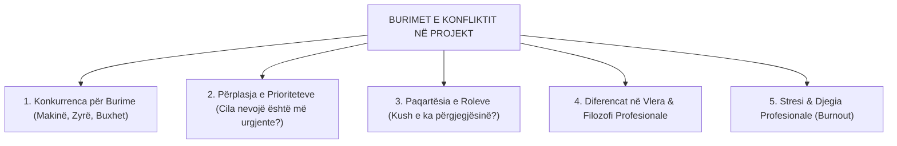
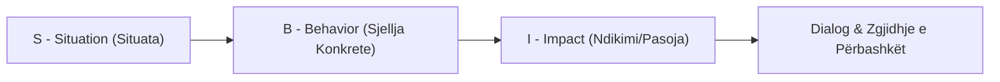

# 📌 Tema 13: Menaxhimi i Performancës dhe Konflikteve

`[[Tema 12 - Lidershipi dhe Puna në Ekip|⬅️ Tema 12: Lidershipi dhe Puna në Ekip]]` | `[[00 - Harta e Lëndës dhe Udhëzuesi i Studimit (MOC)|Indeksi]]` | `[[Tema 14 - Përfundimi dhe Mbyllja e Projektit|Tema 14: Përfundimi dhe Mbyllja ➡️]]`

---

> [!summary] Përmbledhje Ekzekutive
> Performanca e shkëlqyer në një projekt nuk vjen rastësisht; ajo ndërtohet mbi **pritshmëri eksplicite**, mbështetje profesionale dhe trajtim të shpejtë të **konflikteve**. Konflikti në ekipet e projekteve sociale është i pashmangshëm për shkak të ngarkesës emocionale dhe burimeve të kufizuara. Ky leksion trajton **5 stilet e zgjidhjes së konfliktit sipas Thomas-Kilmann**, mënyrën e trajtimit të **performancës së dobët** përmes feedback-ut konstruktiv, si dhe zbatimin e **procedurave disiplinore dhe të ankimimit**.

---

## 🎯 Objektivat e Mësimit
Pas studimit të këtij leksioni, ju do të jeni në gjendje të:
1. Përkufizoni menaxhimin e performancës dhe të qartësoni kërkesat e punës për stafin.
2. Identifikoni shkaqet kryesore të konfliktit në projektet sociale (burimet, rolet, vlerat).
3. Përzgjidhni stilin e duhur të zgjidhjes së konfliktit sipas **Modelit Thomas-Kilmann** (Bashkëpunim, Kompromis, Akomodim, Shmangie, Detyrim).
4. Diagnostikoni shkaqet e **performancës së dobët** dhe të hartoni një Plan Përmirësimi (PIP).
5. Jepni feedback konstruktiv sipas modelit profesional **SBI (Situatë - Sjellje - Impakt)**.
6. Zbatoni me korrektësi ligjore **Procedurat e Ankimimit** dhe **Procedurat Disiplinore**.

---

## 1. Përgatitja për Performancë të Mirë: Qartësia e Pritshmërive

Në fillim të projektit, shumë menaxherë supozojnë gabimisht se "stafi e di vetë çfarë duhet të bëjë". Mungesa e qartësisë është shkaktari numër një i performancës mediokre.

### Kushtet për Performancë të Lartë:
* **Përshkrim pune i detajuar**: Detyrat, përgjegjësitë dhe kufijtë e autoritetit.
* **Standarde të matshme suksesi**: Si matet cilësia e shërbimit (treguesit e performancës - KPI).
* **Trajnimi dhe zhvillimi i vazhdueshëm**: Identifikimi i hendekut të aftësive (Skill Gap) dhe organizimi i trajnimeve.
* **Mjetet e nevojshme**: Sigurimi i pajisjeve, bazës materiale dhe fondeve operacionale në kohë.

---

## 2. Natyra dhe Burimet e Konfliktit në Projektet Sociale

Konflikti nuk është domosdoshmëri e keqe; ai tregon se njerëzve u intereson puna e tyre. Megjithatë, konflikti i pazgjidhur helmon atmosferën e ekipit.



---

## 3. Pesë Stilet e Menaxhimit të Konfliktit (Modeli Thomas-Kilmann)

Modeli bazohet në dy dimensione: **Asertiviteti** (fokusi te qëllimet e mia) dhe **Bashkëpunimi** (fokusi te marrëdhënia me tjetrin):

```mermaid
quadrantChart
    title Modeli i Konfliktit Thomas-Kilmann
    x-axis Bashkëpunim i Ulët --> Bashkëpunim i Lartë
    y-axis Asertivitet i Ulët --> Asertivitet i Lartë
    quadrant-1 BASHKËPUNIMI (Win-Win)
    quadrant-2 DETYRIMI / KONKURRIMI (Win-Lose)
    quadrant-3 SHMANGIA (Lose-Lose)
    quadrant-4 AKOMODIMI (Lose-Win)
    "KOMPROMISI (Mesi i Artë)": [0.50, 0.50]
```

1. **Bashkëpunimi (Collaborating - Win/Win)**: *Zgjidhja optimale.* Të dyja palët ulen, analizojnë thelbin e problemit dhe gjejnë një zgjidhje të re që plotëson plotësisht interesat e të dyve. Kërkon kohë dhe besim.
2. **Kompromisi (Compromising - Ndarja përgjysmë)**: Çdo palë heq dorë nga diçka për të arritur një marrëveshje të shpejtë të pranueshme.
3. **Akomodimi (Accommodating - Lose/Win)**: Njëra palë toleron dhe heq dorë nga kërkesa e saj për hir të ruajtjes së paqes dhe marrëdhënies me kolegun.
4. **Detyrimi / Konkurrimi (Competing / Forcing - Win/Lose)**: Menaxheri përdor autoritetin zyrtar për të vendosur me forcë. Zbatohet vetëm në kriza madhore, emergjenca ose shkelje të rënda etike.
5. **Shmangia (Avoiding - Lose/Lose)**: Palët bëjnë sikur nuk ka problem dhe injorojnë përplasjen. E dobishme vetëm për çështje të parëndësishme pa ndikim në projekt.

---

## 4. Përballja me Performancën e Dobët: Modeli SBI

Kur një anëtar i stafit nuk i përmbush objektivat ose vonon detyrat, menaxheri duhet të ndërhyjë shpejt.



### Shembull i Përdorimit të Modelit SBI:
* **Situata (S)**: *"Dje në orën 10:00 gjatë takimit me familjen përfituese..."*
* **Sjellja (B)**: *"Ju mbërritët 30 minuta me vonesë dhe nuk kishit përgatitur dosjen e vlerësimit..."*
* **Impakti (I)**: *"Kjo shkaktoi pasiguri te nëna e fëmijës dhe la përshtypje jo-profesionale për shërbimin tonë."*
* **Hapi pasardhës**: Dëgjohet shpjegimi i punonjësit dhe hartohet një **Plan Përmirësimi i Performancës (PIP)** me afate 2-javore.

---

## 5. Procedurat Disiplinore dhe Procedurat e Ankimimit

Kur këshillimi dhe feedback-u dështojnë, aktivizohen instrumentet ligjore të parashikuara në Kodin e Punës dhe Rregulloren e Brendshme:

### A. Procedurat Disiplinore (Kur punonjësi shkel rregullat):
1. **Këshillim verbal privat**.
2. **Vërejtje me shkrim** e depozituar në dosjen personale.
3. **Vërejtje me paralajmërim për shkarkim** (me një afat të caktuar për përmirësim).
4. **Pezullim i përkohshëm ose ndërprerje e kontratës së punës**.

### B. Procedurat e Ankimimit (Grievance Procedures - Kur punonjësi ankohet):
* I japin çdo anëtari të stafit të drejtën ligjore të ankohet për trajtim të padrejtë, ngacmim, mbingarkesë të pajustifikuar ose kushte të pasigurta pune.
* Procesi kërkon shqyrtim objektiv, konfidencialitet dhe dëgjim të paanshëm pa frikë nga hakmarrja e menaxherit.

---

## 📖 Fjalori i Termave Kyç

- **Menaxhimi i Performancës**: Procesi i vazhdueshëm i vendosjes së qëllimeve, vlerësimit të ecurisë dhe mbështetjes së stafit për të arritur rezultatet.
- **Modeli Thomas-Kilmann**: Instrument psikologjik që identifikon 5 strategjitë e reagimit ndaj konfliktit bazuar në asertivitet dhe bashkëpunim.
- **Feedback SBI**: Teknikë komunikimi korrektues që specifikon Situatën (S), Sjelljen (B) dhe Impaktin (I).
- **Procedurë Disiplinore**: Mekanizëm zyrtar ligjor për trajtimin e shkeljeve të kontratës ose rregullores nga punonjësi.
- **Procedurë Ankimimi**: Rrugë zyrtare me të cilën punonjësit ngrenë ankesa ndaj drejtuesve apo kushteve të punës.

---

## 🧠 Seksioni i Memorizimit & Retrieval Practice

### 🔹 Flashcards të Fshehura (Kliko për Përgjigjen)

> [!question]- Pyetja 1: Cilët janë 5 stilet e menaxhimit të konfliktit sipas Modelit Thomas-Kilmann dhe kur rekomandohet stili i Bashkëpunimit (Collaborating)?
> **Përgjigjja:**
> 1. **Bashkëpunimi (Collaborating - Win/Win)**
> 2. **Kompromisi (Compromising)**
> 3. **Akomodimi (Accommodating - Lose/Win)**
> 4. **Shmangia (Avoiding - Lose/Lose)**
> 5. **Detyrimi (Competing - Win/Lose)**
> *Stili i Bashkëpunimit* rekomandohet kur çështja është tepër e rëndësishme për të dyja palët dhe kërkohet një zgjidhje afatgjatë me përkushtim të plotë, pa bërë kompromise të dhimbshme.

> [!question]- Pyetja 2: Çfarë përfaqësojnë shkronjat e modelit SBI për dhënien e feedback-ut konstruktiv?
> **Përgjigjja:**
> - **S (Situation)**: Përshkrimi i saktë i kohës dhe vendit ku ndodhi ngjarja.
> - **B (Behavior)**: Përshkrimi objektiv i veprimit/sjelljes konkrete të vëzhguar (pa etiketime fyese).
> - **I (Impact)**: Shpjegimi i pasojës që ajo sjellje pati mbi ekipin, projektin ose përfituesit.

> [!question]- Pyetja 3: Cili është dallimi thelbësor midis një "Procedure Disiplinore" dhe një "Procedure Ankimimi"?
> **Përgjigjja:**
> - **Procedura Disiplinore** niset nga menaxhmenti/punëdhënësi ndaj punonjësit për shkak të shkeljes së detyrave apo rregullave.
> - **Procedura e Ankimimit** niset nga vetë punonjësi ndaj menaxherit apo organizatës për shkak të padrejtësive, diskriminimit apo kushteve të papërshtatshme të punës.

---

### 🔹 Flashcards për Obsidian Spaced Repetition (Plugin)
Bashkëpunimi (Win-Win):: Zgjidhje konflikti ku palët kërkojnë një rrugë të re që kënaq plotësisht interesat e të dyve.
Modeli SBI:: Mënyrë profesionale e dhënies së feedback-ut: Situatë, Sjellje konkrete, Impakt i shkaktuar.
Procedura e Ankimimit:: Rruga ligjore dhe formale që përdor punonjësi për të kërkuar të drejtat e tij ndaj padrejtësive në punë.
Kompromisi në Konflikt:: Zgjidhje ku secila palë heq dorë nga një pjesë e kërkesave për të arritur një marrëveshje të shpejtë.

---

### 🔹 Plotëso Vendet Bosh (Cloze Recall)
1. Modeli i 5 stileve të menaxhimit të konfliktit u zhvillua nga ==Thomas dhe Kilmann==.
2. Stili që synon një zgjidhje të tipit "Fitues-Fitues" njihet si ==bashkëpunim (collaborating)==.
3. Modeli profesional i dhënies së feedback-ut konstruktiv njihet me akronimin ==SBI (Situation, Behavior, Impact)==.
4. Rruga zyrtare ku stafi mund të raportojë trajtim të padrejtë quhet procedurë ==ankimimi==.

---

### 🔹 Checklist për Vetë-Vlerësim
- [ ] Di të shpjegoj të 5 stilet e konfliktit sipas Thomas-Kilmann.
- [ ] Mund të formuloj një feedback sipas strukturës SBI për një situatë pune.
- [ ] Di hapat e shkallëzuar të procedurës disiplinore.
- [ ] Kuptoj dallimin midis procedurës disiplinore dhe asaj të ankimimit.
