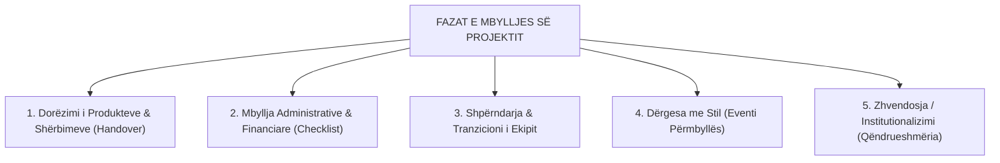
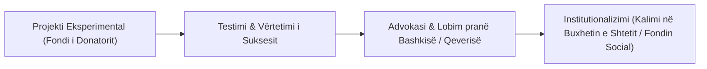

# 📌 Tema 14: Përfundimi dhe Mbyllja e Projektit

`[[Tema 13 - Menaxhimi i Performancës dhe Konflikteve|⬅️ Tema 13: Menaxhimi i Performancës]]` | `[[00 - Harta e Lëndës dhe Udhëzuesi i Studimit (MOC)|Indeksi]]` | `[[Tema 15 - Vlerësimi i Projektit (Evaluation)|Tema 15: Vlerësimi i Projektit ➡️]]`

---

> [!summary] Përmbledhje Ekzekutive
> Çdo projekt ka një afat të fundmë; aftësia për ta mbyllur atë me sukses është po aq e rëndësishme sa aftësia për ta nisur. Projektet që nuk mbyllen formalisht rrezikojnë të mbeten "projekte fantazmë" që konsumojnë kohë pa buxhet. Mbyllja përfshin **Dorëzimin (Handover)** e shërbimit, **"Dërgesën me stil" (festimin e arritjeve)**, mbylljen administrative e financiare me **Listën e Kontrollit**, tranzicionin e stafit dhe **Zhvendosjen (Institutionalizimin)** e shërbimit për qëndrueshmëri afatgjatë.

---

## 🎯 Objektivat e Mësimit
Pas studimit të këtij leksioni, ju do të jeni në gjendje të:
1. Shpjegoni rëndësinë e një mbylljeje formale dhe të planifikuar të projektit.
2. Zbatoni procedurën e **Dorëzimit (Handover)** te përfituesit dhe sponsori.
3. Kuptoni konceptin e **"Dërgesës me Stil" (Celebration & Closure Event)**.
4. Përdorni **Listën e Kontrollit të Mbylljes (Closure Checklist)** për aspekte administrative dhe financiare.
5. Menaxhoni shpërndarjen dhe tranzicionin profesional të anëtarëve të ekipit.
6. Shpjegoni konceptin e **Zhvendosjes / Institutionalizimit (Sustainability)** të shërbimit social.

---

## 1. Pse Mbyllja e Projektit Kërkon Planifikim të Posaçëm?

Shumë drejtues mendojnë se sapo mbaron aktiviteti i fundit, projekti quhet automatikisht i mbyllur. Kjo është një iluzion i rrezikshëm.

### Rreziqet e Mungesës së Mbylljes Formale:
* **"Zvarritja e Pafundme"**: Klientët dhe partnerët vazhdojnë të kërkojnë shërbime dhe mbështetje kur fondet tashmë kanë mbaruar.
* **Mosdorëzimi i Raporteve**: Donatori bllokon këstin e fundit (zakonisht 10-20% të grantit) për shkak të mungesës së dokumentacionit mbyllës.
* **Humbja e Pasurive**: Pajisjet dhe materialet e blera me paratë e projektit humbasin ose përvetësohen padrejtësisht.
* **Probleme Ligjore & Tatimore**: Llogaritë e pambyllura mund të sjellin gjoba nga administrata tatimore.

---

## 2. Dorëzimi (Handover) dhe Shpërndarja e Rezultateve

**Dorëzimi (Handover)** është akti zyrtar i transferimit të pronësisë, përgjegjësisë dhe mirëmbajtjes së produkteve të projektit nga Menaxheri te Sponsori, Bashkia ose stafi i përhershëm.

### Çfarë dorëzohet konkretisht?
* **Pajisjet dhe Mjediset**: Protokoll dorëzimi i inventarit (kompjutera, mjete terapeutike, automjete).
* **Dosjet dhe Dokumentacioni**: Kartelat e klientëve (të siguruara sipas ligjit), manualet e procedurave dhe guidat e trajnimit.
* **Përgjegjësia e shërbimit**: Kush do t'i përgjigjet telefonit të emergjencës nesër në mëngjes?

---

## 3. "Dërgesa me Stil" (Celebration & Recognition)

Teksti universitar thekson një dimension shpesh të anashkaluar: **njohjen e meratave dhe festimin me dinjitet**.
* Projektet sociale sjellin shpesh lodhje dhe ngarkesë psikologjike të lartë për stafin.
* Organizimi i një **konference përmbyllëse** ose një aktiviteti festiv me përfituesit dhe komunitetin:
  - Njeh dhe falënderon publikisht mundin e stafit dhe vullnetarëve.
  - Ofron dukshmëri maksimale mediatike për donatorin.
  - Shënon një kufi të qartë psikologjik midis të qenit në projekt dhe mbylljes së tij.

---

## 4. Lista e Kontrollit të Mbylljes (Closure Checklist)

Përpara se të nënshkruhet mbyllja finale, menaxheri duhet të verifikojë pikë për pikë:

| Fusha | Veprimi i Kontrollit | Statusi |
| :--- | :--- | :---: |
| **Kontraktuale** | A janë dorëzuar të gjitha produktet (deliverables) e premtuara në kontratë? | [ ] |
| **Financiare** | A janë paguar të gjitha faturat e furnitorëve dhe pagat e personelit? | [ ] |
| **Auditimi** | A është realizuar auditimi i pavarur financiar i kërkuar nga donatori? | [ ] |
| **Bankare** | A është mbyllur llogaria bankare e dedikuar e projektit? | [ ] |
| **Inventari** | A janë transferuar asetet sipas marrëveshjes së donatorit? | [ ] |
| **Ligjore** | A janë arkivuar dosjet konfidenciale sipas rregullave të shtetit? | [ ] |
| **Raportimi** | A është dorëzuar dhe miratuar Raporti Final Narrativ dhe Financiar? | [ ] |

---

## 5. Shpërndarja e Ekipit dhe Tranzicioni i Personelit

Mbyllja e një projekti krijon shpesh stres dhe ankth për anëtarët e ekipit për shkak të pasigurisë për vendin e ardhshëm të punës.
* **Roli etik i liderit**: Të mos i lërë njerëzit në errësirë deri në ditën e fundit.
* Njoftimi me shkrim duhet të bëhet në përputhje me Kodin e Punës.
* Sigurimi i **letrave të rekomandimit**, përditësimi i CV-ve dhe ndihma për orientim në projekte të reja.

---

## 6. Zhvendosja e Projektit (Institutionalizimi / Sustainability)

Qëllimi më sublim i çdo projekti social është të mos vdesë kur mbaron granti, por të kthehet në një **shërbim të qëndrueshëm (institutionalizim)**.

> [!example] Rasti i Bashkisë Patos dhe Fondit Social
> Një OJQ hapi një shërbim të kujdesit në shtëpi për të moshuarit me fonde të donatorëve të huaj për 12 muaj. Në fazën e mbylljes, projekti nuk u shpërbë: Bashkia Patos aplikoi pranë **Fondit Social të Ministrisë** për të marrë financim të përvitshëm publik, duke e kthyer shërbimin eksperimental në një institucion të përhershëm komunitar. Ky është shembulli perfekt i **Zhvendosjes së Projektit**.

---

## 📖 Fjalori i Termave Kyç

- **Mbyllja e Projektit**: Faza formale përfundimtare ku dorëzohen rezultatet, shlyhen detyrimet dhe shpërndahet ekipi.
- **Handover (Dorëzimi)**: Transferimi zyrtar i pronësisë dhe përgjegjësisë së produkteve te klienti/donatori.
- **Dërgesa me Stil**: Përmbyllja dinjitoze dhe festimi publik i sukseseve të ekipit dhe përfituesve.
- **Closure Checklist**: Listë kontrolli e plotësimit të të gjitha kërkesave kontraktuale, administrative e financiare.
- **Zhvendosja e Projektit (Institutionalizimi)**: Kalimi i shërbimit të përkohshëm në një program të përhershëm të financuar nga buxheti publik.

---

## 🧠 Seksioni i Memorizimit & Retrieval Practice

### 🔹 Flashcards të Fshehura (Kliko për Përgjigjen)

> [!question]- Pyetja 1: Cilat janë 4 fushat kryesore që duhen trajtuar gjatë mbylljes së një projekti social?
> **Përgjigjja:**
> 1. **Dorëzimi operacional (Handover)** i shërbimeve dhe pajisjeve.
> 2. **Mbyllja administrative dhe financiare** (raporti final, auditimi, llogaritë bankare).
> 3. **Tranzicioni dhe shpërndarja e stafit** (letrat e rekomandimit, zbutja e ankthit).
> 4. **Eventi përmbyllës dhe festimi ("Dërgesa me stil")**.

> [!question]- Pyetja 2: Çfarë nënkupton koncepti i "Zhvendosjes së Projektit" (Institutionalizimit) në shërbimet sociale?
> **Përgjigjja:**
> Zhvendosja nënkupton transformimin e një projekti të përkohshëm eksperimental në një shërbim publik të vazhdueshëm dhe të përhershëm, i cili integrohet dhe financohet nga buxheti i Bashkisë ose Fondi Social Shtetëror.

> [!question]- Pyetja 3: Pse mbyllja e llogarisë bankare dhe inventarizimi i aseteve janë jetike në mbylljen financiare?
> **Përgjigjja:**
> Sepse parandalojnë shpenzimin e paautorizuar të mbetjeve të fondeve, shmangin gjobat e administratës tatimore dhe sigurojnë llogaridhënie të plotë para donatorit që të lëvrohet kësti i fundit i pagesës.

---

### 🔹 Flashcards për Obsidian Spaced Repetition (Plugin)
Dorëzimi (Handover):: Akti zyrtar i transferimit të përgjegjësisë dhe administrimit të shërbimit te komuniteti apo sponsori.
Dërgesa me Stil:: Festimi i arritjeve dhe njohja e kontributit të stafit dhe përfituesve në fund të projektit.
Closure Checklist:: Lista e verifikimit administrativ, financiar dhe ligjor për mbylljen pa mbetje të projektit.
Zhvendosja e Projektit:: Integrimi i një shërbimi të suksesshëm të përkohshëm në strukturat e përhershme publike.

---

### 🔹 Plotëso Vendet Bosh (Cloze Recall)
1. Akti formal i kalimit të përgjegjësisë dhe produkteve te sponsori njihet si ==dorëzimi (handover)==.
2. Festimi i arritjeve dhe vlerësimi publik i stafit në mbyllje quhet ==dërgesë me stil==.
3. Transformimi i një projekti në një strukturë të përhershme publike njihet si ==zhvendosje (ose institutionalizim)==.
4. Mjeti i strukturuar me pika për verifikimin e të gjitha detyrimeve para mbylljes quhet ==lista e kontrollit (closure checklist)==.

---

### 🔹 Checklist për Vetë-Vlerësim
- [ ] Di të listoj të paktën 5 elemente të listës së kontrollit të mbylljes (Closure Checklist).
- [ ] Mund të shpjegoj konceptin e Handover dhe rëndësinë e tij.
- [ ] Di të shpjegoj konceptin e qëndrueshmërisë dhe institutionalizimit të një projekti social.
- [ ] Kuptoj dimensionin njerëzor dhe etik të shpërndarjes së ekipit.
