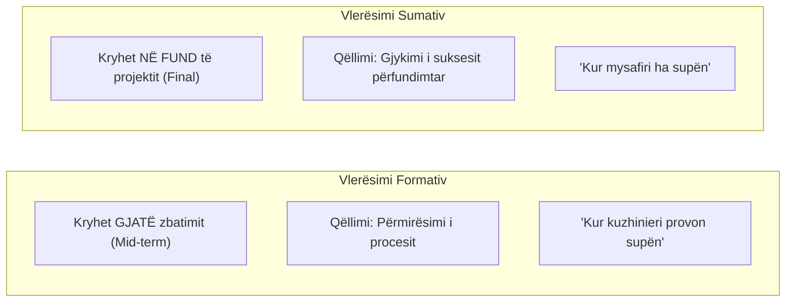
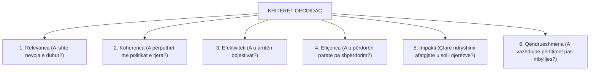

# 📌 Tema 15: Vlerësimi i Projektit (Evaluation)

`[[Tema 14 - Përfundimi dhe Mbyllja e Projektit|⬅️ Tema 14: Përfundimi dhe Mbyllja]]` | `[[00 - Harta e Lëndës dhe Udhëzuesi i Studimit (MOC)|Indeksi]]` | `[[Tema 16 - Raportimi i Projektit dhe Prezantimi|Tema 16: Raportimi dhe Prezantimi ➡️]]`

---

> [!summary] Përmbledhje Ekzekutive
> **Vlerësimi (Evaluation)** është procesi i gjykimit sistematik dhe objektiv mbi vlerën, meritat dhe rëndësinë e një projekti social. Ndryshe nga monitorimi i thjeshtë operacional, vlerësimi analizon nëse ndryshimet në jetën e njerëzve erdhën me të vërtetë prej projektit. Standardi botëror mbështetet në **Kriteret e OECD/DAC**: **Relevanca**, **Koherenca**, **Efektiviteti**, **Efiçenca**, **Impakti** dhe **Qëndrueshmëria (Sustainability)**, duke u ndarë në **Vlerësim Formativ** (gjatë zbatimit) dhe **Vlerësim Sumativ** (në mbyllje).

---

## 🎯 Objektivat e Mësimit
Pas studimit të këtij leksioni, ju do të jeni në gjendje të:
1. Përkufizoni vlerësimin dhe ta krahasoni atë me monitorimin e përditshëm.
2. Dalloni **Vlerësimin Formativ** nga **Vlerësimi Sumativ (Përmbledhës)**.
3. Zbërtheni dhe zbatoni **6 Kriteret Ndërkombëtare të Vlerësimit të OECD/DAC**.
4. Përzgjidhni metodologjitë e duhura të mbledhjes së të dhënave (Kuantitative vs. Kualitative).
5. Dizenjoni një **Plan Vlerësimi Formal** me pyetje vlerësuese, tregues dhe burime verifikimi.
6. Siguroni që gjetjet e vlerësimit të mos mbeten në sirtar, por të përdoren për përmirësim.

---

## 1. Monitorimi vs. Vlerësimi: Dallimet Kryesore

| Dimensioni | Monitorimi (Monitoring) | Vlerësimi (Evaluation) |
| :--- | :--- | :--- |
| **Kur bëhet?** | I vazhdueshëm gjatë gjithë zbatimit | Periodik (në mes të projektit ose në fund) |
| **Fokusi Kryesor** | Proceset, aktivitetet, përdorimi i parave | Rezultatet, impakti afatgjatë, rëndësia |
| **Pyetja Qendrore** | *"A po i bëjmë gjërat sipas planit?"* | *"A bëmë gjërat e duhura? Çfarë ndryshoi realisht?"* |
| **Kush e kryen?** | Ekipi i brendshëm i projektit | Vlerësues të jashtëm të pavarur ose të përbashkët |
| **Qëllimi** | Korrigjimi operacional i menjëhershëm | Nxirrja e mësimeve strategjike dhe llogaridhënia |

---

## 2. Tipet e Vlerësimit: Formativ vs. Sumativ

* **Vlerësimi Formativ (Mid-term / I Ndërmjetëm)**: Bëhet në mesin e ciklit të projektit për të parë nëse metodologjia po funksionon. Nëse rezultatet janë të ulëta, bëhen rregullime përpara se të mbarojnë fondet.
* **Vlerësimi Sumativ (Përmbledhës / Final)**: Bëhet pas përfundimit. Përcakton nëse projekti i arriti objektivat, a e justifikoi buxhetin e investuar dhe a duhet të replikohet në qytete të tjera.

---

## 3. Gjashtë Kriteret e Vlerësimit të OECD/DAC

Ky është kuadri më i pranuar globalisht nga të gjithë donatorët ndërkombëtarë (BE, OKB, USAID, Banka Botërore):

### Zbërthimi i Kritereve:
1. **Relevanca (Përkatësia)**: A përputhen objektivat e projektit me nevojat reale të përfituesve dhe me prioritetet e vendit?
2. **Koherenca**: Sa mirë bashkëpunon dhe harmonizohet kjo ndërhyrje me shërbimet e tjera shtetërore në të njëjtin territor?
3. **Efektiviteti**: Në ç'masë u përmbushën objektivat SMART të premtuara?
4. **Efiçenca (Ekonomiciteti)**: Raporti midis burimeve të shpenzuara dhe produkteve të fituara. A mund të arrihej i njëjti rezultat me më pak para?
5. **Impakti (Ndikimi)**: Efektet afatgjata, pozitive ose negative, direkte ose indirekte, të qëllimshme ose të paqëllimshme në jetën e komunitetit.
6. **Qëndrueshmëria (Sustainability)**: A do të vazhdojnë përfitimet pozitive për njerëzit edhe pasi të ketë mbaruar çdo qindarkë e donatorit?

---

## 4. Metodologjia e Mbledhjes së të Dhënave për Vlerësim

Një vlerësim rigoroz përdor **Triangulimin** (kombinimin e disa burimeve dhe metodave):
* **Metoda Sasiore (Kuantitative)**:
  - Statistikat administrative (numri i fëmijëve të vaksinuar, orët e mësimit plotësues).
  - Pyetësorët e standardizuar me shkallë Likert (1-5).
  - Testet para dhe pas ndërhyrjes (Pre-test & Post-test).
* **Metoda Cilësore (Kualitative)**:
  - Intervista gjysmë-të-strukturuara në thellësi me përfituesit.
  - Fokus-grupe me prindërit dhe stafin.
  - Historitë e suksesit dhe studimet e rasteve (Case Studies).
  - Vëzhgimi i drejtpërdrejtë në mjediset e shërbimit.

---

## 5. Çuarja e Raportit të Vlerësimit deri në Fund

Gabimi më i madh në administratë është hartimi i një raporti të shkëlqyer vlerësimi që mbyllet në sirtar dhe nuk lexohet nga askush.
* Raporti duhet të shoqërohet me një **Përmbledhje Ekzekutive (Executive Summary)** prej 2-3 faqesh për kryetarin e bashkisë dhe donatorin.
* Duhet të përfshijë **Rekomandime Vepruese (Actionable Recommendations)**: Çfarë duhet bërë ndryshe vitin e ardhshëm?
* Organizimi i një **sesioni diskutimi me stafin** për të integruar mësimet e nxjerra në kulturën e organizatës.

---

## 📖 Fjalori i Termave Kyç

- **Vlerësimi (Evaluation)**: Gjykimi sistematik mbi vlerën, ecurinë, impaktin dhe dobinë e një projekti social.
- **Vlerësim Formativ**: Vlerësim i ndërmjetëm që kryhet gjatë zbatimit me qëllim përmirësimin e ecurisë.
- **Vlerësim Sumativ**: Vlerësim përfundimtar që kryhet në mbyllje për të matur suksesin total dhe impaktin.
- **Kriteret OECD/DAC**: Korniza me 6 kritere e përdorur ndërkombëtarisht: Relevanca, Koherenca, Efektiviteti, Efiçenca, Impakti, Qëndrueshmëria.
- **Triangulim**: Përdorimi i metodave dhe burimeve të shumëfishta (sasiore dhe cilësore) për të verifikuar vërtetësinë e gjetjeve.

---

## 🧠 Seksioni i Memorizimit & Retrieval Practice

### 🔹 Flashcards të Fshehura (Kliko për Përgjigjen)

> [!question]- Pyetja 1: Cilat janë 6 Kriteret e Vlerësimit të OECD/DAC dhe çfarë pyetjeje bën secili?
> **Përgjigjja:**
> 1. **Relevanca**: A adresoi nevojat e vërteta të duhura?
> 2. **Koherenca**: A përshtatet me politikat e tjera publike ekzistuese?
> 3. **Efektiviteti**: A u arritën objektivat e planifikuara?
> 4. **Efiçenca**: A u përdorën burimet me kosto-efektivitet pa shpërdorim?
> 5. **Impakti**: Çfarë ndryshimi afatgjatë transformues solli në komunitet?
> 6. **Qëndrueshmëria**: A do të mbijetojnë përfitimet pas ndërprerjes së fondeve?

> [!question]- Pyetja 2: Cili është dallimi midis "Vlerësimit Formativ" dhe "Vlerësimit Sumativ"?
> **Përgjigjja:**
> - **Vlerësimi Formativ** kryhet gjatë procesit të zbatimit (Mid-term) me qëllim korrigjimin dhe përmirësimin e metodave të punës.
> - **Vlerësimi Sumativ** kryhet në fund të projektit (Final) me qëllim gjykimin përfundimtar të suksesit, impaktit dhe llogaridhënies.

> [!question]- Pyetja 3: Cili është dallimi thelbësor midis Efektivitetit dhe Efiçencës?
> **Përgjigjja:**
> - **Efektiviteti** lidhet me arritjen e rezultatit të dëshiruar (bërja e gjërave të duhura për të përmbushur objektivin).
> - **Efiçenca** lidhet me koston dhe kursimin e burimeve (bërja e gjërave me koston më minimale të mundshme për njësi).

> [!question]- Pyetja 4: Çfarë kuptimi ka "Triangulimi" në metodologjinë e vlerësimit?
> **Përgjigjja:**
> Triangulimi është verifikimi i gjetjeve duke kryqëzuar të paktën 3 burime ose metoda të ndryshme (p.sh. kombinimi i të dhënave statistikore me intervistat në thellësi dhe vëzhgimin në terren), me qëllim rritjen e besueshmërisë shkencore të vlerësimit.

---

### 🔹 Flashcards për Obsidian Spaced Repetition (Plugin)
Vlerësim Formativ:: Vlerësim gjatë zbatimit të projektit për të bërë përmirësime në kohë reale.
Vlerësim Sumativ:: Vlerësim përfundimtar pas mbylljes së projektit për të matur suksesin dhe impaktin total.
Efektiviteti:: Shkalla në të cilën janë arritur objektivat e paracaktuar të projektit.
Efiçenca:: Përdorimi optimal dhe pa shpërdorim i burimeve financiare dhe njerëzore për arritjen e rezultateve.
Qëndrueshmëria (Sustainability):: Aftësia e përfitimeve të projektit për të vazhduar pas mbylljes së financimit nga donatori.

---

### 🔹 Plotëso Vendet Bosh (Cloze Recall)
1. Korniza standarde ndërkombëtare e vlerësimit përbëhet nga 6 kriteret e ==OECD/DAC==.
2. Vlerësimi që kryhet gjatë rrugës për përmirësim quhet vlerësim ==formativ==.
3. Vlerësimi që bëhet në përfundim të projektit quhet vlerësim ==sumativ (ose përmbledhës)==.
4. Kombinimi i metodave sasiore dhe cilësore për të rritur vërtetësinë e të dhënave njihet si ==triangulim==.

---

### 🔹 Checklist për Vetë-Vlerësim
- [ ] Di të shpjegoj të 6 kriteret e OECD/DAC me shembuj nga puna sociale.
- [ ] Mund të dalloj qartë vlerësimin formativ nga ai sumativ.
- [ ] Di dallimin thelbësor midis Monitorimit dhe Vlerësimit.
- [ ] Kuptoj si ndërtohet një strategji e mbledhjes së të dhënave me triangulim.
