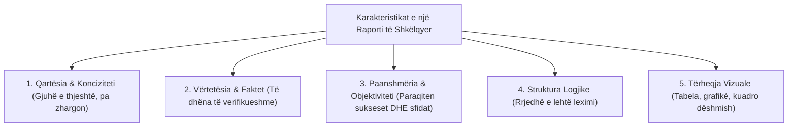
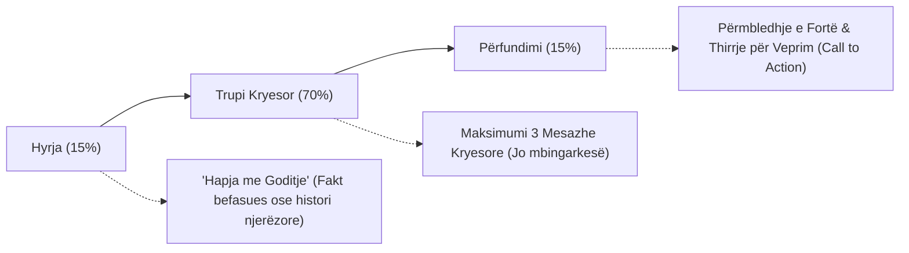

# 📌 Tema 16: Raportimi i Projektit dhe Prezantimi

`[[Tema 15 - Vlerësimi i Projektit (Evaluation)|⬅️ Tema 15: Vlerësimi i Projektit]]` | `[[00 - Harta e Lëndës dhe Udhëzuesi i Studimit (MOC)|Indeksi]]` | `[[Tema 17 - Të Mësuarit nga Projekti (Lessons Learned)|Tema 17: Të Mësuarit nga Projekti ➡️]]`

---

> [!summary] Përmbledhje Ekzekutive
> Pavarësisht sa shkëlqyeshëm mund të jetë zbatuar një projekt në terren, vlera e tij humbet nëse nuk komunikohet me sukses përmes një **raporti të shkruar profesional** dhe një **prezantimi publik me ndikim**. Raporti i projektit nuk është thjesht një detyrim burokratik llogaridhënieje për donatorin, por një dokument avokasie që tregon ndryshimin e krijuar në jetën e përfituesve. Ky leksion zbërthen **strukturën e raportit standard**, kriteret e shkrimit cilësor dhe **teknikat e prezantimit efektiv para audiencave të ndryshme**.

---

## 🎯 Objektivat e Mësimit
Pas studimit të këtij leksioni, ju do të jeni në gjendje të:
1. Përkufizoni qëllimin, karakteristikat dhe strukturën e një **Raporti Projekti të plotë**.
2. Hartoni një **Përmbledhje Ekzekutive (Executive Summary)** bindëse dhe koncize.
3. Strukturoni raportin narrativ dhe financiar sipas kërkesave të donatorëve dhe standardeve akademike.
4. Analizoni audiencën dhe të përshtatni stilin e komunikimit me profilin e marrësit.
5. Zbatoni rregullat e arta të **Dizenjimit dhe Prezantimit Vizual (Rregulli 6x6, hierarkia vizuale)**.
6. Menaxhoni me sukses sesionin e pyetje-përgjigjeve (Q&A) para një paneli vlerësues ose komunitetit.

---

## 1. Karakteristikat e një Raporti të Mirë Projekti

Një raport i mirë duhet të shërbejë si një dëshmi e besueshme dhe transparente e asaj që ka ndodhur.

### Kriteret Kryesore të Cilësisë:
* **Fokusi te Rezultatet (Outcomes), jo vetëm tek Aktivitetet**: Donatori nuk do të lexojë vetëm *"Zhvilluam 10 takime"*, por *"10 takimet rritën me 40% integrimin në shkollë të 25 fëmijëve"*.
* **Ekuilibri i Suksesit dhe Vështirësive**: Raportet që pretendojnë se "çdo gjë shkoi 100% perfekte pa asnjë problem" duken jo-reale. Përshkrimi i ndershëm i barrierave dhe mënyrës se si u kapërcyen ato rrit maksimalisht besueshmërinë e menaxherit.
* **Respektimi i Afateve**: Raporti i dorëzuar me vonesë zhvlerëson të gjithë punën e bërë.

---

## 2. Struktura Standarde e një Raporti Përfundimtar Projekti

1. **Faqja e Titullit**: Titulli i projektit, emri i organizatës zbatuese, donatori, data e dorëzimit dhe kodi i kontratës.
2. **Përmbledhja Ekzekutive (Executive Summary)**:
   - *Pjesa më e rëndësishme e gjithë dokumentit!* (Shumë vendimmarrës lexojnë vetëm këtë pjesë).
   - Në 1 deri në 2 faqe përmbledh: nevojën, synimin, rezultatet madhore të arritura, buxhetin e përdorur dhe mësimet kryesore.
3. **Sfondi dhe Arsyetimi (Racionali)**: Përshkrim i shkurtër i kontekstit social ku nisi ndërhyrja.
4. **Metodologjia dhe Menaxhimi**: Si u organizua puna, ekipi dhe partneritetet me institucionet lokale.
5. **Arritjet e Objektivave (Seksioni Qendror)**:
   - Analizë krahasuese pikë për pikë: Çfarë u planifikua vs. Çfarë u arrit realisht.
   - Përdorimi i treguesve sasiorë dhe dëshmive cilësore (citime nga klientët).
6. **Vështirësitë, Pengesat dhe Zgjidhjet e Zbatuara**.
7. **Përmbledhja Financiare**: Pasqyra e shpenzimeve sipas linjave buxhetore dhe shpjegimi i ndonjë devijimi të lehtë.
8. **Përfundimet dhe Rekomandimet**: Sugjerime konkrete për hapat e ardhshëm dhe qëndrueshmërinë.
9. **Anekeset**: Pyetësorët, lista e pjesëmarrësve (e anonimizuar), fotot e aktiviteteve, botimet.

---

## 3. Raportet për Çmime Akademike dhe Profesionale

Kur projekti synon vlerësim akademik (p.sh. një temë diplome, artikull shkencor apo çmim profesional në punë sociale):
* Theksi zhvendoset nga thjesht "çfarë bëmë" te **"çfarë teorie u testua"** dhe **"cili është kontributi i ri në literaturë"**.
* Kërkohet përshkrim rigoroz i metodologjisë kërkimore, madhësisë së kampionit, kufizimeve studimore dhe referenca të sakta bibliografike sipas formatit APA.

---

## 4. Bërja e Prezantimeve Efektive të Projektit

Prezantimi gojor shoqëruar me slajde shpesh vendos nëse projekti do të marrë fonde shtesë apo nëse do të mbështetet nga Këshilli Bashkiak.

### Rregullat e Arta të Prezantimit Vizual:
1. **Njih Audiencën Tënde**:
   - Para donatorëve: thekso efiçencën, impaktin dhe transparencën financiare.
   - Para komunitetit dhe përfituesve: përdor gjuhë të thjeshtë, të ngrohtë dhe dëshmi njerëzore.
   - Para akademikëve: thekso metodologjinë, treguesit dhe vlerësimin kritik.
2. **Rregulli 6x6 për Slajdet**:
   - Jo më shumë se 6 rreshta tekst për slajd.
   - Jo më shumë se 6 fjalë për rresht.
   - Slajdi nuk është teleprompter për ta lexuar me shpinë nga publiku; ai është mbështetje vizuale për fjalën tuaj!
3. **Fuqia e Historive Njerëzore (Storytelling)**:
   - Statistikat bindin mendjen, por historitë njerëzore prekin zemrën. Kombinoni gjithmonë një numër të madh (p.sh. *"Ndihmuam 150 fëmijë"*) me historinë konkrete të një fëmije (p.sh. *"Si u kthye Beni në shkollë pas 2 vitesh braktisje"*).

---

## 📖 Fjalori i Termave Kyç

- **Raport Projekti**: Dokument formal me shkrim që përmbledh aktivitetet, rezultatet, shpenzimet dhe impaktin e një ndërhyrjeje.
- **Përmbledhje Ekzekutive (Executive Summary)**: Sintezë e ngjeshur e raportit që përmban gjetjet dhe mesazhet kryesore për vendimmarrësit.
- **Storytelling**: Metodë narrative e përdorimit të historive konkrete njerëzore për të ilustruar impaktin e shërbimit social.
- **Rregulli 6x6**: Standard vizual që kufizon tekstin në prezantime për të shmangur lodhjen e audiencës.
- **Call to Action (Thirrje për Veprim)**: Mesazhi përmbyllës i një prezantimi që kërkon një vendim apo veprim konkret nga dëgjuesit.

---

## 🧠 Seksioni i Memorizimit & Retrieval Practice

### 🔹 Flashcards të Fshehura (Kliko për Përgjigjen)

> [!question]- Pyetja 1: Pse Përmbledhja Ekzekutive (Executive Summary) konsiderohet pjesa më e rëndësishme e një raporti projekti?
> **Përgjigjja:**
> Sepse shumica dërrmuese e donatorëve, kryetarëve të bashkive dhe politikëbërësve nuk kanë kohë të lexojnë një raport 50-faqësh. Ata lexojnë vetëm 1-2 faqet e Përmbledhjes Ekzekutive për të marrë vendime mbi ecurinë, vazhdimësinë e financimit dhe vlerësimin e organizatës.

> [!question]- Pyetja 2: Cilat janë 3 pjesët e strukturës së një prezantimi efektiv gojor dhe cila është pesha e tyre kohore?
> **Përgjigjja:**
> 1. **Hyrja (15% e kohës)**: Tërheqja e vëmendjes me një fakt, foto ose pyetje të fortë, prezantimi i temës.
> 2. **Trupi kryesor (70% e kohës)**: Shtjellimi i maksimumi 3 mesazheve ose arritjeve kyçe të projektit.
> 3. **Përfundimi (15% e kohës)**: Sinteza e arritjeve, falënderimi dhe një "Thirrje e qartë për Veprim" (Call to Action).

> [!question]- Pyetja 3: Pse një raport që paraqet vetëm suksese të përsosura pa asnjë vështirësi shihet me dyshim nga donatorët me përvojë?
> **Përgjigjja:**
> Sepse në jetën reale dhe veçanërisht në shërbimet sociale ka gjithmonë pengesa, vonesa dhe sfida të paparashikuara. Një raport që fsheh problemet duket jo i sinqertë dhe i dyshimtë. Paraqitja me transparencë e pengesave dhe e mënyrës se si ekipi i zgjidhi ato dëshmon pjekuri dhe profesionalizëm të lartë menaxherial.

---

### 🔹 Flashcards për Obsidian Spaced Repetition (Plugin)
Përmbledhje Ekzekutive:: Sintezë 1-2 faqëshe e raportit që përmbledh nevojën, rezultatet dhe buxhetin për vendimmarrësit.
Rregulli 6x6 në Prezantim:: Jo më shumë se 6 rreshta për slajd dhe jo më shumë se 6 fjalë për rresht për qartësi maksimale.
Raportimi i Bazuar në Rezultate:: Përshkrimi i ndryshimit konkret në jetën e klientëve (outcomes) dhe jo thjesht listimi i aktiviteteve të kryera.
Call to Action:: Mesazhi final i një prezantimi që orienton audiencën drejt hapit të ardhshëm të kërkuar.

---

### 🔹 Plotëso Vendet Bosh (Cloze Recall)
1. Pjesa hyrëse e sintetizuar e raportit që lexohet më shumë nga vendimmarrësit quhet ==Përmbledhja Ekzekutive (Executive Summary)==.
2. Në vend që të raportohen vetëm aktivitetet, donatorët kërkojnë raportimin e ndikimit dhe ==rezultateve (outcomes)==.
3. Rregulli që parandalon mbingarkimin e slajdeve me shumë rreshta dhe fjalë njihet si ==Rregulli 6x6==.
4. Mbyllja e një prezantimi kërkon një mesazh orientues për veprim që quhet ==Call to Action (Thirrje për Veprim)==.

---

### 🔹 Checklist për Vetë-Vlerësim
- [ ] Di të rendis të gjitha seksionet standarde të një raporti përfundimtar projekti.
- [ ] Mund të shkruaj një Përmbledhje Ekzekutive prej 2 paragrafësh.
- [ ] Di të përshtat stilin e një prezantimi për donatorin kundrejt komunitetit.
- [ ] Kuptoj rëndësinë e kombinimit të të dhënave sasiore me tregimin njerëzor (storytelling).
