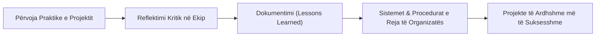
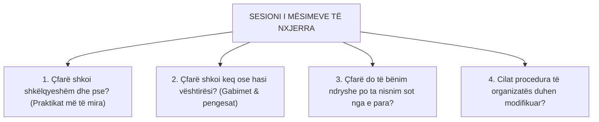
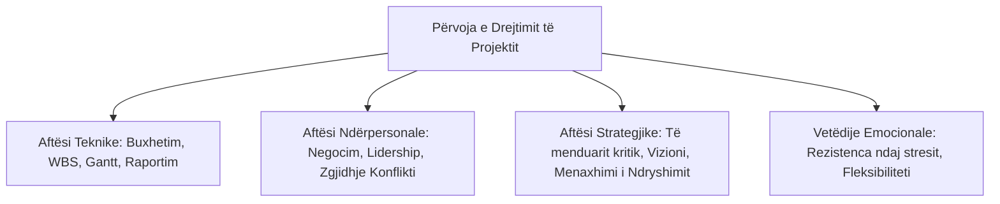

# 📌 Tema 17: Të Mësuarit nga Projekti (Lessons Learned)

`[[Tema 16 - Raportimi i Projektit dhe Prezantimi|⬅️ Tema 16: Raportimi dhe Prezantimi]]` | `[[00 - Harta e Lëndës dhe Udhëzuesi i Studimit (MOC)|Indeksi]]` | `[[18 - Banka e Pyetjeve dhe Simulimi i Provimit Final (Master Retrieval)|Banka e Pyetjeve të Provimit ➡️]]`

---

> [!summary] Përmbledhje Ekzekutive
> Çdo projekt, i suksesshëm apo i vështirë, mbart një pasuri të jashtëzakonshme dijesh dhe përvojash. Nëse kjo përvojë nuk dokumentohet dhe ndahet, ajo humbet kur stafi shpërndahet, duke e dënuar organizatën të "shpikë rrotën" nga e para në çdo projekt të ri. Ky kapitull përmbyllës trajton **Të Mësuarit Organizativ**, organizimin e sesioneve të **Mësimeve të Nxjerra (Lessons Learned Review)**, si dhe **zhvillimin individual dhe menaxherial** të punonjësit social përmes drejtimit të projekteve.

---

## 🎯 Objektivat e Mësimit
Pas studimit të këtij leksioni, ju do të jeni në gjendje të:
1. Përkufizoni konceptin e **Të Mësuarit Organizativ (Organizational Learning)** në menaxhimin e projekteve.
2. Shpjegoni rrezikun e "amnezisë / harresës institucionale" në OJQ dhe institucione publike.
3. Strukturoni dhe drejtoni një sesion formal të **Mësimeve të Nxjerra (Post-Project Review)**.
4. Ndërtoni një **Regjistër të Mësimeve të Nxjerra (Lessons Learned Log)** për organizatën.
5. Identifikoni përfitimet e zhvillimit individual dhe profesional që fiton menaxheri nga drejtimi i një projekti.
6. Krijoni një plan vetjak të zhvillimit profesional në fushën e politikave dhe projekteve sociale.

---

## 1. Të Mësuarit Organizativ: Nga Përvoja Individuale te Dija Institucionale

Projektet janë sipërmarrje të përkohshme, por **organizata vazhdon të jetojë**. Sfida thelbësore është: *Si të shndërrohet përvoja praktike e anëtarëve të ekipit në pasuri të përhershme të organizatës?*

### Rreziku i "Amnezisë Institucionale":
Në shumë organizata jofitimprurëse dhe bashki në Shqipëri, sapo mbyllet një projekt, stafi largohet bashkë me dijet që fitoi. Kur pas 6 muajsh fitohet një grant i ri, organizata bën **ekzaktësisht të njëjtat gabime** në buxhetim, rekrutim apo komunikim me donatorët. Të mësuarit organizativ parandalon këtë harresë shkatërruese.

---

## 2. Sesioni i Mësimeve të Nxjerra (Post-Project Review / Retrospective)

Ky sesion është një mbledhje e posaçme reflektimi e organizuar me stafin kryesor dhe stakeholderat në përfundim të projektit.

### Rregullat e Arta të një Sesioni të Suksesshëm:
* **Kulturë pa Faje ("Blameless Culture")**: Qëllimi nuk është të gjejmë "fajtorin", por të gjejmë arsyen pse sistemi ose procedura çaloi. Nëse stafi ka frikë nga ndëshkimi, ata do të fshehin problemet e vërteta.
* **Përfshirja e të gjitha zërave**: Duhet dëgjuar si drejtuesi, ashtu edhe punonjësi më i ri i terrenit dhe administratori financiar.
* **Fokusi te Veprimi**: Çdo mësim i nxjerrë duhet të shoqërohet me një rekomandim konkret për të ardhmen.

---

## 3. Ndërtimi i Regjistrit të Mësimeve të Nxjerra (Lessons Learned Log)

Mësimet duhet të kategorizohen dhe të ruhen në një databazë të përbashkët të organizatës (p.sh. në një dosje dixhitale në Obsidian ose re kompjuterike):

| Faza e Projektit | Problemi / Sfida e Hasur | Shkaku Rrënjësor | Mësimi i Nxjerrë (Çfarë duhet bërë herën tjetër?) |
| :--- | :--- | :--- | :--- |
| **Buxhetimi** | Vonesë 1 mujore në prokurimin e pajisjeve | Procedurat e tenderimit morën më shumë kohë se parashikimi | Të shtohen minimalisht 3 javë rezervë (lag) në grafikun Gantt për çdo prokurim mbi \$5,000 |
| **Zbatimi** | Refuzim fillestar i komunitetit për qendrën | Mungesa e konsultimit paraprak me banorët fqinj | Në çdo projekt të ardhshëm, takimet me banorët duhet të nisin 1 muaj PARA hapjes së dyerve |
| **Stafi** | Djegie profesionale (burnout) e psikologëve | Numër shumë i lartë rastesh të rënda pa mbikëqyrje | Të përfshihet detyrimisht në buxhet fondi për **supervizion të jashtëm klinik** 1 herë në muaj |

---

## 4. Zhvillimi Individual dhe Profesional nga Drejtimi i Projektit

Drejtimi i një projekti social shërben si një "përshpejtues karriere" për punonjësin social apo administratorin publik.

### Zhvillimi i Menaxhimit përmes Drejtimit të Projektit:
* Mëson të punosh brenda afateve strikte dhe buxheteve të kufizuara.
* Mëson të bashkëpunosh me donatorë ndërkombëtarë, ministra dhe kryetarë bashkish.
* Fiton besim në marrjen e vendimeve të vështira në kushte pasigurie.
* Shndërrohesh nga një zbatues i thjeshtë pasiv në një **arkitekt të ndryshimit shoqëror**.

---

## 📖 Fjalori i Termave Kyç

- **Të Mësuarit Organizativ**: Procesi përmes të cilit një organizatë fiton, ruan dhe transferon dije nga përvoja e projekteve për të përmirësuar efikasitetin e saj në të ardhmen.
- **Mësimet e Nxjerra (Lessons Learned)**: Dijet, përvojat dhe përfundimet e dokumentuara nga sukseset dhe dështimet e një projekti.
- **Post-Project Review (Retrospective)**: Takim formal reflektues në fund të projektit për të analizuar çfarë shkoi mirë dhe çfarë mund të përmirësohet.
- **Amnezia Institucionale**: Humbja e përvojës dhe njohurive të organizatës si pasojë e largimit të stafit dhe mungesës së dokumentimit.
- **Supervizion Klinik**: Mbështetje profesionale periodike nga një ekspert i jashtëm për të parandaluar djegien profesionale (burnout) të stafit social.

---

## 🧠 Seksioni i Memorizimit & Retrieval Practice

### 🔹 Flashcards të Fshehura (Kliko për Përgjigjen)

> [!question]- Pyetja 1: Çfarë është "Amnezia Institucionale" dhe si mund të parandalohet ajo nga menaxheri i projektit?
> **Përgjigjja:**
> Amnezia institucionale është fenomeni ku një organizatë harron mësimet dhe përvojat e fituara pas mbylljes së një projekti dhe largimit të stafit, duke përsëritur të njëjtat gabime në projektet pasardhëse. Ajo parandalohet përmes:
> 1. Zhvillimit të sesioneve të Mësimeve të Nxjerra (Post-Project Review).
> 2. Krijimit të një Regjistri Dixhital të Mësimeve të Nxjerra (Lessons Learned Log).
> 3. Përditësimit të procedurave standarde të organizatës.

> [!question]- Pyetja 2: Cilat janë 3 pyetjet kryesore që duhet të shtrohen gjatë një takimi të Mësimeve të Nxjerra (Lessons Learned Review)?
> **Përgjigjja:**
> 1. **Çfarë shkoi mirë** dhe duhet të kthehet në standard për projektet e ardhshme?
> 2. **Çfarë shkoi keq / çaloi** dhe cilat ishin shkaqet rrënjësore të vështirësive?
> 3. **Çfarë do të bënim ndryshe** nëse do ta fillonim këtë projekt sërish nesër?

> [!question]- Pyetja 3: Pse kultura e "mos-fajësimit" (Blameless Culture) është thelbësore për të nxjerrë mësime të vërteta nga një projekt?
> **Përgjigjja:**
> Sepse nëse anëtarët e stafit kanë frikë se do të ndëshkohen, do të fyhen ose do të humbasin punën kur pranojnë një gabim, ata do të fshehin ose do të zbukurojnë të vërtetën. Një kulturë e hapur përqendrohet te korrigjimi i sistemit dhe procedurave, jo te kryqëzimi i individit.

---

### 🔹 Flashcards për Obsidian Spaced Repetition (Plugin)
Të Mësuarit Organizativ:: Aftësia e organizatës për të akumuluar, dokumentuar dhe zbatuar dijet e fituara nga projektet e kaluara.
Lessons Learned Log:: Regjistër i strukturuar ku pasqyrohen sfidat e hasura, shkaqet rrënjësore dhe veprimet e rekomanduara për të ardhmen.
Amnezia Institucionale:: Humbja e memories dhe njohurive organizative si pasojë e mos-dokumentimit dhe lëvizjes së stafit.
Post-Project Review:: Mbledhje përmbyllëse vlerësuese për nxjerrjen e mësimeve para shpërndarjes përfundimtare të ekipit.

---

### 🔹 Plotëso Vendet Bosh (Cloze Recall)
1. Humbja e dijes dhe përvojës së projektit pas largimit të personelit njihet si ==amnezi institucionale==.
2. Takimi reflektues që zhvillohet në fund të projektit për të analizuar sukseset dhe dështimet quhet ==sesioni i mësimeve të nxjerra (Post-Project Review)==.
3. Krijimi i një atmosfere ku stafi nuk ka frikë të tregojë gabimet njihet si kulturë ==pa fajësime (blameless culture)==.
4. Tërësia e dijes së grumbulluar nga përvoja e njëpasnjëshme e projekteve ushqen konceptin e ==të mësuarit organizativ==.

---

### 🔹 Checklist për Vetë-Vlerësim
- [ ] Di të moderoj një sesion të nxjerrjes së mësimeve me ekipin e projektit.
- [ ] Mund të hartoj një tabelë të regjistrit të mësimeve të nxjerra (Lessons Learned Log).
- [ ] Kuptoj si ndërlidhet përvoja e projektit me zhvillimin tim profesional afatgjatë.
- [ ] Di si transformohet një gabim operacional në një procedurë të re parandaluese.
