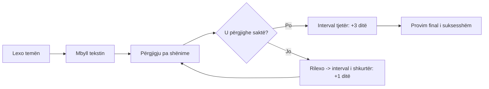

# 🎓 DASHBOARD — Qendra e Studimit

> [!summary] Çfarë është ky sistem
> Një vault Obsidian i ndërtuar mbi **5 shkencat e mësonderit**: rikujtim aktiv (retrieval practice), përsëritje me intervale (spaced repetition), praktikë e përzier (interleaving), përpunim (elaboration) dhe efekti i testimit. Të dhënat buron nga *Dosja Studimi.zip* (77 dokumente markdown + 21 dokumente Office të nxjerra) dhe nga programi zyrtar i lëndës **Menaxhimi i Projekteve Sociale (FSHS-UT, 2026–2027)**.

## 🗂️ Harat e Lëndëve (fillo këtu)

| Lënda | Harta | Statusi |
|---|---|---|
| Menaxhimi i Projekteve Sociale | [[MOC - Menaxhimi i Projekteve Sociale]] | 🟢 syllabus zyrtar i verifikuar |
| Analiza Krahasuese e Politikave Sociale | [[MOC - Analiza Krahasuese e Politikave Sociale]] | 🟡 kurrikulë orientuese |
| Administrimi i Burimeve Njerëzore | [[MOC - Administrimi i Burimeve Njerëzore]] | 🟡 kurrikulë orientuese |
| Organizimi dhe Drejtimi i Shërbimeve Sociale | [[MOC - Organizimi dhe Drejtimi i Shërbimeve Sociale]] | 🟡 kurrikulë orientuese |
| Organizatat Jofitimprurëse dhe Zhvillimi Social | [[MOC - OJF dhe Zhvillimi Social]] | 🟡 kurrikulë orientuese |

## ⚙️ Mjetet e Sistemit

- [[UDHEZUES - Metoda e Studimit me Rikujtim Aktiv]] — si të studiohesh me këtë vault
- [[PLAN-JAVOR - Rituali i Studimit]] — plani 4-javor dhe blloqet e kohës
- [[SPACED-REPETITION - Kalendari i Përsëritjes]] — kalendari 1→3→7→14→30 ditë
- [[FLAKCARDS - Banka Master e Flashcard-eve]] — {{number of flashcards}} kartela me shënimin `#flashcard` që i lexon plugin-i **Spaced Repetition**
- [[GLOSAR - Fjalori Ndër-lëndës]] — 80+ terma kyç të gjitha lëndëve në një vend
- [[MATRIKE-KRYQEZORE - Lidhjet Ndër-lëndësive]] — ku takohen fushat (p.sh. Fondi Social = MPS + OJF + ODSS)
- [[04_Risorse/BURIME - Repo-t e Integruara Teknologjike|Burime teknologjike]] — OpenDeepSearch, Haystack, Weaviate etj.

## 🔥 Rutina e sotme (3 veprime)

1. Hap [[SPACED-REPETITION - Kalendari i Përsëritjes]] → bëj të gjitha kartelat e radhës së sotme.
2. Studio 1 temë të re nga një MOC → mbyll tekstin → përgjigju pyetjeve `> [!question]-`.
3. Shënime progresin te checkbox-at `- [ ]` në MOC-në e asaj lënde.

> [!tip] Rregulli i artë
> **Së pari rikujto, pastaj rilexo.** Truri konsolidon kur *përpjekesh të tërkësh* informacionin, jo kur e rilexon pasivisht. Çdo sesion pa rikujtim aktiv është 50% i humbur.

