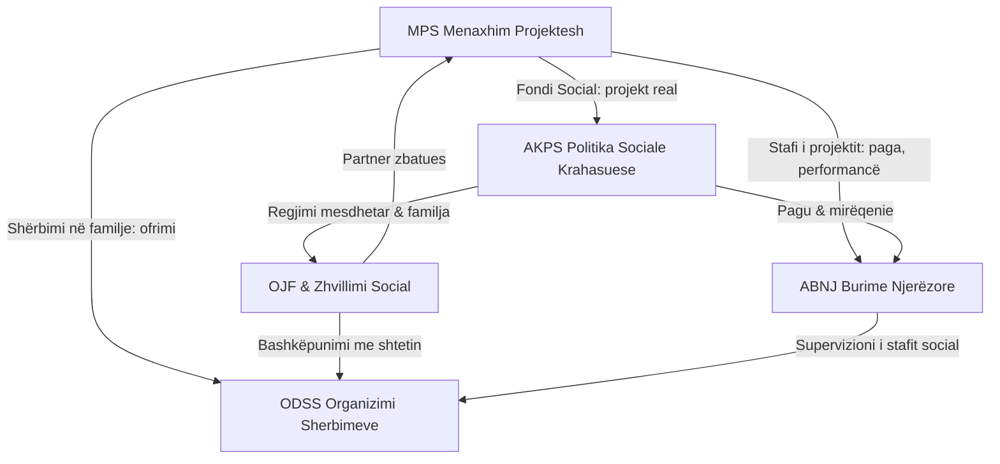

# 🔀 MATRIKE-KRYQEZORE — Ku takohen 5 lëndët (interleaving)

> [!abstract] Pse kjo dokument
> Provat më të mira në shkenca kognitive: **interleaving** (përzierja) rrit transferin. Kur një koncept shfaqet në 3 lëndë me 3 kënde, truri thel thellë. Këtu janë pikat e takimit + pyetje sintetike që përgatitin për ese ndërlëndore.

## 🕸️ Harta e takimeve

## 📌 Rasti i artë: Aplikimi Bashkia Patos (një dokument = 4 lëndë)

| Elementi i aplikimit | Lënda | Koncepti |
|---|---|---|
| Projekt 24 muaj jashtë rutinës | MPS | Përkufizimi i projektit; cikli i jetës |
| 5 objektivat (personi, familja, shërbimet, modeli, menaxhimi) | MPS | SMART; hierarkia qëllim→objektiv→aktivitet |
| 300 PAK me SHM, stigma, mungesë shërbimesh | AKPS+ODSS | Nevoja, ekskluzioni, dekomodifikimi i kujdesit |
| Pa asnjë OJF në territor | OJF | Tregu/shoqëria civile e dobët; roli zëvendësues |
| 44.000 lekë/muaj × pozicione | ABNJ | Kosto puna; planifikimi i fuqisë punëtore |
| Edukim psikologjik 10 seanca + trajnim stafi | ODSS+ABNJ | Praktika e bazuar në prova; Kirkpatrick niveli 2–3 |
| Takime me shëndetësi/policinë/arsim | ODSS | Referime ndërprofesionale |
| Modeli mbetet praktikë e Sektorit Social | MPS | Zhvendosja/sostenueshmëria; transition |
| Fondi Social 90/60/30% | AKPS | Politikat sociale shqiptare në tranzicion |

## ❓ Pyetjet sintetike (për ese & gozhdë mendore)

1. **MPS×AKPS**: Pse Fondi Social sillet si *instrument politikash sociale* dhe jo thjesht grant? Cilin model mirëqenies reflektoni (asistencial vs investim social)?
2. **MPS×ABNJ**: Në buxhetin Patos pagat janë 83% (4.22M/5.0M). Çfarë thotë kjo për natyrën e shërbimeve sociale si *labor-intensive*, dhe pse trajnimi është risk kryesor cilësie?
3. **AKPS×ODSS**: Shërbimi në familje kundër institucionalizimit — cilin parim të konventave & strategjisë kombëtare zbaton?
4. **OJF×MPS**: Nëse bashkia do ta jepte shërbimin me kontraktim te një OJF, cilat 3 rreziqe partneriteti duhen menaxhuar (capturing, kapaciteti, llogaridhënia dy-anëshe)?
5. **ABNJ×ODSS**: Burnout i punonjëses sociale me 80 takime/muaj → cilat masa organizative (jo vetëm individuale)?
6. **Të 5-at**: Rindërto shkurtimisht ciklin e projektit Patos me gjuhën e PMBOK + kritet DAC + trekëndëshin e mirëqenies.

## 🔁 Udhëzimi praktik për interleaving

Çdo sesion përsëritjeje (pas ditës 7) nxjerr **rastësisht 2 kartela nga lëndë të ndryshme** dhe detyrohu të gjesh 1 lidhje mes tyre brenda 2 minutash. Shënoji te fletorja — këto bëhen materialet e eseseve.
