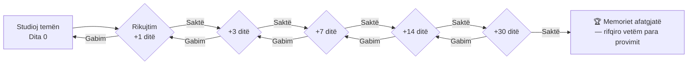

# ⏳ SPACED-REPETITION — Kalendari i Përsëritjes

> [!abstract] Logjika
> Harresa është aleatja jote nëse e strukturon. Intervali ideal: **Dita 1 → Dita 3 → Dita 7 → Dita 14 → Dita 30**. Pas 5 rikujtimesh të suksesshme, koncepta hyn në memorie afatgjatë. Gabimi kthehet mbrapsht një hap (dita 3 jo dita 7).

## 📐 Rregulli i përsëritjes

## 🗓️ Tryeza e përsëritjeve (shembull me fillim 2 Nëntor 2026)

Shëno ✅ kur e bën; nëse gabon, shëno 🔁 dhe kthehu te kolona e mëparshme.

### MPS — Menaxhimi i Projekteve Sociale
| Tema | Studim | D+1 | D+3 | D+7 | D+14 | D+30 |
|---|---|---|---|---|---|---|
| T01 Projekt & SMART | 02.11 | 03.11 | 05.11 | 09.11 | 16.11 | 02.12 |
| T02 Scope & cikli i jetës | 03.11 | 04.11 | 06.11 | 10.11 | 17.11 | 03.12 |
| T03 Vendimmarrja me informacion | 04.11 | 05.11 | 07.11 | 11.11 | 18.11 | 04.12 |
| T04 Korniza & stakeholder-at | 05.11 | 06.11 | 08.11 | 12.11 | 19.11 | 05.12 |
| T05 Risku & PRAM | 06.11 | 07.11 | 09.11 | 13.11 | 20.11 | 06.12 |
| T06 Plani & WBS | 07.11 | 08.11 | 10.11 | 14.11 | 21.11 | 07.12 |
| T07 Kosto & VNP | 08.11 | 09.11 | 11.11 | 15.11 | 22.11 | 08.12 |
| T08 Gantt & CPM | 09.11 | 10.11 | 12.11 | 16.11 | 23.11 | 09.12 |
| T09 Implementimi | 10.11 | 11.11 | 13.11 | 17.11 | 24.11 | 10.12 |
| T10 Monitorimi | 11.11 | 12.11 | 14.11 | 18.11 | 25.11 | 11.12 |
| T11 Komunikimi | 12.11 | 13.11 | 15.11 | 19.11 | 26.11 | 12.12 |
| T12 Lidershipi & ekipi | 13.11 | 14.11 | 16.11 | 20.11 | 27.11 | 13.12 |
| T13 Performanca & konfliktet | 14.11 | 15.11 | 17.11 | 21.11 | 28.11 | 14.12 |
| T14 Mbyllja | 15.11 | 16.11 | 18.11 | 22.11 | 29.11 | 15.12 |
| T15 Vlerësimi | 16.11 | 17.11 | 19.11 | 23.11 | 30.11 | 16.12 |
| T16 Raportimi | 17.11 | 18.11 | 20.11 | 24.11 | 01.12 | 17.12 |
| T17 Lessons Learned | 18.11 | 19.11 | 21.11 | 25.11 | 02.12 | 18.12 |

### AKPS — Analiza Krahasuese e Politikave Sociale
| Tema | Studim | D+1 | D+3 | D+7 | D+14 | D+30 |
|---|---|---|---|---|---|---|
| T01 Hyrje & metodologji | 19.11 | 20.11 | 22.11 | 26.11 | 03.12 | 19.12 |
| T02 Origjina e mirëqenies | 20.11 | 21.11 | 23.11 | 27.11 | 04.12 | 20.12 |
| T03 Esping-Andersen | 21.11 | 22.11 | 24.11 | 28.11 | 05.12 | 21.12 |
| T04 Regjimi Mesdhetar/feminist | 22.11 | 23.11 | 25.11 | 29.11 | 06.12 | 22.12 |
| T05 Post-komuniste | 23.11 | 24.11 | 26.11 | 30.11 | 07.12 | 23.12 |
| T06 Pensionet | 24.11 | 25.11 | 27.11 | 01.12 | 08.12 | 24.12 |
| T07 Shëndetësia | 25.11 | 26.11 | 28.11 | 02.12 | 09.12 | 25.12 |
| T08 Tregu i punës | 26.11 | 27.11 | 29.11 | 03.12 | 10.12 | 26.12 |
| T09 Varfëria | 27.11 | 28.11 | 30.11 | 04.12 | 11.12 | 27.12 |
| T10 Familja & gjinia | 28.11 | 29.11 | 01.12 | 05.12 | 12.12 | 28.12 |
| T11 BE & globalizimi | 29.11 | 30.11 | 02.12 | 06.12 | 13.12 | 29.12 |
| T12 Shqipëria & BP | 30.11 | 01.12 | 03.12 | 07.12 | 14.12 | 30.12 |

### ABNJ & ODSS & OJF
| Tema | Studim | D+1 | D+3 | D+7 | D+14 | D+30 |
|---|---|---|---|---|---|---|
| ABNJ T01–T04 | 01.12 | 02.12 | 04.12 | 08.12 | 15.12 | 31.12 |
| ABNJ T05–T08 | 05.12 | 06.12 | 08.12 | 12.12 | 19.12 | 04.01 |
| ABNJ T09–T12 | 09.12 | 10.12 | 12.12 | 16.12 | 23.12 | 08.01 |
| ODSS T01–T04 | 13.12 | 14.12 | 16.12 | 20.12 | 27.12 | 12.01 |
| ODSS T05–T08 | 17.12 | 18.12 | 20.12 | 24.12 | 31.12 | 16.01 |
| ODSS T09–T12 | 21.12 | 22.12 | 24.12 | 28.12 | 04.01 | 20.01 |
| OJF 01–04 | 25.12 | 26.12 | 28.12 | 01.01 | 08.01 | 24.01 |
| OJF 05–08 | 29.12 | 30.12 | 01.01 | 05.01 | 12.01 | 28.01 |
| OJF 09–12 | 02.01 | 03.01 | 05.01 | 09.01 | 16.01 | 01.02 |

> [!tip] Përdorimi me plugin-in Spaced Repetition
> Nëse aktivizon `sr-due` / `sr-review` komandat, kalendari manual bëhet rezervë. Por për **provime me datë fikse**, ky kalendar është mbrojtje: sheh me sy cilat tema janë "në rrezik".

## 🚨 Zona e nxehtë (përsërit çdo ditë para provimit)

1. Numrat e Fondit Social: **90% / 60% / 30%** dhe **36 muaj** detyrim.
2. Pesha e vlerësimit MPS: **10/20/70**, kalimi **41 pikë**.
3. Tipologjitë: Liberal / Korporatist / Social-Demokrat + Mesdhetar + post-komunist.
4. SMART, WBS, CPM/rruga kritike, VNP, PRAM.
5. Dekomodifikim & defamilizim.
